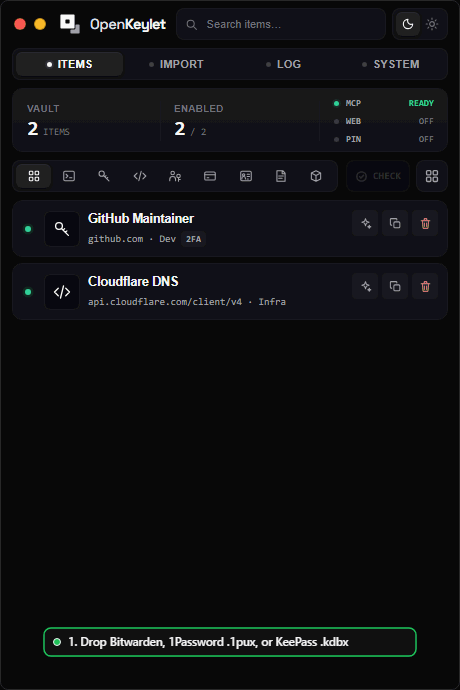
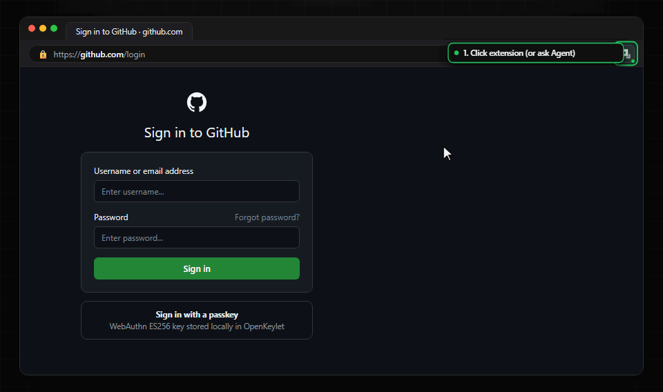
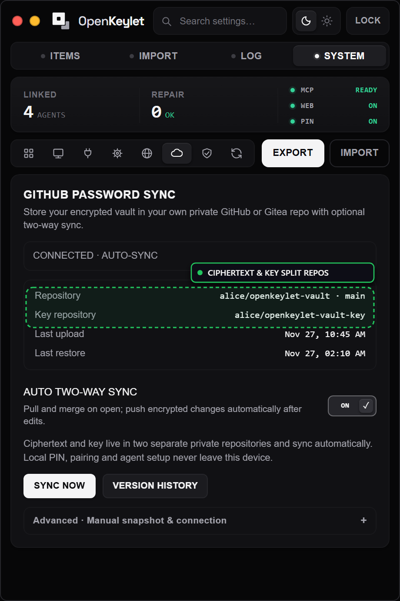
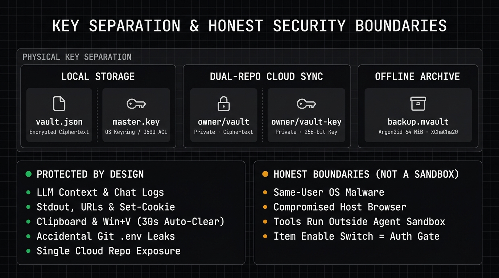

<p align="center">
  
</p>

<h1 align="center">OpenKeylet</h1>

<p align="center">
  <strong>Local-first encrypted password vault, Passkey manager, and zero-plaintext <code>stdio</code> MCP credential relay for AI agents.</strong>
</p>

<p align="center">
  <a href="https://github.com/omaekumiko2-create/OpenKeylet/releases/latest"></a>
  <a href="LICENSE"></a>
  
  
  
  <a href="#community-feedback--long-term-maintenance"></a>
</p>

<p align="center">
  <a href="../../releases/latest"><strong>Download Latest</strong></a>
  &nbsp;&nbsp;·&nbsp;&nbsp;
  <a href="README.zh-CN.md"><strong>简体中文</strong></a>
  &nbsp;&nbsp;·&nbsp;&nbsp;
  <a href="#3-minute-quickstart-5-everyday-workflows">Quickstart</a>
  &nbsp;&nbsp;·&nbsp;&nbsp;
  <a href="#more-interfaces">Real UI</a>
  &nbsp;&nbsp;·&nbsp;&nbsp;
  <a href="#architecture--full-capabilities">Architecture</a>
  &nbsp;&nbsp;·&nbsp;&nbsp;
  <a href="#key-separation--honest-security-boundaries">Security Boundaries</a>
  &nbsp;&nbsp;·&nbsp;&nbsp;
  <a href="#complete-mcp-surface-26-tools--native-cli-bridge">26 Tools</a>
  &nbsp;&nbsp;·&nbsp;&nbsp;
  <a href="#community-feedback--long-term-maintenance">Feedback &amp; Discussions</a>
  &nbsp;&nbsp;·&nbsp;&nbsp;
  <a href="SECURITY.md">Security Policy</a>
</p>

---

**OpenKeylet** bridges your personal local password manager with modern AI coding & terminal agents — offering 1-click local setup for **Antigravity, Claude Code, Codex, Cursor, DeepSeek Harness, and OpenCode**.

When an agent needs to SSH into a server, call an authenticated API, render a `.env` secret template, fill a browser login or checkout form, or sign in with a **WebAuthn Passkey**, OpenKeylet executes the credential step **locally on your machine** — making everyday agent workflows effortless while keeping hidden plaintext out of LLM context, model proxies, and chat logs.

> [!NOTE]
> **Long-Term Maintained Open-Source Project**: OpenKeylet is a free, **actively and long-term maintained** open-source community tool ([MIT](LICENSE), provided **as-is with no formal security warranty**). Its core purpose is to make AI agent credential workflows smooth, fast, and practical while preventing everyday accidental leaks — with complete honesty about what it does and does not defend against. We warmly welcome **all kinds of feedback, bug reports, UI/UX suggestions, feature ideas, and open discussions** in [Issues](https://github.com/omaekumiko2-create/OpenKeylet/issues) and [Discussions](https://github.com/omaekumiko2-create/OpenKeylet/discussions).

---

## 3-Minute Quickstart: 5 Everyday Workflows

### 1 · Bind Your AI Agent in 1 Click

<table>
  <tr>
    <td width="44%" align="center">
      
    </td>
    <td width="56%" valign="middle">
      <p>OpenKeylet connects over on-demand local <code>stdio</code> MCP — <strong>no open network ports, no background daemon, no vendor account</strong>:</p>
      <ol>
        <li>Open <strong>SYSTEM → MCP / 02 (Agent Setup)</strong> (shortcut: <code>⌘/Ctrl + ,</code>).</li>
        <li>Locate your client — <strong>Antigravity, Codex, Claude Code, Cursor, DeepSeek Harness, or OpenCode</strong> — and click <strong>CONNECT</strong> (or <strong>REPAIR</strong> after moving the binary / upgrading from KRU).</li>
        <li>OpenKeylet writes <code>openkeylet mcp stdio</code> automatically and installs the <em>"prefer OpenKeylet for authentication"</em> rule where supported.</li>
        <li>Confirm the top bar shows green <strong><code>MCP · READY</code></strong>, start a <strong>fresh agent session</strong>, and run a 5-second check:</li>
      </ol>
      <pre><code>List the enabled items you can see in OpenKeylet MCP.</code></pre>
      <p><sub>The agent calls <code>items_search</code> and sees only item names, non-secret targets, and available actions — never hidden plaintext. Using another MCP client? See <a href="#complete-mcp-surface-26-tools--native-cli-bridge">Manual MCP Configuration</a> below.</sub></p>
    </td>
  </tr>
</table>

---

### 2 · Hand Credentials to Your Agent Inside Chat

<p align="center">
  
</p>

- **Way A (Fastest & Zero-Mistake)**: Confirm the item's left green dot is ON → click the **✨ (Use)** icon on the row to copy `use Prod Tokyo Cluster in OpenKeylet MCP` → paste straight into your AI agent chat followed by your task.
- **Way B (Pure Natural Language)**: Mention the item name naturally or tell the agent to check OpenKeylet first. For multi-item templates, headers, or commands, use `{{openkeylet:Item/module}}` placeholders; OpenKeylet resolves them locally and scrubs echoed secrets into `[REDACTED]`.

<details open>
  <summary><strong>Everyday Agent Prompt Cookbook (Copy, Swap Item Name &amp; Run)</strong></summary>

| Real-World Task | What to Type in Agent Chat | Local OpenKeylet Tools |
| --- | --- | --- |
| **SSH Diagnostics & Ops** | `SSH into "Prod Tokyo Cluster" via OpenKeylet and check why Docker container web-1 is restarting.` | `items_search` → `ssh_run` |
| **SFTP Deploy** | `Upload ./dist to /var/www/app on "Prod Tokyo Cluster" and reload caddy.` | `ssh_upload` → `ssh_run` |
| **Authenticated REST API** | `Using "Cloudflare DNS" in OpenKeylet, list all A and AAAA records for example.com.` | `http_send` |
| **Capture New API Key** | `Save the one-time API key displayed on this console page straight into OpenKeylet without printing it.` | `browser_inspect` → `browser_save_key` |
| **Generate `.env` Safely** | `Create .env.local with DEEPSEEK_API_KEY from "DeepSeek Inference API" via secret_write_file — do not read it back.` | `secret_write_file` |
| **Browser Login + 2FA** | `Log into the active Chrome tab using "GitHub Maintainer" from OpenKeylet (including 2FA).` | `browser_inspect` → `browser_fill_login` → `browser_click` |
| **WebAuthn Passkey Sign-In** | `Sign into github.com in my browser using the Passkey stored in "GitHub Maintainer".` | `browser_inspect` → `browser_passkey` |
| **Checkout Card & Address** | `Fill out the card and billing address on this checkout tab using "Corporate Visa ···· 4242" — do not submit.` | `browser_inspect` → `browser_fill_personal` |
| **Interactive CLI / `sudo`** | `Start a local terminal, run the release script, and fill the passphrase from "Release Signing Key" when prompted.` | `terminal_start` → `credential_fill` → `terminal_read` |

</details>

---

### 3 · Save Secrets Hands-Free by Talking to Your Agent (Zero-Touch)

You never have to copy a freshly generated API key, password, or SSH private key into chat. Simply tell your AI agent in natural language — OpenKeylet captures, generates, or ingests the secret **directly on localhost into your encrypted vault** while keeping raw plaintext completely out of LLM context:

<p align="center">
  
</p>

<details open>
  <summary><strong>Zero-Touch Secret Saving Prompts (Say It Naturally — Agent Never Sees Plaintext)</strong></summary>

| Scenario | What to Say in Agent Chat | Local OpenKeylet Tools |
| --- | --- | --- |
| **Web Console One-Time API Key** | `Save the one-time API key on my open browser tab into OpenKeylet as "Cloud Prod API" — never print or read it.` | `browser_inspect` → `browser_save_key` |
| **Newly Submitted Web Login** | `Save the login I just signed in with on this browser tab into OpenKeylet as "Vercel Prod".` | `browser_save_login` |
| **Token Returned by an API** | `Create a scoped deploy token via "Cloudflare DNS" and capture the returned secret straight into OpenKeylet without printing it.` | `http_send(captureSecrets / holdResponse)` → `http_save_secret` |
| **Generate Password / Token Locally** | `Generate a 32-character secret inside OpenKeylet for "Staging Postgres" and write .env.local without displaying the password.` | `secret_generate` → `secret_write_file` |
| **Generate Ed25519 SSH Keypair** | `Generate a fresh Ed25519 SSH keypair in OpenKeylet for "Staging GPU Node" and give me only the public key to paste into GitHub.` | `ssh_keygen` *(returns public key & fingerprint only)* |
| **Ingest Local `.env` / PEM File** | `Ingest ./.env.production into OpenKeylet and generate a sealed .env.template — do not read the plaintext file.` | `secret_ingest_file` |
| **Pre-Fill Draft for Manual Paste** | `Prepare an OpenKeylet item draft for "Stripe Billing" with URL https://api.stripe.com/v1 so I can paste the key myself in the GUI.` | `draft_prepare` |

</details>

---

### 4 · Save Credentials in 10 Seconds with the Offline Import Hub & Vault Migration

<table>
  <tr>
    <td width="44%" align="center">
      
    </td>
    <td width="56%" valign="middle">
      <p>Switch to the <strong>IMPORT</strong> tab for a <strong>100% offline, zero-network rule extractor</strong> with 4 fast ways to save secrets:</p>
      <ol>
        <li><strong>Paste or Drop Anything</strong>: Paste or drop <code>.env</code> files, cURL commands, SSH configs/keys, database URIs, 2FA QR images, or mixed text. OpenKeylet parses everything into staged preview cards (<code>NEW</code> / <code>UPDATE</code>); review and click <strong>Import</strong> to commit atomically and optionally export a sealed <code>{{openkeylet:...}}</code> <code>.env</code> template.</li>
        <li><strong>Scan PC / Scan Folder</strong>: Switch to <strong>Scan</strong> to discover credentials scattered across <code>~/.ssh</code>, <code>~/.aws</code>, project <code>.env</code> files, <code>CLAUDE.md</code>, <code>AGENTS.md</code>, <code>.bashrc</code>, and shell history. Source files are never altered, and the completion screen lists every file that still holds plaintext with cleanup next steps.</li>
        <li><strong>Modular Create &amp; Vault Migration</strong>: Click <strong>+ New</strong> (<code>⌘/Ctrl + N</code>) to compose modules, or drop <strong>Bitwarden (plain &amp; password-protected encrypted JSON), 1Password <code>.1pux</code>, KeePass <code>.kdbx</code> / XML, Chrome CSV, or <code>.mvault</code></strong> for non-destructive merge preview.</li>
        <li><strong>Zero-Plaintext Agent Self-Save</strong>: Whenever an agent mints a new API key on a web dashboard or receives a token from an API, let it call <code>browser_save_key</code>, <code>browser_save_login</code>, or <code>http_send(captureSecrets)</code> to store secrets straight into the vault.</li>
      </ol>
    </td>
  </tr>
</table>

#### Direct Migration from Bitwarden, 1Password &amp; KeePass

<table>
  <tr>
    <td width="44%" align="center">
      
    </td>
    <td width="56%" valign="middle">
      <p>No need to convert your vault into plaintext spreadsheets — simply <strong>drag a password-manager export onto any OpenKeylet screen</strong> (or pick it under <strong>SYSTEM → SAFE / 06 → Import vault</strong>) to decrypt locally, check individual items, and merge safely without overwriting existing entries:</p>
      <ul>
        <li><strong>Bitwarden (Password-Protected Encrypted JSON &amp; Plain JSON)</strong>: Decrypts locally via <code>PBKDF2-SHA256</code> or <code>Argon2id</code> + <code>AES-256-CBC</code> / <code>HMAC-SHA256</code>, preserving logins, URI match rules, <strong>Passkeys</strong>, TOTP, SSH keys, cards, identities, folders, and password history. (Account-restricted exports can only be decrypted inside Bitwarden; choose <em>Encrypted JSON · Password protected</em> or plain JSON.)</li>
        <li><strong>1Password (<code>.1pux</code>)</strong>: Reads 1Password desktop <code>.1pux</code> archives directly — mapping logins, TOTP, SSH keys, API credentials, cards, identities, notes, and vault folders while skipping archived/trashed items.</li>
        <li><strong>KeePass / KeePassXC (<code>.kdbx</code> &amp; XML)</strong>: Unlocks KDBX 3.1 / 4.x databases with your master password, preserving nested group paths, <code>otp</code> &amp; <code>TimeOtp-Secret-Base32</code> 2FA, SSH keys, custom fields, and history while skipping the Recycle Bin.</li>
      </ul>
    </td>
  </tr>
</table>

---

### 5 · Load the Browser Extension & Live Browser Usage

#### Step 1: Load OpenKeylet into Chrome / Edge / Brave in 3 Steps

Open **SYSTEM → WEB / 04 (Browser Bridge)**: (1) Click **Open Chrome & copy address**, paste `chrome://extensions/`, and turn on **Developer mode**; (2) Hold the **OpenKeylet badge in Step 3 and drag it onto an empty area of `chrome://extensions/`** (or click **Load unpacked** and pick the extension folder). Local pairing completes automatically:

<p align="center">
  
</p>

#### Step 2: Live Browser Usage (Zero-Plaintext Autofill + 2FA + Passkey + Agent Channel)

Once paired, click the toolbar extension on any site to fill logins, cards, addresses, or copy live 2FA codes manually (never auto-submitting behind your back) — or let your AI agent fill logins, 2FA, and Passkeys live inside your real browser tab while keeping plaintext completely out of LLM context:

<p align="center">
  
</p>

---

## More Interfaces

Crafted in **Pure Monochrome Carbon & Porcelain** on a strict 4px/8px hardware grid, supporting instant Dark/Light switching, per-module Agent visibility controls, and dual-repo encrypted sync:

<table>
  <tr>
    <td width="50%" align="center">
      <br />
      <sub><strong>Carbon Dark</strong> · 4-tab layout, one-click batch <code>CHECK</code> &amp; <code>PASSKEY / 2FA / NOTE</code> badges</sub>
    </td>
    <td width="50%" align="center">
      <br />
      <sub><strong>Porcelain Light</strong> · Crisp daylight ceramic palette; left green dot acts as an instant Agent kill-switch</sub>
    </td>
  </tr>
  <tr>
    <td width="50%" align="center">
      <br />
      <sub><strong>Per-Module Control</strong> · Independent <code>AGENT HIDDEN / VISIBLE</code> gate, generator, 2FA / QR scan &amp; local ES256 Passkeys</sub>
    </td>
    <td width="50%" align="center">
      <br />
      <sub><strong>Dual-Repo Cloud Sync (CLOUD / 05)</strong> · Splits ciphertext (<code>owner/vault</code>) and 256-bit key (<code>owner/vault-key</code>) with Version History</sub>
    </td>
  </tr>
</table>

---

## Architecture & Full Capabilities

<p align="center">
  
</p>

<table>
  <tr>
    <td width="25%"><strong>01 · Encrypted Core</strong><br /><br />Passwords, API keys, SSH keys, Passkey private keys, TOTP seeds, and payment cards are encrypted locally with <code>XChaCha20-Poly1305</code>. No OpenKeylet account or hosted server exists.</td>
    <td width="25%"><strong>02 · Handle-Only Discovery</strong><br /><br />Agents see only item names, field labels, non-secret targets, and <code>{{openkeylet:...}}</code> handles via on-demand local <code>stdio</code> MCP — never hidden plaintext.</td>
    <td width="25%"><strong>03 · Local Execution &amp; Redaction</strong><br /><br />OpenKeylet runs HTTP, SSH/SFTP, PTY, web/desktop fill, and Passkey signing locally while scrubbing echoed secrets, <code>Set-Cookie</code> headers, and URL tokens into <code>[REDACTED]</code>.</td>
    <td width="25%"><strong>04 · Zero-Plaintext Self-Save</strong><br /><br />Newly minted API keys on web pages, submitted logins, API-issued tokens, generated passwords, and Ed25519 SSH keys save straight into the vault without touching LLM context.</td>
  </tr>
</table>

### Six Core Capability Areas

| Area | Problem Solved | Key Capabilities |
| --- | --- | --- |
| **1. Zero-Plaintext Agent Execution** | Let agents run SSH, APIs, and deployments without pasting keys into chat | `http_send` (auto provider auth, origin-scoped service URL / website rules, cross-origin redirect auth stripping, `Set-Cookie` redaction), `ssh_run` / `ssh_upload` / `ssh_download` (TOFU host-key pinning), `terminal_run` / interactive PTY with cross-chunk redaction, `secret_write_file` (atomic `0600` / Win32 NTFS ACL + unignored/tracked Git `.env` warnings). |
| **2. Zero-Plaintext Agent Self-Save** | Save freshly created keys, logins, or generated credentials without leaking them to chat | `browser_save_key` (captures newly displayed one-time API keys straight from paired pages), `browser_save_login`, `http_send(captureSecrets / holdResponse)` + `http_save_secret` (encrypted local receipt for one-time token responses), `secret_generate`, `ssh_keygen` (returns public key & fingerprint only), `secret_ingest_file`, and `draft_prepare`. |
| **3. Paired Browser & Passkeys** | Automate authenticated dashboards, 2FA steps, checkout forms, and Passkey sign-in | Reuses your real Chrome / Edge / Brave session via paired extension: `browser_open`, `browser_inspect` (masked URLs, forms, `keyCandidates`, secure child iframes), `browser_fill_login` (auto-fills OTP-only steps), `browser_fill_personal` (incl. Stripe Elements), `browser_click`, and `browser_passkey` (Agent auto-signing OFF by default). |
| **4. Universal Import & Vault Migration** | Consolidate scattered `.env`, SSH keys, cURL snippets, and Bitwarden / 1Password / KeePass vaults | Dedicated **IMPORT** tab runs a 100% offline rule extractor + **Scan PC / Scan Folder**; directly unlocks **Bitwarden encrypted/plain JSON, 1Password `.1pux`, KeePass `.kdbx` / XML**, and Chrome CSV locally for selective merge, while flagging lingering plaintext files on disk. |
| **5. Native Shell & Protocol Bridges** | Use vault secrets seamlessly inside Claude Code / Codex / Antigravity native shells | `openkeylet run --env-file` (zero-plaintext env injection + live stdout/stderr redaction), `openkeylet ssh-agent` (read-only local OpenSSH Agent over Unix socket / Windows Named Pipe), `openkeylet git-credential` (Git HTTPS credential helper), and SSH-tunneled `admin serve` for headless Linux servers. |
| **6. Dual-Repo Sync, `.mvault` & Auto-Update** | Sync across macOS, Windows, Linux desktops, and headless VPS without a vendor cloud | Optional private GitHub / self-hosted Gitea & Forgejo two-way sync splitting ciphertext (`owner/repo`) and 256-bit key (`owner/repo-key`) with Version History rollback; Argon2id (64 MiB) `.mvault` offline backups (v3–v8 compatible); Ed25519-signed GitHub Releases auto-updater. |

---

## Key Separation & Honest Security Boundaries

<p align="center">
  
</p>

> [!IMPORTANT]
> **Radical Transparency Over Security Theater.**
> Because AI agents need to execute SSH, API, and browser credentials smoothly in the background without blocking on a master password every minute, OpenKeylet separates everyday leak prevention from OS-level sandboxing — and explicitly states what it does and does not defend against.

### What OpenKeylet Protects vs. Honest Boundaries

| Boundary | Status | How It Actually Works |
| --- | :---: | --- |
| **LLM Context, Prompts & Chat Logs** | **Protected** | Default-hidden modules are never returned in `items_search` or activity logs. Terminal, SSH, HTTP, and browser outputs redact secrets of used items, every value rendered or filled in the MCP session, other hidden vault values of 8+ characters, live TOTP codes, and `Set-Cookie` / embedded URL tokens — even when a call names no item. |
| **Agents Reading Hidden Plaintext** | **Accidental Disclosure Only** | There is no `get_secret` tool and hidden modules never appear in `items_search`, keeping secrets out of context in normal workflows. This is **not** a defense against a malicious or prompt-injected agent: an enabled item's secret can be substituted into `terminal_run` / `ssh_run` or written by `secret_write_file` to a file the agent can read with its own tools, and output redaction covers raw values plus common encodings (JSON escapes, base64 / base64url, hex, percent-encoding, shell quoting, individual lines of multi-line secrets). **The item's Enable switch is the real authorization gate.** |
| **Other People Using Your Unlocked PC** | **Protected (with PIN)** | The optional 6-digit PIN locks the desktop GUI, scrubs items/logs behind the lock screen, blocks management IPC commands, enforces progressive wrong-PIN cooldown, and supports optional idle auto-lock (5 / 15 / 30 / 60 min). |
| **Clipboard History Leakage** | **Protected** | Copying passwords, secrets, 2FA codes, generated passwords, or recovery keys marks them to bypass Windows `Win+V` & Cloud Clipboard and **auto-clears after 30 seconds** (only if unchanged) or immediately on lock/quit. |
| **Offline Backup Theft** | **Protected** | Desktop `.mvault` exports enforce a ≥12-char password with **Argon2id (64 MiB) + XChaCha20-Poly1305**. |
| **Single Cloud Repo Exposure** | **Dual-Repo Split** | Cloud snapshots use a random 256-bit `okv1_` key stored in a second private repository (`<repo>-key`) under the same account. Both repositories must pass `private: true`, and neither alone decrypts the vault; anyone who controls the account or holds a token covering both repos can read it. |
| **Local Vault Files at Rest** | **Separated, Relies on OS** | By default, the vault key lives outside the data directory — in Windows Credential Manager / Linux Secret Service, or a dedicated per-user `master.key` directory (`~/Library/Application Support/OpenKeylet`, `~/.config/openkeylet`, `%LOCALAPPDATA%\OpenKeylet`, restricted with Unix `0600` / Win32 owner-only NTFS DACL `D:P`) — so copying or syncing the data directory alone omits the key. Explicit `OPENKEYLET_DATA_DIR` stays self-contained unless `OPENKEYLET_KEY_FILE` is set. At-rest confidentiality relies on your OS account and full-disk encryption; item names, hosts, URLs, folders, and activity logs are unencrypted. |
| **Same-User OS Malware / Compromised Browser** | **Not a Sandbox** | OpenKeylet does **not** defend against malware running as your same OS user, a compromised browser, or a malicious agent running destructive commands over an enabled SSH/API item. Pair with OS login lock & full-disk encryption (FileVault / BitLocker / LUKS). |
| **Background MCP When GUI Is Locked** | **By Design: Active** | The desktop 6-digit PIN stops *people* from viewing/editing the vault on screen without interrupting background `stdio` MCP tasks on **enabled** items. Disable an item to block agent access immediately. |

> [!WARNING]
> **OpenKeylet tools run outside your agent's sandbox.** `terminal_*`, `ssh_*`, `http_send`, and `secret_write_file` execute with your OS user's permissions in the OpenKeylet MCP server process rather than inside your agent client's shell sandbox (`terminal_run` runs even when no item is specified). Keep per-tool approval enabled in your agent client instead of blanket-allowing the `openkeylet` server.

### Per-Module Visibility Matrix

| Module State | Unlocked Owner GUI | Returned to AI Agent (MCP) | Usable Locally by OpenKeylet |
| --- | :---: | :---: | :---: |
| **Hidden** *(default for secrets)* | Masked (click Eye / Copy) | Never | Yes (`ssh`, `http`, `fill`, `browser`, `secret_write_file`) |
| **Visible** *(explicit toggle)* | Yes | Yes | Yes |
| **TOTP Seed** | Masked + **Copy 2FA Code** | Seed never returned; live 6-digit code injected/redacted locally | Yes |
| **Passkey Private Key** | Metadata only (RP ID + user) | Private key never leaves desktop vault | Yes. Browser prompts go through extension confirmation; `browser_passkey` requires explicitly enabling **Agent Passkey signing** (OFF by default) and cannot take over an open manual confirmation window |
| **Disabled / Trashed Item** | Viewable / Restorable by owner | Blocked | Blocked (no autofill, no Passkey signing, no MCP execution) |

> Read the complete [Security Policy & Threat Boundary](SECURITY.md). Recommended habits: (1) enable 6-digit PIN + idle auto-lock on shared machines; (2) treat each item's green Enable dot as your Agent kill-switch; (3) save the service URL on API items to scope `http_send`; (4) turn on 2FA on any GitHub account used for cloud sync.

---

## Offline `.mvault` Backups, Dual-Repo Sync & Shortcuts

* **Offline `.mvault` Archives (SYSTEM → SAFE / 06)**:
  * **Export `.mvault`**: Requires a ≥12-char password (Argon2id 64 MiB + XChaCha20-Poly1305) packaging items, Passkeys, last 20 password versions, and Trash.
  * **Restore `.mvault`**: Auto-detects password-protected packages and legacy v3–v7 / CLI `--self-unlocking` files, presenting a **non-destructive merge preview** before committing.
  * **Key Location Readout**: The **`VAULT KEY`** strip shows whether your master key lives in the OS keyring or an external `master.key` path outside the data directory.
* **Dual-Repo Encrypted Cloud Sync (SYSTEM → CLOUD / 05, Optional)**:
  * Supports **GitHub** (`gh auth login` or fine-grained PAT) and **Self-hosted Gitea / Forgejo** (with live `/api/v1/user` verification).
  * Automatically creates `owner/repo-key` beside your private `owner/repo` (`private: true` enforced on every read/write), supports debounced **Auto two-way sync** with conflict merge & deletion tombstones, and includes **Version history** snapshot rollback.
  * Local PIN, browser pairing tokens, agent configs, activity logs (`activity.jsonl`), SSH host-key pins, and drafts **never** leave your device.

| Shortcut | Action |
| --- | --- |
| `⌘/Ctrl + K` or `⌘/Ctrl + F` | Focus search bar |
| `⌘/Ctrl + N` | Add new vault item |
| `⌘/Ctrl + 1 / 2 / 3 / 4` | Switch between **Items / Import / Log / System** |
| `⌘/Ctrl + ,` | Open **System** settings |
| `⌘/Ctrl + S` | Save open item editor |
| `⌘/Ctrl + Shift + L` | Lock OpenKeylet immediately (when PIN is enabled) |
| `Esc` | Close active modal / cancel drag / close search |

---

## Complete MCP Surface (26 Tools) & Native CLI Bridge

OpenKeylet runs on demand via local `stdio` MCP (`openkeylet mcp stdio`) and exposes **26 typed tools** with `structuredContent` outputs:

| Category | Tool | Purpose |
| --- | --- | --- |
| **Discovery & Memory** | `items_search(query?)` | Search enabled items (Login, SSH, API, Card, Identity, Secure Note), module names, saved `agentNotes`, and available actions |
| | `item_note` | Attach, update, or remove short non-secret context notes (≤200 chars, secret-guarded) so future sessions pick the right item fast |
| **Browser & Passkey** | `browser_open` | Open an HTTP/HTTPS URL in a new tab or navigate an existing tab and wait for load completion |
| | `browser_inspect` | Inspect active tab & secure child iframes: masked URLs, forms, fields, buttons, sanitized alerts/summary, `keyCandidates` handles for `browser_save_key`, pending Passkeys, and matching vault items |
| | `browser_fill_login` | Match and fill saved login credentials (and auto-fill TOTP on OTP-only verification steps) into a live page or matching SSO iframe |
| | `browser_save_key` | Capture a newly displayed one-time API key directly from the paired page into the vault without exposing plaintext in model context |
| | `browser_save_login` | Save a submitted login captured by the paired browser extension directly into the vault without exposing plaintext |
| | `browser_fill_personal` | Fill saved cards or identity details into HTTPS/localhost pages, including split cross-origin payment iframes (e.g. Stripe Elements) |
| | `browser_click` | Click a visible button, link, checkbox, radio, or label in the page or secure iframe |
| | `browser_passkey` | Complete WebAuthn Passkey sign-in or registration (attaching to a matching login item when available) using the local vault; requires explicitly enabling **Agent Passkey signing** (OFF by default) |
| **Direct Fill** | `credential_fill` | Fill one hidden module into a browser control, explicit desktop foreground control, or managed terminal |
| **SSH & SFTP** | `ssh_run` | Run SSH commands with private-key-first + password fallback auth, stdin, output cap, and cross-item placeholders; pins server host keys (TOFU) and refuses changed keys |
| | `ssh_upload` | Recursively upload local files/directories over SFTP |
| | `ssh_download` | Recursively download remote files/directories over SFTP |
| **HTTP APIs** | `http_send` | Send authenticated HTTP/HTTPS requests (auto provider auth, Bearer/Basic, custom headers, streaming, multipart, cross-origin redirect auth stripping, `Set-Cookie` redaction, `captureSecrets`, and optional `holdResponse=true` receipt mode); origin-scoped whenever a service URL or website rule is saved |
| | `http_save_secret` | Save fields from an encrypted local `http_send` receipt (`holdResponse=true` or `captureSecrets` fallback) without repeating a one-time issuance request |
| **Files & Onboarding** | `secret_write_file` | Atomically render a local file template (`{{openkeylet:module}}` / `{{openkeylet:Item/module}}`) with Unix `0600` / Windows owner-only NTFS ACL and Git unignored/tracked warnings |
| | `secret_generate` | Cryptographically generate and store a strong password/hex/base64url secret locally into an item without exposing plaintext |
| | `ssh_keygen` | Generate an Ed25519 SSH keypair locally, store the private key encrypted, and return only the public key & fingerprint |
| | `secret_ingest_file` | Import a local `.env` or PEM private key directly into the vault without exposing plaintext (and optionally write a sealed template) |
| | `draft_prepare` | Scaffold an encrypted item draft (up to 10 queued drafts) with public metadata so the owner only pastes secrets locally in the desktop GUI |
| **Terminal** | `terminal_run` | One-shot local command with cross-item placeholder & `secretEnv` substitution, output truncation cap, and multi-item redaction |
| | `terminal_start` / `terminal_write` / `terminal_read` / `terminal_stop` | Managed interactive PTY sessions with bounded buffers and continuous cross-boundary secret redaction |

### Native CLI & Protocol Layer (for Claude Code, Codex & Antigravity Native Shells)

```bash
# Inject secrets into any native command with real-time boundary-safe stdout/stderr redaction
openkeylet run --item "OpenAI" --env-file .env.template --env DB_PASS="Prod DB/password" -- npm run dev

# Import a plaintext .env and emit a sealed template without altering the original file
openkeylet import-env .env --seal .env.template

# Local read-only OpenSSH Agent (Unix socket on macOS/Linux, Named Pipe on Windows)
# Exposes only enabled SSH items and revokes signing immediately when disabled
openkeylet ssh-agent
eval "$(openkeylet ssh-agent --print-env)"   # PowerShell: $env:SSH_AUTH_SOCK = '\\.\pipe\openkeylet-ssh-agent'

# Git HTTPS credential helper (uses enabled tokens/passwords; store/erase are safe no-ops)
git config --global credential.helper '!openkeylet git-credential'
```

<details>
  <summary>Manual <code>stdio</code> MCP Configuration (JSON &amp; CLI)</summary>

```json
{
  "mcpServers": {
    "openkeylet": {
      "command": "/Applications/OpenKeylet.app/Contents/MacOS/openkeylet",
      "args": ["mcp", "stdio"]
    }
  }
}
```

Print client-ready configuration for your OS from the CLI:

```bash
openkeylet config stdio-json
openkeylet config stdio-toml
```

</details>

---

## Downloads, Data Locations & Auto-Updates

| Target | Format | Notes |
| --- | --- | --- |
| **macOS arm64** | `.zip` | Native Apple Silicon `.app` with macOS traffic lights & titlebar; Accessibility permission needed for desktop fill |
| **Windows x64** | `.zip` | Portable GUI, tray, `Win+V` clipboard exclusion, Win32 NTFS ACLs, desktop fill & browser extension |
| **Linux x64 GUI** | `.tar.gz` | Desktop GUI; X11 desktop fill & system tray |
| **Linux x64 Headless** | `.tar.gz` | Zero WebView/GUI deps (`--no-default-features`); full MCP, SSH, HTTP, terminal, backup, remote bridge & `admin serve` |

Upgrading the binary preserves your vault automatically:

| Platform | Default Vault Directory | Default Separated Key Storage |
| --- | --- | --- |
| macOS | `~/Library/Application Support/mcp-vault/v2` | `~/Library/Application Support/OpenKeylet/master.key` |
| Windows | `%APPDATA%\mcp-vault\v2` | Windows Credential Manager / `%LOCALAPPDATA%\OpenKeylet\master.key` |
| Linux | `${XDG_DATA_HOME:-~/.local/share}/mcp-vault/v2` | Linux Secret Service / `~/.config/openkeylet/master.key` |

*(Override with `OPENKEYLET_DATA_DIR=/absolute/path` for isolated/portable vaults, or `OPENKEYLET_KEY_FILE=/absolute/path` for an explicit external key file. For headless Linux VPS, remote/LAN Browser Bridge, and SSH-tunneled admin UI, see [docs/HEADLESS_AND_REMOTE.md](docs/HEADLESS_AND_REMOTE.md).)*

**Automatic Updates (GitHub Releases)**: Official signed builds check `releases/latest/download/latest.json` directly on GitHub Releases, verify the Ed25519 manifest signature and SHA-256 checksum, optionally download silently in the background, and update in place without breaking MCP paths. Configure under **SYSTEM → UPDATE / 07**, or run `openkeylet update check` / `openkeylet update install` on headless Linux.

<details>
  <summary>Upgrading from KRU</summary>
  <p>OpenKeylet is the successor to <strong>KRU</strong> and keeps full compatibility with existing local vaults, keys, <code>.mvault</code> backups, <code>{{kru:module}}</code> placeholders, and <code>KRU_*</code> environment variables. After upgrading, open <strong>SYSTEM → Agent Setup → REPAIR</strong> to migrate existing <code>kru</code> MCP entries to <code>openkeylet</code>, then restart your agent.</p>
</details>

---

## Build & Test from Source

Requirements: **Rust 1.88+**, **Node.js 22+**, and [Tauri 2 prerequisites](https://v2.tauri.app/start/prerequisites/).

```bash
npm install
npm run check
npm test
npm run build
npm run portable
```

Additional release targets & verification suites:

```bash
npm run release:mac
npm run release:linux
npm run release:headless

# Cross-platform real-binary scenario suite + real Chromium extension, Passkey & stress E2E
cargo test --manifest-path src-tauri/Cargo.toml --no-default-features --test real_world_scenarios
npm run test:browser
node scripts/test-realworld-agent-journey.mjs
node scripts/test-agent-browser.mjs
node scripts/test-realworld-passkey-autofill.mjs
node scripts/test-ux-interactions.mjs
node scripts/test-adversarial-e2e.mjs
```

---

## Community, Feedback & Long-Term Maintenance

**OpenKeylet is a long-term maintained project.** We continuously evolve it across Windows, macOS, and Linux — keeping up with new AI agent clients, browser autofill & Passkey quirks, third-party password vault formats, and security hardening.

Every form of feedback helps shape OpenKeylet, no matter how brief or informal:

- **Bug Reports & Edge Cases**: Hit a crash, site autofill quirk, OS/platform glitch, or unexpected behavior? [Open an Issue](https://github.com/omaekumiko2-create/OpenKeylet/issues/new) — even a short note or screenshot is welcome.
- **Feature Requests, UX Suggestions & Open Discussions**: Have an idea for a new workflow, UI polish, password-manager importer, or AI agent integration — or just want to share how you use OpenKeylet? [Start or join a Discussion](https://github.com/omaekumiko2-create/OpenKeylet/discussions).
- **Pull Requests & Contributions**: Fixes, docs improvements, localizations, and compatibility patches are always welcome.

---

## License

[MIT](LICENSE) — open-source, long-term maintained, inspectable, and run completely on your own hardware.
