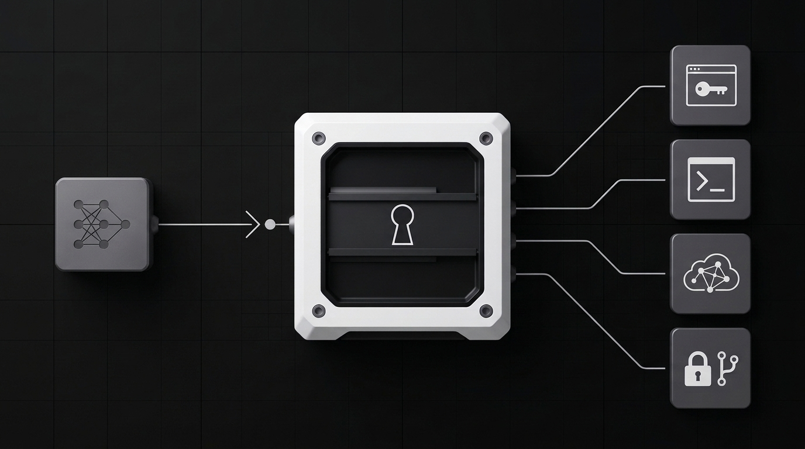

<p align="center">
  
</p>

<h1 align="center">OpenKeylet</h1>

<p align="center">
  <strong>Local-first encrypted password vault, Passkey manager, and zero-plaintext <code>stdio</code> MCP credential relay for AI agents.</strong>
</p>

<p align="center">
  <code>Local-First</code>&nbsp;·&nbsp;<code>XChaCha20-Poly1305</code>&nbsp;·&nbsp;<code>No Cloud Account</code>&nbsp;·&nbsp;<code>Windows / macOS / Linux</code>&nbsp;·&nbsp;<code>MIT License</code>
</p>

<p align="center">
  <a href="../../releases/latest"><strong>Download Latest</strong></a>
  &nbsp;&nbsp;·&nbsp;&nbsp;
  <a href="README.zh-CN.md"><strong>简体中文</strong></a>
  &nbsp;&nbsp;·&nbsp;&nbsp;
  <a href="#permission-boundaries--threat-model">Permission Boundaries</a>
  &nbsp;&nbsp;·&nbsp;&nbsp;
  <a href="#step-by-step-tutorials">Tutorials</a>
  &nbsp;&nbsp;·&nbsp;&nbsp;
  <a href="#recommended-practices">Best Practices</a>
  &nbsp;&nbsp;·&nbsp;&nbsp;
  <a href="SECURITY.md">Security Policy</a>
</p>

---

**OpenKeylet** bridges your personal local password manager with modern AI coding & terminal agents — including **Antigravity, Codex, Claude Code, Cursor, DeepSeek Harness, and OpenCode**.

When an agent needs to SSH into a server, call an authenticated API, render a `.env` secret file, fill a browser login, or sign in with a **WebAuthn Passkey**, OpenKeylet executes the credential step **locally on your machine** while keeping hidden plaintext out of the LLM context, tool responses, and logs.

---

## Interface Gallery

Designed in a distraction-free **Pure Monochrome Carbon & Porcelain** aesthetic with native platform chrome across Windows, macOS, and Linux.

<table>
  <tr>
    <td width="50%" align="center">
      <br />
      <sub><strong>Carbon Dark</strong> · Single-row list (default) with one-click 4-column card grid toggle</sub>
    </td>
    <td width="50%" align="center">
      <br />
      <sub><strong>Porcelain Light</strong> · Crisp ceramic dual theme with full names, 2FA &amp; Passkey badges</sub>
    </td>
  </tr>
  <tr>
    <td width="50%" align="center">
      <br />
      <sub><strong>Per-Module Control</strong> · Independent Agent visibility, live 2FA TOTP &amp; Passkeys</sub>
    </td>
    <td width="50%" align="center">
      <br />
      <sub><strong>Agent Setup</strong> · One-click local <code>stdio</code> MCP link &amp; repair</sub>
    </td>
  </tr>
</table>

<details>
  <summary>View the optional GitHub Password Sync UI (GitHub / Self-hosted Gitea &amp; Forgejo)</summary>
  <br />
  <p align="center">
    
  </p>
</details>

---

## Architecture: Zero-Plaintext Local Relay

<p align="center">
  
</p>

<table>
  <tr>
    <td width="25%"><strong>01 · Encrypted Core</strong><br /><br />All secrets, Passkey private keys, TOTP seeds, and cards are encrypted locally with <code>XChaCha20-Poly1305</code>. No OpenKeylet account or hosted server exists.</td>
    <td width="25%"><strong>02 · Metadata Discovery</strong><br /><br />Agents see only item names, field labels, non-secret targets, and advertised actions via on-demand <code>stdio</code> MCP — never hidden plaintext.</td>
    <td width="25%"><strong>03 · Local Execution</strong><br /><br />OpenKeylet signs Passkeys, fills web/desktop forms, runs SSH/SFTP, calls APIs, and writes template files locally while redacting echoed secrets (<code>[REDACTED]</code>).</td>
    <td width="25%"><strong>04 · User-Owned Sync</strong><br /><br />Optionally export <code>.mvault</code> encrypted packages or sync an encrypted vault snapshot two ways through private GitHub / Gitea repositories you own.</td>
  </tr>
</table>

---

## Permission Boundaries & Threat Model

OpenKeylet is intentionally **transparent about what it protects and what it does not**. Because background AI agents must execute credentials smoothly without blocking on a master password every minute, OpenKeylet separates local convenience from cryptographic offline protection:

### What OpenKeylet Protects vs. Does Not Protect

| Boundary | Status | How It Works |
| --- | :---: | --- |
| **LLM Context & Prompt Leakage** | **Protected** | Default-hidden modules are never returned in MCP responses or activity logs. Terminal, SSH, HTTP, and browser results redact the secrets of the items they use, every value the MCP session rendered or filled, other hidden vault values of 8+ characters, and live TOTP codes, including when the call names no item. |
| **Agents Reading Hidden Plaintext** | **Accidental Disclosure Only** | There is no `get_secret` tool and hidden modules are never returned by `items_search`, so in normal use their values stay out of model context. This is not a boundary against a malicious or prompt-injected agent: an enabled item's secret can be substituted into `terminal_run` / `ssh_run` commands or rendered by `secret_write_file` into a file the agent can then read with its own tools, and output redaction only matches the raw value and common encodings of it (JSON escapes, base64 / base64url, hex, percent-encoding, shell quoting, single lines of multi-line values). The item's **Enable** switch is the real authorization gate. |
| **Other People Using Your Unlocked PC** | **Protected (with PIN)** | The optional 6-digit PIN locks the desktop GUI, scrubs items/logs behind the lock screen, blocks management IPC commands, enforces progressive wrong-PIN cooldown, and supports optional idle auto-lock (5 / 15 / 30 / 60 min). |
| **Clipboard History Leakage** | **Protected** | Copying passwords, secrets, TOTP codes, generated passwords, or recovery keys marks them to bypass Windows `Win+V` & Cloud Clipboard and **auto-clears after 30 seconds** (only if unchanged — never wiping newer user copies) or immediately on lock/quit. |
| **Offline Backup Theft** | **Protected** | Desktop `.mvault` exports use Argon2id (64 MiB) + XChaCha20-Poly1305 with a ≥12-char password. |
| **Cloud Repository Leak** | **One Repository Only** | Cloud snapshots are encrypted with a random 256-bit `okv1_` key kept in a second private repository (`<repo>-key`) of the same account. The vault repository holds ciphertext only, both must be `private: true`, and neither one alone can be read. Whoever controls the account, or a token covering both repositories, can read the vault. |
| **Local Vault Files at Rest** | **Relies on OS** | The vault key is kept in Windows Credential Manager / Linux Secret Service or in a `master.key` file in the data directory (always on macOS and with `OPENKEYLET_DATA_DIR`), so at-rest confidentiality rests on your OS account and full-disk encryption. Item names, descriptions, hosts, URLs, folders, and the activity log are stored unencrypted. |
| **Malicious Agent / Compromised OS User** | **Not a Sandbox** | OpenKeylet does **not** defend against malware running as your same OS user, a compromised browser, or a malicious agent sending destructive commands over an enabled SSH/HTTP item. Pair with OS login lock & full-disk encryption (BitLocker / FileVault / LUKS). |
| **Background MCP When GUI Is Locked** | **By Design: Active** | Locking the desktop GUI with PIN stops *people* from viewing/editing the vault on screen; background `stdio` MCP sessions continue working for **enabled** items so long-running agent jobs are not interrupted. Disable an item to block agents from using it. |

**OpenKeylet tools run outside your agent's sandbox.** `terminal_*`, `ssh_*`, `http_send`, and `secret_write_file` execute with your OS user's permissions in the OpenKeylet MCP server process, not inside the sandbox or command-approval system your agent client applies to its own shell; `terminal_run` works even when no item is used. Keep per-tool approval enabled for these tools in your agent client instead of blanket-allowing the `openkeylet` server.

### Per-Module Visibility Matrix

| Module State | Visible to Owner (Unlocked GUI) | Returned to AI Agent (MCP) | Usable Locally by OpenKeylet |
| --- | :---: | :---: | :---: |
| **Hidden** *(default for secrets)* | Masked (click Eye / Copy) | Never | Yes (`ssh`, `http`, `fill`, `browser`, `secret_write_file`) |
| **Visible** *(explicit toggle)* | Yes | Yes | Yes |
| **TOTP Seed** | Masked + **Copy 2FA Code** | Seed never returned; live 6-digit code injected/redacted locally | Yes |
| **Passkey Private Key** | Metadata only (RP ID + user) | Private key never leaves desktop vault | Yes. Browser-initiated use goes through the extension confirmation window (UV only after PIN); agent `browser_passkey` requires explicitly enabling **Agent Passkey signing** (OFF by default) and cannot take over an open manual confirmation window |
| **Disabled / Trashed Item** | Viewable / Restorable by owner | Blocked | Blocked (no autofill, no Passkey signing, no MCP execution) |

> Read the complete [Security Policy & Threat Boundary](SECURITY.md) before using OpenKeylet with sensitive production infrastructure.

---

## Recommended Practices

1. **Turn on 6-Digit PIN + Idle Auto-Lock on shared or office machines**
   Go to **System → APP / 03**, enable **PIN lock**, and pick a comfortable **Auto-lock** interval (e.g., `15 minutes`). Your background MCP workflows keep running while your screen stays safe when you step away.
2. **Use the item `Enable` toggle as your Agent kill-switch**
   Keep everyday dev/staging credentials enabled for agents, and leave high-risk production root keys or personal banking logins **disabled** until you actively need them.
3. **Keep `Agent Visible` OFF unless truly needed**
   Leave the left toggle on every password, API key, SSH key, and TOTP module set to **Hidden** (`OFF`). Prefer `{{openkeylet:module name}}` placeholders in `http_send`, `terminal_run`, `ssh_run`, and `secret_write_file`.
4. **Save the service URL on API items**
   When an item has a saved service URL (or website rules), `http_send` only sends its token to that origin; an item without one lets the agent pick any destination. Placeholders in `terminal_run`, `ssh_run`, and `secret_write_file` are not destination-bound.
5. **Protect your GitHub account, and keep your `.mvault` password safe**
   The sync key lives in the `<repo>-key` private repository of your account, so whoever controls the account can read the vault: turn on two-factor authentication. Never make either repository public, and do not delete the key repository. For an extra safety net, open **Recovery key** under Advanced and keep an offline copy.
6. **Control Agent Passkey signing explicitly**
   **Agent Passkey signing** under **System → WEB / 04** is OFF by default. Enable it only if you want `browser_passkey` to sign in or register a Passkey for enabled items without per-request confirmation (the response asserts user presence and user verification on your standing authorization; agents still cannot take over an open manual confirmation window). Keep it off for manual-only confirmation in the extension window.
7. **Avoid concurrent offline edits to the exact same item**
   Two-way repo sync merges cleanly across devices by item `id` and `updatedAt`, and propagates permanent deletions via tombstones. Sync before editing the same item on a second machine to avoid last-write-wins overwrites.

---

## Step-by-Step Tutorials

### Tutorial 1 · Bind Your AI Agent (1-Click Setup)

OpenKeylet connects to AI coding and terminal agents over local on-demand **`stdio` MCP** — no open network ports and no cloud broker.

1. Launch **OpenKeylet** and open **System → MCP / 02 (Agent Setup)** (shortcut: `⌘/Ctrl + ,`).
2. Find your client — **Antigravity**, **Codex**, **Claude Code**, **Cursor**, **DeepSeek Harness**, or **OpenCode** — and click **CONNECT** (if you moved the binary or upgraded from KRU, click **REPAIR**).
   - OpenKeylet writes the local `stdio` MCP entry (`openkeylet mcp stdio`) automatically.
   - Where supported, it also installs the *"prefer OpenKeylet for authentication"* rule so the agent knows to check OpenKeylet automatically instead of asking you to paste passwords.
3. Verify the top status panel shows **`MCP · READY`** (green dot), then **start a fresh chat session** (or reload MCP servers in your IDE).
4. **Sanity-check the link** by asking your agent:
   ```text
   List the enabled items you can see in OpenKeylet MCP.
   ```
   The agent will call `items_search` and return only item names, targets, and available actions — never hidden secrets.

> Using another MCP-compatible client? Expand [Manual `stdio` MCP Configuration](#complete-mcp-surface-23-tools--native-cli-bridge) below or run `openkeylet config stdio-json`.

---

### Tutorial 2 · Tell Your Agent Which Credential to Use (`USE` Button & Natural Language)

There are **two effortless ways** to hand a credential to an AI agent without ever revealing the secret:

#### Way A — The Fastest Workflow: One-Click `USE` Button

1. Locate your item in the vault (default **Single-Row List** view, or click the layout toggle next to **`+ ADD`** to switch to the **4-Column Card Grid**).
2. Make sure its green status dot is **ON** (clicking the dot toggles Agent access on/off immediately).
3. Click **`USE`** on the row/card. OpenKeylet immediately copies a secret-free reference phrase to your clipboard:
   ```text
   use Prod Tokyo Cluster in OpenKeylet MCP
   ```
4. **Paste it into your AI Agent chat** and type your task right after it:
   ```text
   use Prod Tokyo Cluster in OpenKeylet MCP — check disk space, tail the last 50 lines of /var/log/nginx/error.log, and restart nginx if needed.
   ```
   ```text
   use GitHub Maintainer in OpenKeylet MCP — open the release settings page in my browser and sign in.
   ```

#### Way B — Pure Natural Language Prompt Cookbook

You don't need special syntax or tool names. Just speak naturally and mention the item name (or let the agent search OpenKeylet automatically):

| Real-World Task | What You Can Say to the Agent | Tools OpenKeylet Uses Locally |
| --- | --- | --- |
| **SSH Diagnostics & Ops** | `SSH into "Prod Tokyo Cluster" via OpenKeylet and check why Docker container web-1 is restarting.` | `items_search` → `ssh_run` |
| **Deploy / SFTP Transfer** | `Upload ./dist to /var/www/app on "Prod Tokyo Cluster" and reload caddy.` | `ssh_upload` → `ssh_run` |
| **Download Server Logs** | `Download /var/log/app/crash.log from "Prod Tokyo Cluster" into ./tmp/crash.log and analyze it.` | `ssh_download` |
| **Authenticated REST API** | `Using "Cloudflare DNS" in OpenKeylet, list all A/AAAA records for example.com.` | `http_send` |
| **Generate `.env` Safely** | `Create .env.local with DEEPSEEK_API_KEY from "DeepSeek Inference API" via secret_write_file — do not print the key.` | `secret_write_file` |
| **Browser Login + 2FA** | `Log into my staging console in Chrome using "AWS Staging Console" from OpenKeylet (including 2FA).` | `browser_inspect` → `browser_fill_login` → `browser_click` |
| **WebAuthn Passkey Sign-In** | `Sign into github.com in my browser using the Passkey stored in "GitHub Maintainer".` | `browser_inspect` → `browser_passkey` |
| **Fill Billing / Address Form** | `Fill out the shipping and card fields on the current checkout tab using "Corporate Visa ···· 4242".` | `browser_inspect` → `browser_fill_personal` |
| **Interactive CLI / `sudo`** | `Start a local terminal session, run the deployment CLI, and fill the passphrase from "Release Signing Key" when prompted.` | `terminal_start` → `credential_fill` → `terminal_read` |
| **Auto-Discovery (Hands-Off)** | `Finish deploying the staging branch. If any step needs SSH, API, or web login, check OpenKeylet first.` | `items_search` → matching action |

#### Way C — Secret Placeholders for Templates & Commands (`{{openkeylet:...}}`)

When asking an agent to render `.env` / YAML / JSON files or pass secrets into commands/headers, tell it to use `{{openkeylet:Module Name}}` placeholders:

```env
DEEPSEEK_API_KEY={{openkeylet:API Credential}}
CF_API_TOKEN={{openkeylet:Token}}
```

OpenKeylet resolves placeholders **locally** inside `secret_write_file`, `http_send`, `ssh_run`, and `terminal_run`, and automatically replaces echoed secrets (raw or in a common encoding, also when a terminal wraps or colors them) in stdout/stderr/HTTP output with `[REDACTED]`. Prefer `secretEnv` or `openkeylet run --env-file` to hand secrets to a program; a file rendered by `secret_write_file` holds plaintext, so agents should never read it back, diff, or commit it.

---

### Tutorial 3 · Create, Test & Organize Modular Items

1. Click **`+ ADD`** (`⌘/Ctrl + N`) and pick a template: **Login**, **SSH**, **API**, **Card**, **Identity**, **Secure Note**, or **Blank**.
2. **Compose only the modules you need**: click **`+ ADD MODULE`** to add Username, Password (with built-in generator), TOTP 2FA, API Credential, SSH Private Key, Passphrase, Host/Port, Service URL, or Custom Fields. Drag module handles to reorder.
3. **Keep the left eye/switch OFF** for secret modules (default: *Hidden from Agent*), or turn it ON only for non-sensitive values an agent should read verbatim.
4. **Add multiple website rules** on login items (`baseDomain`, `host`, `startsWith`, `exact`, `regex`) so browser autofill and `browser_fill_login` match subdomains accurately.
5. Click **`CHECK`** on SSH or API items to verify connectivity right from the vault, click **`HIS`** to inspect/copy up to 20 past password versions, and use **drag-and-drop** (or `↑/↓` in List view, `←/→` in Grid view) to arrange your favorite order.

---

### Tutorial 4 · Browser Extension, Autofill, 2FA & Passkeys

1. Open **System → WEB / 04 (Browser Bridge)** and enable the bridge (the top status strip turns **`WEB · ON`**).
2. **Step 1**: Click **Open Chrome & copy address** → paste `chrome://extensions/` → turn on **Developer mode**.
3. **Step 2**: Drag the OpenKeylet badge onto the extensions page (or click **Extension folder** → **Load unpacked**). Pairing completes automatically.
4. **Daily Human Use**:
   - Click the extension popup on any site to fill logins, cards, or identities (supports CJK/international checkout forms, Shadow DOM, React/Vue controlled inputs, and multi-step logins) — never auto-submits behind your back.
   - Click **2FA** in the popup (or **COPY 2FA CODE** in the desktop editor) for live TOTP codes with automatic 30-second clipboard cleanup.
   - Register and sign in with **WebAuthn Passkeys** (ES256, discoverable & allow-list credentials, optional `prf` / `largeBlob` extensions); private keys stay encrypted inside the desktop vault.
5. **Agent-Driven Web Login**:
   - Keep your target site open in Chrome/Edge/Brave, then tell your agent: `use GitHub Maintainer in OpenKeylet MCP — sign into this page.`
   - You can watch every fill and click live in your tab. **Agent Passkey signing** is OFF by default so Passkeys always require manual confirmation unless you explicitly enable it under **System → WEB / 04** (even when enabled, `browser_passkey` cannot take over an already-open manual confirmation window).

---

### Tutorial 5 · Offline `.mvault` Backups & Vault Migration (v3–v8 Compatible)

All local data operations live together under **System → SAFE / 06 (Local Data & Offline Packages)**:

* **Export `.mvault`**: Click **Export .mvault** and choose an independent backup password (≥ 12 characters). Encrypted with Argon2id (64 MiB, 3 iterations) + XChaCha20-Poly1305; includes all items, Passkeys, password history (last 20), and Trash.
* **Restore `.mvault` (with Safe Dry-Run Preview)**:
  1. Click **Restore .mvault** and pick your `.mvault` file first.
  2. OpenKeylet automatically detects whether the package requires a password — **legacy v3–v7 files and files written with `openkeylet backup export --self-unlocking` skip the password prompt automatically** (and display a security advisory encouraging you to re-export with a password). The CLI writes such a file only when that flag is given; its default export asks for a passphrase.
  3. Review the **non-destructive merge preview**: exact counts of new items, identical entries skipped, safe numbered conflict renames (e.g. `GitHub(2)` — existing items are never overwritten), Passkeys, Trash, and password history.
  4. Click **Confirm Import** to commit atomically (and trigger automatic cloud sync if enabled).
* **Migrate from Bitwarden / Chrome / Edge**: Click **Import Bitwarden / CSV** to preview compatibility notes and transactionally import Bitwarden JSON (including ES256 PKCS#8 Passkeys & TOTP) or Chrome/Edge CSV (also accepts `.mvault` packages).
* **Clean up plaintext after importing from files**: On the **Import** page, **Scan PC** also checks agent rule files (`CLAUDE.md`, `AGENTS.md`, `GEMINI.md`, `.cursorrules`, `.claude/rules`, `.cursor/rules`), shell startup files (`export NAME=value` in `.bashrc`, `.zshrc`, `.profile`, fish config) and shell history. Importing never changes the source files, so the done view lists each file that **still holds plaintext** with the next step for it (switch to the sealed `.env` template, delete the key file once the vault copy works, remove the pasted line, …). The CLI `import-env` and `import-ssh` commands print the same list. The sealed `.env` template replaces any line it cannot seal with a `# OpenKeylet removed …` comment instead of copying it.

---

### Tutorial 6 · Multi-Device Encrypted Cloud Sync (GitHub / Self-Hosted Gitea & Forgejo)

In **System → CLOUD / 05**, you may optionally sync an encrypted snapshot through **private** repositories you own (completely opt-in):

1. **Choose your host**:
   - **GitHub**: reuse your local `gh auth login` session or paste a fine-grained PAT with `Contents: Read & write` on both the vault repository and its key repository (plus `Administration: Write` if you want OpenKeylet to create them automatically).
   - **Self-hosted Gitea / Forgejo**: enter your HTTPS server URL + personal access token, then click **Check server & account** to verify `/api/v1/user` connectivity before saving.
2. **Bind a private repo**: enter `owner/repo` (every read/write strictly enforces `private: true`). OpenKeylet creates the key repository `owner/repo-key` in the same account and stores the sync key there, apart from the ciphertext. There is no key for you to remember.
3. **One-Button Everyday Sync**:
   - Turn on **Auto two-way sync** for debounced background pushes after edits and automatic pull-merge on launch (handles `409 Conflict` auto-retry and tombstone deletions).
   - Whenever local changes haven't been synced yet (or a background push hits offline network), a **`PENDING SYNC`** banner stays visible and the primary button switches to **`SYNC PENDING CHANGES`** — one click reconciles everything.
   - Manual actions (**Back up only**, **Restore only**, **Recovery key**, **Reconnect**, **Disconnect**) stay neatly tucked inside the collapsible **Advanced · Manual snapshot & connection** drawer.
4. **Add a second machine (Windows / macOS / Linux)**: open **System → CLOUD / 05**, choose **Connect an existing vault repo**, authorize the same account, pick the repo, and click **`SYNC & RESTORE`**. The key is read from the key repository.

> Local PIN, browser pairing tokens, agent configs, the activity log (`activity.jsonl`), SSH host-key pins (`ssh-known-hosts.json`), and editor drafts **never** leave your device.

---

### Desktop Keyboard Shortcuts

| Shortcut | Action |
| --- | --- |
| `⌘/Ctrl + K` or `⌘/Ctrl + F` | Focus search bar |
| `⌘/Ctrl + N` | Add new vault item |
| `⌘/Ctrl + 1 / 2 / 3` | Switch between **Items / Log / System** |
| `⌘/Ctrl + ,` | Open **System** settings |
| `⌘/Ctrl + S` | Save open item editor |
| `⌘/Ctrl + Shift + L` | Lock OpenKeylet immediately (when PIN is enabled) |
| `Esc` | Close active modal / cancel drag / close search |

---

## Complete MCP Surface (23 Tools) & Native CLI Bridge

OpenKeylet runs on demand via local `stdio` MCP (`openkeylet mcp stdio`) and exposes **23 typed tools** with `structuredContent` outputs:

| Category | Tool | Purpose |
| --- | --- | --- |
| **Discovery & Memory** | `items_search(query?)` | Search enabled items (including Login, SSH, API, Card, Identity, Secure Note), module names, saved `agentNotes`, and available actions |
| | `item_note` | Attach, update, or remove short non-secret context notes (≤200 chars, secret-guarded) so future agent sessions select the right item fast |
| **Browser & Web** | `browser_open` | Open an HTTP/HTTPS URL in a new tab or navigate an existing tab and wait for load completion |
| | `browser_inspect` | Inspect active tab & secure child iframes: URLs, forms, fields (incl. checkboxes/radios), buttons, sanitized alerts/page summary, pending Passkeys, and matching vault items |
| | `browser_fill_login` | Match and fill saved login credentials (and auto-fill TOTP on OTP-only verification steps) into a live page or matching SSO iframe |
| | `browser_fill_personal` | Fill saved cards or identity details into HTTPS/localhost pages, including split cross-origin payment iframes (e.g. Stripe Elements) |
| | `browser_click` | Click a visible button, link, checkbox, radio, or label in the page or secure iframe |
| | `browser_passkey` | Complete WebAuthn Passkey sign-in or registration (attaching to a specified/matching login item when available) using the local vault, with no per-request confirmation while **Agent Passkey signing** is on |
| **Direct Fill** | `credential_fill` | Fill one hidden module into a browser control, explicit desktop foreground control, or managed terminal |
| **SSH & SFTP** | `ssh_run` | Run SSH commands with private-key-first + password fallback auth, stdin, bounded output cap, and cross-item `{{openkeylet:Item/module}}` / `{{openkeylet-raw:...}}` placeholders; pins the server host key on first connection and refuses a changed key |
| | `ssh_upload` | Recursively upload local files/directories over SFTP |
| | `ssh_download` | Recursively download remote files/directories over SFTP |
| **HTTP APIs** | `http_send` | Send authenticated HTTP/HTTPS requests (auto-detects providers, Bearer/Basic, custom headers, streaming, multipart, `insecure`, `followRedirects`, cross-origin auth stripping, and zero-plaintext `captureSecrets` from JSON responses); secrets of an item with a saved service URL or website rules are only sent to that origin or matching rules |
| **Files & Onboarding** | `secret_write_file` | Render a local file template replacing single-item `{{openkeylet:module}}` or cross-item `{{openkeylet:Item/module}}` placeholders atomically (`0600` on Unix) for programs that cannot read environment variables; the rendered file holds plaintext |
| | `secret_generate` | Cryptographically generate and store a strong password/hex/base64url secret locally into an item without exposing plaintext |
| | `ssh_keygen` | Generate an Ed25519 SSH keypair locally, store the private key encrypted, and return only the public key & fingerprint |
| | `secret_ingest_file` | Import a local `.env` or PEM private key directly into the vault without exposing plaintext (and optionally write a sealed template) |
| | `draft_prepare` | Scaffold an encrypted item draft (queued up to 10 drafts) with public metadata so the owner only pastes secrets locally in the desktop GUI |
| **Terminal** | `terminal_run` | One-shot local command with cross-item placeholder & `secretEnv` substitution, output truncation cap, and multi-item redaction |
| | `terminal_start` / `terminal_write` / `terminal_read` / `terminal_stop` | Managed interactive PTY sessions with bounded buffers and continuous cross-boundary secret redaction |

### Native CLI & Protocol Layer (for Claude Code, Codex & Antigravity Native Shells)

When agents (or humans) run `git`, `ssh`, dev servers, or test suites inside native shells (`Bash` / `run_command`), OpenKeylet also provides zero-plaintext native bridges:

```bash
# Inject secrets into any native command with real-time boundary-safe stdout/stderr redaction
openkeylet run --item "OpenAI" --env-file .env.template --env DB_PASS="Prod DB/password" -- npm run dev

# Local read-only OpenSSH Agent (Unix domain socket on macOS/Linux, Named Pipe on Windows)
# Exposes only enabled SSH items and revokes immediately when disabled
openkeylet ssh-agent
eval "$(openkeylet ssh-agent --print-env)"   # macOS/Linux (or PowerShell $env:SSH_AUTH_SOCK = '\\.\pipe\openkeylet-ssh-agent')

# Git HTTPS credential helper (uses enabled tokens/passwords; store/erase are safe no-ops)
git config --global credential.helper '!openkeylet git-credential'
```

<details>
  <summary>Manual <code>stdio</code> MCP Configuration (JSON &amp; CLI)</summary>

```json
{
  "mcpServers": {
    "openkeylet": {
      "command": "C:\\path\\to\\openkeylet.exe",
      "args": ["mcp", "stdio"]
    }
  }
}
```

Print client-ready configuration from the CLI:

```bash
openkeylet config stdio-json
openkeylet config stdio-toml
```

</details>

---

## Downloads & Data Locations

| Target | Format | Notes |
| --- | --- | --- |
| **Windows x64** | `.zip` | Portable GUI, tray, native clipboard history exclusion, desktop fill & browser extension |
| **macOS arm64** | `.zip` | Native `.app` with macOS traffic lights & titlebar; Accessibility permission needed for desktop fill |
| **Linux x64 GUI** | `.tar.gz` | AppImage GUI; X11 desktop fill & system tray |
| **Linux x64 Headless** | `.tar.gz` | Zero WebView/GUI deps (`--no-default-features`); full MCP, SSH, HTTP, terminal, backup & bridge |

Upgrading the binary preserves your vault automatically:

| Platform | Default Vault Directory |
| --- | --- |
| Windows | `%APPDATA%\mcp-vault\v2` |
| macOS | `~/Library/Application Support/mcp-vault/v2` |
| Linux | `${XDG_DATA_HOME:-~/.local/share}/mcp-vault/v2` |

*(Override with `OPENKEYLET_DATA_DIR=/absolute/path` for isolated/portable vaults. For headless Linux servers, remote/LAN Browser Bridge, SSH-tunneled admin UI, and CLI `--passphrase` backups, see [docs/HEADLESS_AND_REMOTE.md](docs/HEADLESS_AND_REMOTE.md).)*

**Automatic Updates (GitHub Releases)**: Official signed builds check `releases/latest/download/latest.json` directly on GitHub Releases (no custom server), verify the Ed25519 manifest signature and SHA-256 checksum, optionally download silently in the background, and apply updates in place on restart without breaking MCP paths. Configure under **System → UPDATE / 07**, or run `openkeylet update check` / `openkeylet update install` on headless Linux.

<details>
  <summary>Upgrading from KRU</summary>
  <p>OpenKeylet is the successor to <strong>KRU</strong> and keeps full compatibility with existing local vaults, keys, <code>.mvault</code> backups, <code>{{kru:module}}</code> placeholders, and <code>KRU_*</code> environment variables. After upgrading, open <strong>System → Agent Setup → Repair</strong> to migrate existing <code>kru</code> MCP entries to <code>openkeylet</code>, then restart your agent.</p>
</details>

---

## Build & Test from Source

Requirements: **Rust 1.88+**, **Node.js 22+**, and [Tauri 2 prerequisites](https://v2.tauri.app/start/prerequisites/).

```bash
npm install
npm run check
npm test
npm run build
npm run portable
```

Additional release targets & verification suites:

```bash
npm run release:mac
npm run release:linux
npm run release:headless

# Real-Chromium extension, Passkey, UX & adversarial stress E2E (Playwright)
npm run test:browser
node scripts/test-agent-browser.mjs
node scripts/test-realworld-passkey-autofill.mjs
node scripts/test-ux-interactions.mjs
node scripts/test-adversarial-e2e.mjs
```

---

## License

[MIT](LICENSE) — inspect it, build it, and run it completely on your own hardware.
