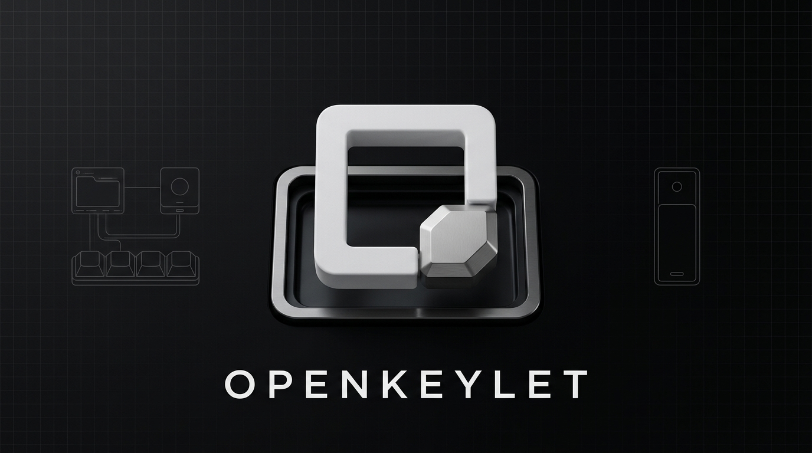
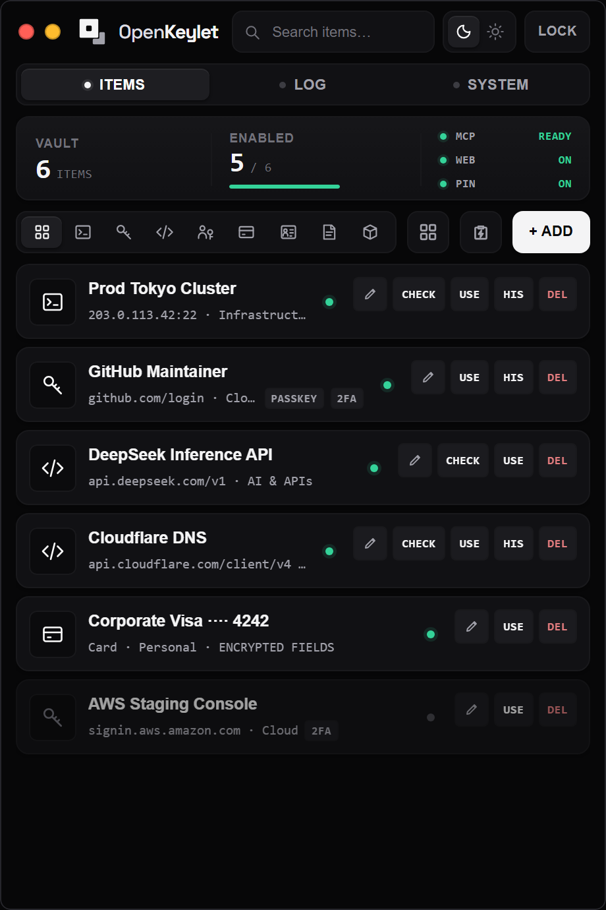
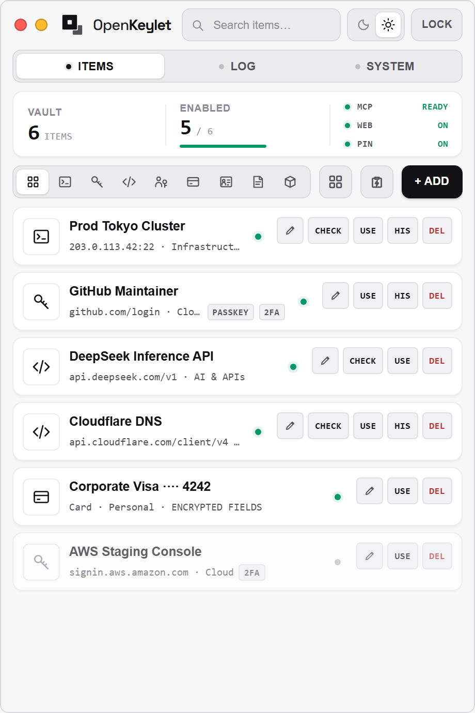
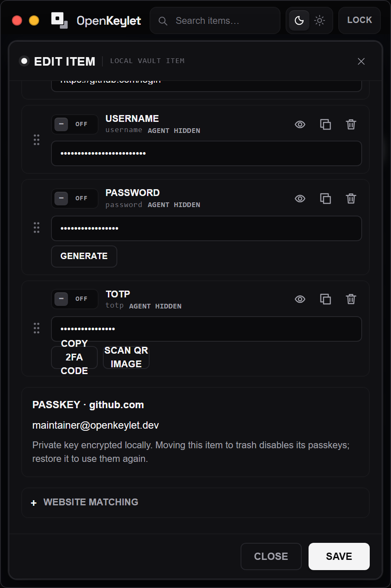
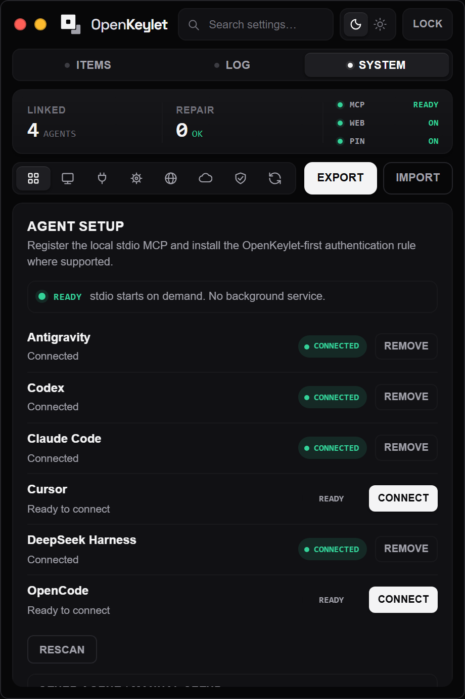

<p align="center">
  
</p>

<h1 align="center">OpenKeylet</h1>

<p align="center">
  <strong>Local-first encrypted password vault, Passkey manager, and zero-plaintext <code>stdio</code> MCP credential relay for AI agents.</strong>
</p>

<p align="center">
  <code>Local-First</code>&nbsp;·&nbsp;<code>XChaCha20-Poly1305</code>&nbsp;·&nbsp;<code>No Cloud Account</code>&nbsp;·&nbsp;<code>Windows / macOS / Linux</code>&nbsp;·&nbsp;<code>MIT License</code>
</p>

<p align="center">
  <a href="../../releases/latest"><strong>Download Latest</strong></a>
  &nbsp;&nbsp;·&nbsp;&nbsp;
  <a href="README.zh-CN.md"><strong>简体中文</strong></a>
  &nbsp;&nbsp;·&nbsp;&nbsp;
  <a href="#permission-boundaries--threat-model">Permission Boundaries</a>
  &nbsp;&nbsp;·&nbsp;&nbsp;
  <a href="#step-by-step-tutorials">Tutorials</a>
  &nbsp;&nbsp;·&nbsp;&nbsp;
  <a href="#recommended-practices">Best Practices</a>
  &nbsp;&nbsp;·&nbsp;&nbsp;
  <a href="SECURITY.md">Security Policy</a>
</p>

---

**OpenKeylet** bridges your personal local password manager with modern AI coding & terminal agents — including **Antigravity, Codex, Claude Code, Cursor, DeepSeek Harness, and OpenCode**.

When an agent needs to SSH into a server, call an authenticated API, render a `.env` secret file, fill a browser login, or sign in with a **WebAuthn Passkey**, OpenKeylet executes the credential step **locally on your machine** while keeping hidden plaintext out of the LLM context, tool responses, and logs.

---

## Interface Gallery

Designed in a distraction-free **Pure Monochrome Carbon & Porcelain** aesthetic with native platform chrome across Windows, macOS, and Linux.

<table>
  <tr>
    <td width="50%" align="center">
      <br />
      <sub><strong>Carbon Dark</strong> · Single-row list (default) with one-click 4-column card grid toggle</sub>
    </td>
    <td width="50%" align="center">
      <br />
      <sub><strong>Porcelain Light</strong> · Crisp ceramic dual theme with full names, 2FA &amp; Passkey badges</sub>
    </td>
  </tr>
  <tr>
    <td width="50%" align="center">
      <br />
      <sub><strong>Per-Module Control</strong> · Independent Agent visibility, live 2FA TOTP &amp; Passkeys</sub>
    </td>
    <td width="50%" align="center">
      <br />
      <sub><strong>Agent Setup</strong> · One-click local <code>stdio</code> MCP link &amp; repair</sub>
    </td>
  </tr>
</table>

<details>
  <summary>View Optional Personal Encrypted Vault Repository UI (GitHub / Self-hosted Gitea &amp; Forgejo)</summary>
  <br />
  <p align="center">
    
  </p>
</details>

---

## Architecture: Zero-Plaintext Local Relay

<p align="center">
  
</p>

<table>
  <tr>
    <td width="25%"><strong>01 · Encrypted Core</strong><br /><br />All secrets, Passkey private keys, TOTP seeds, and cards are encrypted locally with <code>XChaCha20-Poly1305</code>. No OpenKeylet account or hosted server exists.</td>
    <td width="25%"><strong>02 · Metadata Discovery</strong><br /><br />Agents see only item names, field labels, non-secret targets, and advertised actions via on-demand <code>stdio</code> MCP — never hidden plaintext.</td>
    <td width="25%"><strong>03 · Local Execution</strong><br /><br />OpenKeylet signs Passkeys, fills web/desktop forms, runs SSH/SFTP, calls APIs, and writes template files locally while redacting echoed secrets (<code>[REDACTED]</code>).</td>
    <td width="25%"><strong>04 · User-Owned Sync</strong><br /><br />Optionally export <code>.mvault</code> encrypted packages or enable end-to-end encrypted two-way sync to your own private GitHub / Gitea repository.</td>
  </tr>
</table>

---

## Permission Boundaries & Threat Model

OpenKeylet is intentionally **transparent about what it protects and what it does not**. Because background AI agents must execute credentials smoothly without blocking on a master password every minute, OpenKeylet separates local convenience from cryptographic offline protection:

### What OpenKeylet Protects vs. Does Not Protect

| Boundary | Status | How It Works |
| --- | :---: | --- |
| **LLM Context & Prompt Leakage** | **Protected** | Default-hidden modules are never returned in MCP responses, tool outputs, or activity logs. Terminal and HTTP outputs dynamically redact known secrets and live TOTP codes. |
| **Unauthorized Plaintext Extraction** | **Protected** | No unrestricted `get_secret` tool exists. Agents can only *use* hidden credentials through explicit actions unless you manually flip a module's **Agent Visible** switch. |
| **Other People Using Your Unlocked PC** | **Protected (with PIN)** | The optional 6-digit PIN locks the desktop GUI, scrubs items/logs behind the lock screen, blocks management IPC commands, enforces progressive wrong-PIN cooldown, and supports optional idle auto-lock (5 / 15 / 30 / 60 min). |
| **Clipboard History Leakage** | **Protected** | Copying passwords, secrets, TOTP codes, generated passwords, or recovery keys marks them to bypass Windows `Win+V` & Cloud Clipboard and **auto-clears after 30 seconds** (only if unchanged — never wiping newer user copies) or immediately on lock/quit. |
| **Offline Cloud / Backup Theft** | **Protected** | Desktop `.mvault` exports use Argon2id (64 MiB) + XChaCha20-Poly1305 with a ≥12-char password. Cloud repo snapshots use a separate random 256-bit `okv1_` recovery key; the remote repo receives ciphertext only and must be `private: true`. |
| **Malicious Agent / Compromised OS User** | **Not a Sandbox** | OpenKeylet does **not** defend against malware running as your same OS user, a compromised browser, or a malicious agent sending destructive commands over an enabled SSH/HTTP item. Pair with OS login lock & full-disk encryption (BitLocker / FileVault / LUKS). |
| **Background MCP When GUI Is Locked** | **By Design: Active** | Locking the desktop GUI with PIN stops *people* from viewing/editing the vault on screen; background `stdio` MCP sessions continue working for **enabled** items so long-running agent jobs are not interrupted. Disable an item to block agents from using it. |

### Per-Module Visibility Matrix

| Module State | Visible to Owner (Unlocked GUI) | Returned to AI Agent (MCP) | Usable Locally by OpenKeylet |
| --- | :---: | :---: | :---: |
| **Hidden** *(default for secrets)* | Masked (click Eye / Copy) | Never | Yes (`ssh`, `http`, `fill`, `browser`, `secret_write_file`) |
| **Visible** *(explicit toggle)* | Yes | Yes | Yes |
| **TOTP Seed** | Masked + **Copy 2FA Code** | Seed never returned; live 6-digit code injected/redacted locally | Yes |
| **Passkey Private Key** | Metadata only (RP ID + user) | Private key never leaves desktop vault | Yes (requires extension confirmation; optional Agent Passkey toggle) |
| **Disabled / Trashed Item** | Viewable / Restorable by owner | Blocked | Blocked (no autofill, no Passkey signing, no MCP execution) |

> Read the complete [Security Policy & Threat Boundary](SECURITY.md) before using OpenKeylet with sensitive production infrastructure.

---

## Recommended Practices

1. **Turn on 6-Digit PIN + Idle Auto-Lock on shared or office machines**
   Go to **System → APP / 03**, enable **PIN lock**, and pick a comfortable **Auto-lock** interval (e.g., `15 minutes`). Your background MCP workflows keep running while your screen stays safe when you step away.
2. **Use the item `Enable` toggle as your Agent kill-switch**
   Keep everyday dev/staging credentials enabled for agents, and leave high-risk production root keys or personal banking logins **disabled** until you actively need them.
3. **Keep `Agent Visible` OFF unless truly needed**
   Leave the left toggle on every password, API key, SSH key, and TOTP module set to **Hidden** (`OFF`). Prefer `{{openkeylet:module name}}` placeholders in `http_send`, `terminal_run`, `ssh_run`, and `secret_write_file`.
4. **Store your `okv1_` Recovery Key and `.mvault` password outside the repository**
   Print or save your recovery key in a separate offline location. Without it (and with no connected device left), encrypted cloud snapshots cannot be decrypted.
5. **Control Agent Passkey signing explicitly**
   Under **System → WEB / 04**, toggle **Agent Passkey signing** off if you only want manual user-confirmed Passkeys in the browser.
6. **Avoid concurrent offline edits to the exact same item**
   Two-way repo sync merges cleanly across devices by item `id` and `updatedAt`, and propagates permanent deletions via tombstones. Sync before editing the same item on a second machine to avoid last-write-wins overwrites.

---

## Step-by-Step Tutorials

### Tutorial 1 · Bind Your AI Agent (1-Click Setup)

OpenKeylet connects to AI coding and terminal agents over local on-demand **`stdio` MCP** — no open network ports and no cloud broker.

1. Launch **OpenKeylet** and open **System → MCP / 02 (Agent Setup)** (shortcut: `⌘/Ctrl + ,`).
2. Find your client — **Antigravity**, **Codex**, **Claude Code**, **Cursor**, **DeepSeek Harness**, or **OpenCode** — and click **CONNECT** (if you moved the binary or upgraded from KRU, click **REPAIR**).
   - OpenKeylet writes the local `stdio` MCP entry (`openkeylet mcp stdio`) automatically.
   - Where supported, it also installs the *"prefer OpenKeylet for authentication"* rule so the agent knows to check OpenKeylet automatically instead of asking you to paste passwords.
3. Verify the top status panel shows **`MCP · READY`** (green dot), then **start a fresh chat session** (or reload MCP servers in your IDE).
4. **Sanity-check the link** by asking your agent:
   ```text
   List the enabled items you can see in OpenKeylet MCP.
   ```
   The agent will call `items_search` and return only item names, targets, and available actions — never hidden secrets.

> Using another MCP-compatible client? Expand [Manual `stdio` MCP Configuration](#complete-mcp-surface-17-tools) below or run `openkeylet config stdio-json`.

---

### Tutorial 2 · Tell Your Agent Which Credential to Use (`USE` Button & Natural Language)

There are **two effortless ways** to hand a credential to an AI agent without ever revealing the secret:

#### Way A — The Fastest Workflow: One-Click `USE` Button

1. Locate your item in the vault (default **Single-Row List** view, or click the layout toggle next to **`+ ADD`** to switch to the **4-Column Card Grid**).
2. Make sure its green status dot is **ON** (clicking the dot toggles Agent access on/off immediately).
3. Click **`USE`** on the row/card. OpenKeylet immediately copies a secret-free reference phrase to your clipboard:
   ```text
   use Prod Tokyo Cluster in OpenKeylet MCP
   ```
4. **Paste it into your AI Agent chat** and type your task right after it:
   ```text
   use Prod Tokyo Cluster in OpenKeylet MCP — check disk space, tail the last 50 lines of /var/log/nginx/error.log, and restart nginx if needed.
   ```
   ```text
   use GitHub Maintainer in OpenKeylet MCP — open the release settings page in my browser and sign in.
   ```

#### Way B — Pure Natural Language Prompt Cookbook

You don't need special syntax or tool names. Just speak naturally and mention the item name (or let the agent search OpenKeylet automatically):

| Real-World Task | What You Can Say to the Agent | Tools OpenKeylet Uses Locally |
| --- | --- | --- |
| **SSH Diagnostics & Ops** | `SSH into "Prod Tokyo Cluster" via OpenKeylet and check why Docker container web-1 is restarting.` | `items_search` → `ssh_run` |
| **Deploy / SFTP Transfer** | `Upload ./dist to /var/www/app on "Prod Tokyo Cluster" and reload caddy.` | `ssh_upload` → `ssh_run` |
| **Download Server Logs** | `Download /var/log/app/crash.log from "Prod Tokyo Cluster" into ./tmp/crash.log and analyze it.` | `ssh_download` |
| **Authenticated REST API** | `Using "Cloudflare DNS" in OpenKeylet, list all A/AAAA records for example.com.` | `http_send` |
| **Generate `.env` Safely** | `Create .env.local with DEEPSEEK_API_KEY from "DeepSeek Inference API" via secret_write_file — do not print the key.` | `secret_write_file` |
| **Browser Login + 2FA** | `Log into my staging console in Chrome using "AWS Staging Console" from OpenKeylet (including 2FA).` | `browser_inspect` → `browser_fill_login` → `browser_click` |
| **WebAuthn Passkey Sign-In** | `Sign into github.com in my browser using the Passkey stored in "GitHub Maintainer".` | `browser_inspect` → `browser_passkey` |
| **Fill Billing / Address Form** | `Fill out the shipping and card fields on the current checkout tab using "Corporate Visa ···· 4242".` | `browser_inspect` → `browser_fill_personal` |
| **Interactive CLI / `sudo`** | `Start a local terminal session, run the deployment CLI, and fill the passphrase from "Release Signing Key" when prompted.` | `terminal_start` → `credential_fill` → `terminal_read` |
| **Auto-Discovery (Hands-Off)** | `Finish deploying the staging branch. If any step needs SSH, API, or web login, check OpenKeylet first.` | `items_search` → matching action |

#### Way C — Secret Placeholders for Templates & Commands (`{{openkeylet:...}}`)

When asking an agent to render `.env` / YAML / JSON files or pass secrets into commands/headers, tell it to use `{{openkeylet:Module Name}}` placeholders:

```env
DEEPSEEK_API_KEY={{openkeylet:API Credential}}
CF_API_TOKEN={{openkeylet:Token}}
```

OpenKeylet resolves placeholders **locally** inside `secret_write_file`, `http_send`, `ssh_run`, and `terminal_run`, and automatically replaces any echoed secret in stdout/stderr/HTTP output with `[REDACTED]`.

---

### Tutorial 3 · Create, Test & Organize Modular Items

1. Click **`+ ADD`** (`⌘/Ctrl + N`) and pick a template: **Login**, **SSH**, **API**, **Card**, **Identity**, **Secure Note**, or **Blank**.
2. **Compose only the modules you need**: click **`+ ADD MODULE`** to add Username, Password (with built-in generator), TOTP 2FA, API Credential, SSH Private Key, Passphrase, Host/Port, Service URL, or Custom Fields. Drag module handles to reorder.
3. **Keep the left eye/switch OFF** for secret modules (default: *Hidden from Agent*), or turn it ON only for non-sensitive values an agent should read verbatim.
4. **Add multiple website rules** on login items (`baseDomain`, `host`, `startsWith`, `exact`, `regex`) so browser autofill and `browser_fill_login` match subdomains accurately.
5. Click **`CHECK`** on SSH or API items to verify connectivity right from the vault, click **`HIS`** to inspect/copy up to 20 past password versions, and use **drag-and-drop** (or `↑/↓` in List view, `←/→` in Grid view) to arrange your favorite order.

---

### Tutorial 4 · Browser Extension, Autofill, 2FA & Passkeys

1. Open **System → WEB / 04 (Browser Bridge)** and enable the bridge (the top status strip turns **`WEB · ON`**).
2. **Step 1**: Click **Open Chrome & copy address** → paste `chrome://extensions/` → turn on **Developer mode**.
3. **Step 2**: Drag the OpenKeylet badge onto the extensions page (or click **Extension folder** → **Load unpacked**). Pairing completes automatically.
4. **Daily Human Use**:
   - Click the extension popup on any site to fill logins, cards, or identities (supports CJK/international checkout forms, Shadow DOM, React/Vue controlled inputs, and multi-step logins) — never auto-submits behind your back.
   - Click **2FA** in the popup (or **COPY 2FA CODE** in the desktop editor) for live TOTP codes with automatic 30-second clipboard cleanup.
   - Register and sign in with **WebAuthn Passkeys** (ES256, discoverable & allow-list credentials, optional `prf` / `largeBlob` extensions); private keys stay encrypted inside the desktop vault.
5. **Agent-Driven Web Login**:
   - Keep your target site open in Chrome/Edge/Brave, then tell your agent: `use GitHub Maintainer in OpenKeylet MCP — sign into this page.`
   - You can watch every fill and click live in your tab; toggle **Agent Passkey signing** OFF under **System → WEB / 04** if you prefer manual Passkey confirmations only.

---

### Tutorial 5 · Offline `.mvault` Backups & Vault Migration (v3–v8 Compatible)

All local data operations live together under **System → SAFE / 06 (Local Data & Offline Packages)**:

* **Export `.mvault`**: Click **Export .mvault** and choose an independent backup password (≥ 12 characters). Encrypted with Argon2id (64 MiB, 3 iterations) + XChaCha20-Poly1305; includes all items, Passkeys, password history (last 20), and Trash.
* **Restore `.mvault` (with Safe Dry-Run Preview)**:
  1. Click **Restore .mvault** and pick your `.mvault` file first.
  2. OpenKeylet automatically detects whether the package requires a password — **legacy v3–v7 and CLI self-unlocking `.mvault` files skip the password prompt automatically** (and display a security advisory encouraging you to re-export with a password).
  3. Review the **non-destructive merge preview**: exact counts of new items, identical entries skipped, safe numbered conflict renames (e.g. `GitHub(2)` — existing items are never overwritten), Passkeys, Trash, and password history.
  4. Click **Confirm Import** to commit atomically (and trigger automatic cloud sync if enabled).
* **Migrate from Bitwarden / Chrome / Edge**: Click **Import Bitwarden / CSV** to preview compatibility notes and transactionally import Bitwarden JSON (including ES256 PKCS#8 Passkeys & TOTP) or Chrome/Edge CSV (also accepts `.mvault` packages).

---

### Tutorial 6 · Multi-Device Encrypted Cloud Sync (GitHub / Self-Hosted Gitea & Forgejo)

In **System → CLOUD / 05**, you may optionally sync ciphertext through a **private** repository you own (completely opt-in):

1. **Choose your host**:
   - **GitHub**: reuse your local `gh auth login` session or paste a fine-grained PAT with `Contents: Read & write` (plus `Administration: Write` if you want OpenKeylet to create the private repo automatically).
   - **Self-hosted Gitea / Forgejo**: enter your HTTPS server URL + personal access token, then click **Check server & account** to verify `/api/v1/user` connectivity before saving.
2. **Verify private repo & store Recovery Key**: enter `owner/repo` (every read/write strictly enforces `private: true`), generate your 256-bit `okv1_` **Recovery Key**, and save it **outside the repository**.
3. **One-Button Everyday Sync**:
   - Turn on **Auto two-way sync** for debounced background pushes after edits and automatic pull-merge on launch (handles `409 Conflict` auto-retry and tombstone deletions).
   - Whenever local changes haven't been synced yet (or a background push hits offline network), a **`PENDING SYNC`** banner stays visible and the primary button switches to **`SYNC PENDING CHANGES`** — one click reconciles everything.
   - Manual actions (**Back up only**, **Restore only**, **Recovery key**, **Reconnect**, **Disconnect**) stay neatly tucked inside the collapsible **Advanced · Manual snapshot & connection** drawer.
4. **Add a second machine (Windows / macOS / Linux)**: open **System → CLOUD / 05**, choose **Connect an existing vault repo**, enter the same repo + your `okv1_` Recovery Key, and click **`SYNC & RESTORE`**.

> Local PIN, browser pairing tokens, agent configs, activity logs, and editor drafts **never** leave your device.

---

### Desktop Keyboard Shortcuts

| Shortcut | Action |
| --- | --- |
| `⌘/Ctrl + K` or `⌘/Ctrl + F` | Focus search bar |
| `⌘/Ctrl + N` | Add new vault item |
| `⌘/Ctrl + 1 / 2 / 3` | Switch between **Items / Log / System** |
| `⌘/Ctrl + ,` | Open **System** settings |
| `⌘/Ctrl + S` | Save open item editor |
| `⌘/Ctrl + Shift + L` | Lock OpenKeylet immediately (when PIN is enabled) |
| `Esc` | Close active modal / cancel drag / close search |

---

## Complete MCP Surface (17 Tools)

OpenKeylet runs on demand via local `stdio` MCP (`openkeylet mcp stdio`) and exposes 17 typed tools with `structuredContent` outputs:

| Category | Tool | Purpose |
| --- | --- | --- |
| **Discovery** | `items_search(query?)` | Search enabled items, module names, public targets, and advertised actions |
| **Browser & Web** | `browser_inspect` | Inspect active tab URL, forms, fields, and clickable controls via paired extension |
| | `browser_fill_login` | Match and fill saved login credentials (and TOTP) into a live web page |
| | `browser_fill_personal` | Fill saved cards or identity details into web forms |
| | `browser_click` | Click a targeted button/link in the active page |
| | `browser_passkey` | Complete WebAuthn Passkey registration or sign-in using the local vault |
| **Direct Fill** | `credential_fill` | Fill one hidden module into a focused browser, desktop control, or managed terminal |
| **SSH & SFTP** | `ssh_run` | Run SSH commands with local password/key auth, stdin, and `{{openkeylet:...}}` placeholders |
| | `ssh_upload` | Recursively upload local files/directories over SFTP |
| | `ssh_download` | Recursively download remote files/directories over SFTP |
| **HTTP APIs** | `http_send` | Send authenticated HTTP/HTTPS requests (auto-detects providers, Bearer/Basic, custom headers, streaming, multipart) |
| **Files** | `secret_write_file` | Render a local file template replacing `{{openkeylet:module}}` placeholders atomically without exposing plaintext |
| **Terminal** | `terminal_run` | One-shot local command with hidden-module substitution and output redaction |
| | `terminal_start` / `terminal_write` / `terminal_read` / `terminal_stop` | Managed interactive PTY sessions with continuous secret redaction across read boundaries |

<details>
  <summary>Manual <code>stdio</code> MCP Configuration (JSON &amp; CLI)</summary>

```json
{
  "mcpServers": {
    "openkeylet": {
      "command": "C:\\path\\to\\openkeylet.exe",
      "args": ["mcp", "stdio"]
    }
  }
}
```

Print client-ready configuration from the CLI:

```bash
openkeylet config stdio-json
openkeylet config stdio-toml
```

</details>

---

## Downloads & Data Locations

| Target | Format | Notes |
| --- | --- | --- |
| **Windows x64** | `.zip` | Portable GUI, tray, native clipboard history exclusion, desktop fill & browser extension |
| **macOS arm64** | `.zip` | Native `.app` with macOS traffic lights & titlebar; Accessibility permission needed for desktop fill |
| **Linux x64 GUI** | `.tar.gz` | AppImage GUI; X11 desktop fill & system tray |
| **Linux x64 Headless** | `.tar.gz` | Zero WebView/GUI deps (`--no-default-features`); full MCP, SSH, HTTP, terminal, backup & bridge |

Upgrading the binary preserves your vault automatically:

| Platform | Default Vault Directory |
| --- | --- |
| Windows | `%APPDATA%\mcp-vault\v2` |
| macOS | `~/Library/Application Support/mcp-vault/v2` |
| Linux | `${XDG_DATA_HOME:-~/.local/share}/mcp-vault/v2` |

*(Override with `OPENKEYLET_DATA_DIR=/absolute/path` for isolated/portable vaults.)*

**Automatic Updates (GitHub Releases)**: Official signed builds check `releases/latest/download/latest.json` directly on GitHub Releases (no custom server), verify the Ed25519 manifest signature and SHA-256 checksum, optionally download silently in the background, and apply updates in place on restart without breaking MCP paths. Configure under **System → UPDATE / 07**, or run `openkeylet update check` / `openkeylet update install` on headless Linux.

<details>
  <summary>Upgrading from KRU</summary>
  <p>OpenKeylet is the successor to <strong>KRU</strong> and keeps full compatibility with existing local vaults, keys, <code>.mvault</code> backups, <code>{{kru:module}}</code> placeholders, and <code>KRU_*</code> environment variables. After upgrading, open <strong>System → Agent Setup → Repair</strong> to migrate existing <code>kru</code> MCP entries to <code>openkeylet</code>, then restart your agent.</p>
</details>

---

## Build & Test from Source

Requirements: **Rust 1.88+**, **Node.js 22+**, and [Tauri 2 prerequisites](https://v2.tauri.app/start/prerequisites/).

```bash
npm install
npm run check
npm test
npm run build
npm run portable
```

Additional release targets & verification suites:

```bash
npm run release:mac
npm run release:linux
npm run release:headless

# Real-Chromium extension, Passkey, UX & adversarial stress E2E (Playwright)
npm run test:browser
node scripts/test-agent-browser.mjs
node scripts/test-realworld-passkey-autofill.mjs
node scripts/test-ux-interactions.mjs
node scripts/test-adversarial-e2e.mjs
```

---

## License

[MIT](LICENSE) — inspect it, build it, and run it completely on your own hardware.
