<p align="center">
  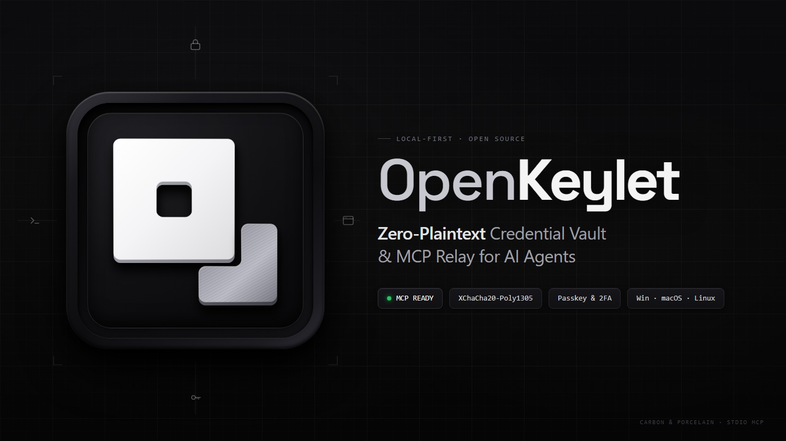
</p>

<h1 align="center">OpenKeylet</h1>

<p align="center">
  <strong>Yapay zeka ajanları için yerel öncelikli şifreli parola kasası, Passkey yöneticisi ve sıfır düz metin <code>stdio</code> MCP kimlik bilgisi aktarıcısı.</strong>
</p>

<p align="center">
  <a href="https://github.com/omaekumiko2-create/OpenKeylet/releases/latest"></a>
  <a href="LICENSE"></a>
  
  
  
  <a href="#topluluk-geri-bildirim-ve-uzun-vadeli-bakım"></a>
</p>

<p align="center">
  <a href="#kurulum-ve-güncelleme"><strong>Kurulum (CLI Önerilir)</strong></a>
  &nbsp;&nbsp;·&nbsp;&nbsp;
  <a href="../../releases/latest"><strong>Sürümler</strong></a>
  &nbsp;&nbsp;·&nbsp;&nbsp;
  <a href="README.md"><strong>English</strong></a>
  &nbsp;&nbsp;·&nbsp;&nbsp;
  <a href="README.zh-CN.md"><strong>简体中文</strong></a>
  &nbsp;&nbsp;·&nbsp;&nbsp;
  <a href="#3-dakikada-hızlı-başlangıç-5-günlük-iş-akışı">Hızlı Başlangıç</a>
  &nbsp;&nbsp;·&nbsp;&nbsp;
  <a href="#diğer-arayüzler">Gerçek Arayüz</a>
  &nbsp;&nbsp;·&nbsp;&nbsp;
  <a href="#mimari-ve-tüm-yetenekler">Mimari</a>
  &nbsp;&nbsp;·&nbsp;&nbsp;
  <a href="#anahtar-ayrımı-ve-dürüst-güvenlik-sınırları">Güvenlik Sınırları</a>
  &nbsp;&nbsp;·&nbsp;&nbsp;
  <a href="#tam-mcp-yüzeyi-26-araç-ve-yerel-cli-köprüsü">26 Araç</a>
  &nbsp;&nbsp;·&nbsp;&nbsp;
  <a href="#topluluk-geri-bildirim-ve-uzun-vadeli-bakım">Geri Bildirim ve Tartışmalar</a>
  &nbsp;&nbsp;·&nbsp;&nbsp;
  <a href="SECURITY.md">Güvenlik Politikası</a>
</p>

---

**OpenKeylet**, kişisel yerel parola yöneticinizi modern yapay zeka kodlama ve terminal ajanlarıyla buluşturur — **Antigravity, Claude Code, Codex, Cursor, DeepSeek Harness ve OpenCode** için tek tıkla yerel kurulum sunar.

Bir ajanın bir sunucuya SSH bağlantısı kurması, kimlik doğrulamalı bir API çağırması, bir `.env` gizli şablonunu işlemesi, tarayıcıda oturum açma veya ödeme formunu doldurması ya da **WebAuthn Passkey** ile oturum açması gerektiğinde, OpenKeylet kimlik bilgisi adımını **yerel olarak makinenizde** yürütür — gizli düz metni LLM bağlamından, model vekil sunucularından ve sohbet günlüklerinden uzak tutarken günlük ajan iş akışlarını zahmetsiz hale getirir.

---

## Kurulum ve Güncelleme

### 1 · CLI Kurulumu (Önerilen)

Resmi CLI kurucusu, OpenKeylet'i kurmanın en hızlı, en temiz ve en güvenilir yoludur. **Ed25519 sürüm imzasını** (uygun olduğunda Node.js üzerinden) + **SHA-256** sağlama toplamlarını doğrular, yerleşik otomatik güncellemelerle uyumlu kullanıcı tarafından yazılabilir bir standart dizine kurar, `openkeylet` komutunu `PATH` içine ekler ve algılanan yapay zeka ajanlarını bağlamak için `openkeylet setup` komutunu otomatik çalıştırır.

**macOS ve Linux** *(Masaüstü GUI veya Başsız (Headless) Linux sunucusunu otomatik algılar; geçersiz kılmak için `--headless` veya `--gui` parametresi verin)*:

```bash
curl -fsSL https://raw.githubusercontent.com/omaekumiko2-create/OpenKeylet/main/scripts/install.sh -o /tmp/openkeylet-install.sh \
  && bash /tmp/openkeylet-install.sh \
  && rm -f /tmp/openkeylet-install.sh
```

**Windows (PowerShell)**:

```powershell
$s = Join-Path $env:TEMP "openkeylet-install.ps1"
Invoke-WebRequest "https://raw.githubusercontent.com/omaekumiko2-create/OpenKeylet/main/scripts/install.ps1" -OutFile $s -UseBasicParsing
powershell -NoProfile -ExecutionPolicy Bypass -File $s -Shortcut
Remove-Item $s -Force
```

**CLI üzerinden yerinde güncelleme** *(OpenKeylet'in yerleşik Ed25519 imzalı güncelleyicisini kullanır, arka planda hazırlanmış GUI güncellemelerini çakışmasız yeniden kullanır ve bağlı ajan kurallarını yeniler)*:

```bash
openkeylet update install
```

### 2 · Yapay Zeka Ajanınızın Tek Cümleyle Kurmasına veya Güncellemesine İzin Verin

Cümlelerden birini **Claude Code, Antigravity, Codex, Cursor, OpenCode veya DeepSeek Harness** içine yapıştırın — ajanınız yukarıdaki resmi CLI kurucusunu ve yerleşik güncelleyiciyi kullanarak denetlenebilir [INSTALL.md](INSTALL.md) kılavuzunu izler:

- **Kurulum:**
  ```text
  Read https://raw.githubusercontent.com/omaekumiko2-create/OpenKeylet/main/INSTALL.md and install OpenKeylet on this machine and connect it to this agent.
  ```
- **Yerinde güncelleme:**
  ```text
  Update OpenKeylet to the latest signed release in place following https://raw.githubusercontent.com/omaekumiko2-create/OpenKeylet/main/INSTALL.md.
  ```

### 3 · Elle Taşınabilir İndirme

Elle arşivden çıkarmayı mı tercih ediyorsunuz? Windows, macOS, Linux GUI veya Linux Headless için en son taşınabilir arşivi [GitHub Releases](../../releases/latest) sayfasından edinin.

> [!NOTE]
> **Uzun Vadeli Bakımı Yapılan Açık Kaynak Proje**: OpenKeylet ücretsiz, **aktif ve uzun vadeli bakımı yapılan** bir açık kaynak topluluk aracıdır ([MIT](LICENSE), **resmi bir güvenlik garantisi olmaksızın olduğu gibi** sağlanır). Temel amacı, yapay zeka ajanı kimlik bilgisi iş akışlarını akıcı, hızlı ve pratik hale getirirken günlük kazara sızıntıları önlemektir — neye karşı savunma yaptığı ve neye karşı yapmadığı konusunda tam bir dürüstlükle. [Issues](https://github.com/omaekumiko2-create/OpenKeylet/issues) ve [Discussions](https://github.com/omaekumiko2-create/OpenKeylet/discussions) bölümlerinde **her türlü geri bildirimi, hata raporunu, UI/UX önerisini, özellik fikrini ve açık tartışmayı** memnuniyetle karşılıyoruz.

---

## 3 Dakikada Hızlı Başlangıç: 5 Günlük İş Akışı

### 1 · Yapay Zeka Ajanınızı Tek Tıkla Bağlayın (GUI veya CLI)

<table>
  <tr>
    <td width="44%" align="center">
      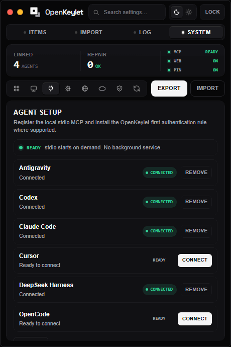
    </td>
    <td width="56%" valign="middle">
      <p>OpenKeylet isteğe bağlı yerel <code>stdio</code> MCP üzerinden bağlanır — <strong>açık ağ portu yok, arka plan hizmeti (daemon) yok, satıcı hesabı yok</strong>:</p>
      <ol>
        <li><strong>SYSTEM → MCP / 02 (Agent Setup)</strong> bölümünü açın (kısayol: <code>⌘/Ctrl + ,</code>).</li>
        <li>İstemcinizi bulun — <strong>Antigravity, Codex, Claude Code, Cursor, DeepSeek Harness veya OpenCode</strong> — ve <strong>CONNECT</strong> (veya ikili dosyayı taşıdıktan / KRU'dan yükselttikten sonra <strong>REPAIR</strong>) düğmesine tıklayın.</li>
        <li>OpenKeylet otomatik olarak <code>openkeylet mcp stdio</code> yazar ve desteklenen yerlerde <em>"kimlik doğrulama için OpenKeylet'i tercih et"</em> kuralını yükler.</li>
        <li>Üst çubuğun yeşil <strong><code>MCP · READY</code></strong> gösterdiğini doğrulayın, <strong>yeni bir ajan oturumu</strong> başlatın ve 5 saniyelik bir kontrol çalıştırın:</li>
      </ol>
      <pre><code>List the enabled items you can see in OpenKeylet MCP.</code></pre>
      <p><sub>Ajan <code>items_search</code> aracını çağırır ve yalnızca öğe adlarını, gizli olmayan hedefleri ve kullanılabilir eylemleri görür — gizli düz metni asla görmez. Başka bir MCP istemcisi mi kullanıyorsunuz? Aşağıdaki <a href="#tam-mcp-yüzeyi-26-araç-ve-yerel-cli-köprüsü">Elle MCP Yapılandırması</a> bölümüne bakın.</sub></p>
    </td>
  </tr>
</table>

---

### 2 · Kimlik Bilgilerini Sohbet İçinden Ajanınıza Verin

<p align="center">
  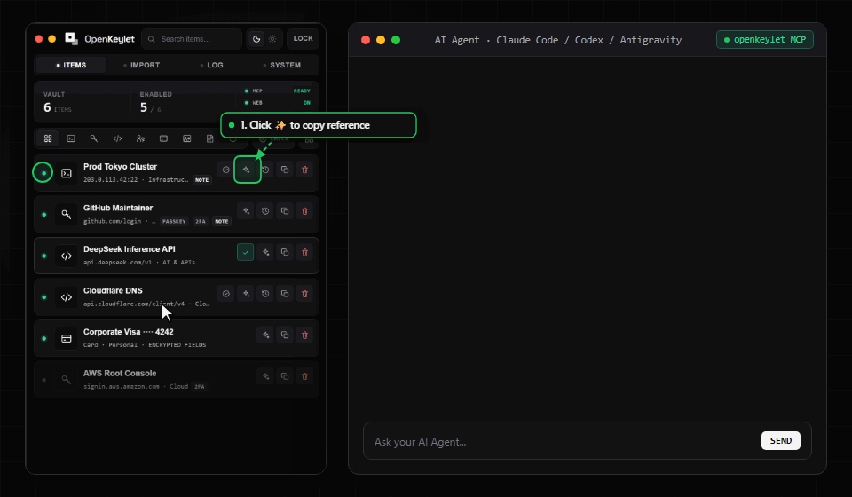
</p>

- **Yol A (En Hızlı ve Sıfır Hata)**: Öğenin sol yeşil noktasının AÇIK olduğunu doğrulayın → `use Prod Tokyo Cluster in OpenKeylet MCP` ifadesini kopyalamak için satırdaki **✨ (Use)** simgesine tıklayın → doğrudan yapay zeka ajanı sohbetinize yapıştırıp görevinizi yazın.
- **Yol B (Saf Doğal Dil)**: Öğe adını doğal bir şekilde belirtin veya ajana önce OpenKeylet'i kontrol etmesini söyleyin. Çok öğeli şablonlar, üstbilgiler veya komutlar için `{{openkeylet:Item/module}}` yer tutucularını kullanın; OpenKeylet bunları yerel olarak çözer ve yansıyan gizli bilgileri `[REDACTED]` olarak temizler.

<details open>
  <summary><strong>Günlük Ajan İstemi Tarif Kitabı (Kopyalayın, Öğe Adını Değiştirin ve Çalıştırın)</strong></summary>

| Gerçek Dünya Görevi | Ajan Sohbetine Yazılacak İfade | Yerel OpenKeylet Araçları |
| --- | --- | --- |
| **SSH Tanılama ve Operasyon** | `SSH into "Prod Tokyo Cluster" via OpenKeylet and check why Docker container web-1 is restarting.` | `items_search` → `ssh_run` |
| **SFTP Dağıtımı** | `Upload ./dist to /var/www/app on "Prod Tokyo Cluster" and reload caddy.` | `ssh_upload` → `ssh_run` |
| **Kimlik Doğrulamalı REST API** | `Using "Cloudflare DNS" in OpenKeylet, list all A and AAAA records for example.com.` | `http_send` |
| **Yeni API Anahtarını Yakala** | `Save the one-time API key displayed on this console page straight into OpenKeylet without printing it.` | `browser_inspect` → `browser_save_key` |
| **`.env` Dosyasını Güvenle Oluştur** | `Create .env.local with DEEPSEEK_API_KEY from "DeepSeek Inference API" via secret_write_file — do not read it back.` | `secret_write_file` |
| **Tarayıcı Girişi + 2FA** | `Log into the active Chrome tab using "GitHub Maintainer" from OpenKeylet (including 2FA).` | `browser_inspect` → `browser_fill_login` → `browser_click` |
| **WebAuthn Passkey ile Giriş** | `Sign into github.com in my browser using the Passkey stored in "GitHub Maintainer".` | `browser_inspect` → `browser_passkey` |
| **Ödeme Kartı ve Adres** | `Fill out the card and billing address on this checkout tab using "Corporate Visa ···· 4242" — do not submit.` | `browser_inspect` → `browser_fill_personal` |
| **Etkileşimli CLI / `sudo`** | `Start a local terminal, run the release script, and fill the passphrase from "Release Signing Key" when prompted.` | `terminal_start` → `credential_fill` → `terminal_read` |

</details>

---

### 3 · Ajanınızla Konuşarak Gizli Bilgileri El Değmeden Kaydedin (Zero-Touch)

Yeni oluşturulmuş bir API anahtarını, parolayı veya SSH özel anahtarını asla sohbete kopyalamanız gerekmez. Yapay zeka ajanınıza doğal dilde söylemeniz yeterlidir — OpenKeylet ham düz metni LLM bağlamından tamamen uzak tutarak gizli bilgiyi **doğrudan localhost üzerinde şifreli kasanıza** yakalar, üretir veya aktarır:

<p align="center">
  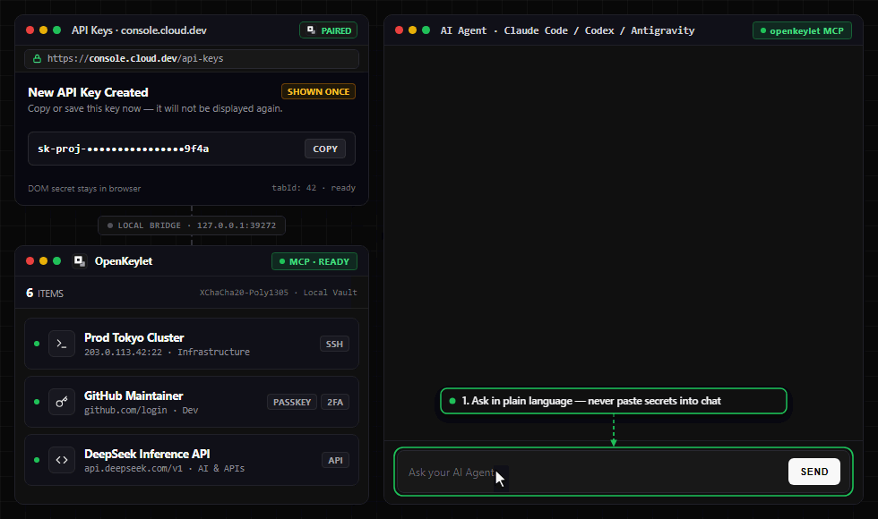
</p>

<details open>
  <summary><strong>El Değmeden Gizli Bilgi Kaydetme İstemleri (Doğal Olarak Söyleyin — Ajan Düz Metni Asla Görmez)</strong></summary>

| Senaryo | Ajan Sohbetinde Söylenecek İfade | Yerel OpenKeylet Araçları |
| --- | --- | --- |
| **Web Konsolu Tek Kullanımlık API Anahtarı** | `Save the one-time API key on my open browser tab into OpenKeylet as "Cloud Prod API" — never print or read it.` | `browser_inspect` → `browser_save_key` |
| **Yeni Gönderilen Web Girişi** | `Save the login I just signed in with on this browser tab into OpenKeylet as "Vercel Prod".` | `browser_save_login` |
| **Bir API Tarafından Döndürülen Belirteç** | `Create a scoped deploy token via "Cloudflare DNS" and capture the returned secret straight into OpenKeylet without printing it.` | `http_send(captureSecrets / holdResponse)` → `http_save_secret` |
| **Yerel Olarak Parola / Belirteç Üret** | `Generate a 32-character secret inside OpenKeylet for "Staging Postgres" and write .env.local without displaying the password.` | `secret_generate` → `secret_write_file` |
| **Ed25519 SSH Anahtar Çifti Üret** | `Generate a fresh Ed25519 SSH keypair in OpenKeylet for "Staging GPU Node" and give me only the public key to paste into GitHub.` | `ssh_keygen` *(yalnızca ortak anahtarı ve parmak izini döndürür)* |
| **Yerel `.env` / PEM Dosyasını Al** | `Ingest ./.env.production into OpenKeylet and generate a sealed .env.template — do not read the plaintext file.` | `secret_ingest_file` |
| **Elle Yapıştırma İçin Taslak Hazırla** | `Prepare an OpenKeylet item draft for "Stripe Billing" with URL https://api.stripe.com/v1 so I can paste the key myself in the GUI.` | `draft_prepare` |

</details>

---

### 4 · Çevrimdışı İçe Aktarma Merkezi ve Kasa Geçişi ile Kimlik Bilgilerini 10 Saniyede Kaydedin

<table>
  <tr>
    <td width="44%" align="center">
      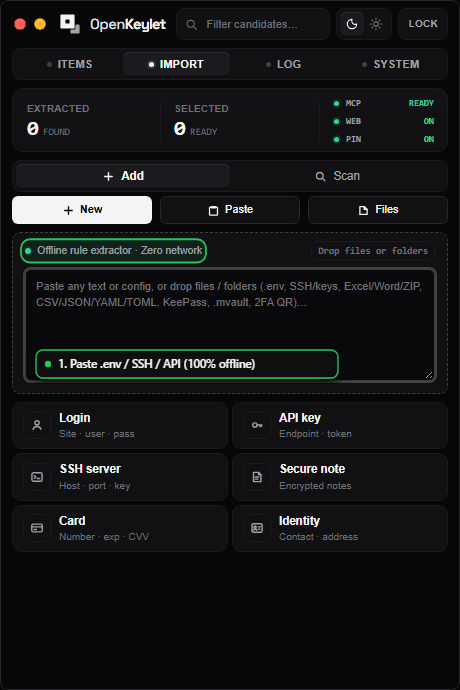
    </td>
    <td width="56%" valign="middle">
      <p>Gizli bilgileri kaydetmenin 4 hızlı yolunu sunan <strong>%100 çevrimdışı, ağsız bir kural çıkarıcı</strong> için <strong>IMPORT</strong> sekmesine geçin:</p>
      <ol>
        <li><strong>Her Şeyi Yapıştırın veya Bırakın</strong>: <code>.env</code> dosyalarını, cURL komutlarını, SSH yapılandırmalarını/anahtarlarını, veritabanı URI'lerini, 2FA QR görsellerini veya karışık metni yapıştırın ya da sürükleyip bırakın. OpenKeylet her şeyi aşamalı önizleme kartlarına (<code>NEW</code> / <code>UPDATE</code>) ayrıştırır; inceleyin, atomik olarak işlemek için <strong>Import</strong> düğmesine tıklayın ve isteğe bağlı olarak mühürlü bir <code>{{openkeylet:...}}</code> <code>.env</code> şablonu dışa aktarın.</li>
        <li><strong>PC Tara / Klasör Tara</strong>: <code>~/.ssh</code>, <code>~/.aws</code>, proje <code>.env</code> dosyaları, <code>CLAUDE.md</code>, <code>AGENTS.md</code>, <code>.bashrc</code> ve kabuk geçmişine dağılmış kimlik bilgilerini keşfetmek için <strong>Scan</strong> sekmesine geçin. Kaynak dosyalar asla değiştirilmez ve tamamlama ekranı hâlâ düz metin tutan her dosyayı temizleme adımlarıyla birlikte listeler.</li>
        <li><strong>Modüler Oluşturma ve Kasa Geçişi</strong>: Modüller oluşturmak için <strong>+ New</strong> (<code>⌘/Ctrl + N</code>) düğmesine tıklayın veya tahribatsız birleştirme önizlemesi için <strong>Bitwarden (düz ve parolayla korunan şifreli JSON), 1Password <code>.1pux</code>, KeePass <code>.kdbx</code> / XML, Chrome CSV ya da <code>.mvault</code></strong> bırakın.</li>
        <li><strong>Sıfır Düz Metin Ajan Kendi Kendine Kaydı</strong>: Bir ajan web panosunda yeni bir API anahtarı oluşturduğunda veya bir API'den belirteç aldığında, gizli bilgileri doğrudan kasaya kaydetmek için <code>browser_save_key</code>, <code>browser_save_login</code> veya <code>http_send(captureSecrets)</code> araçlarını çağırmasına izin verin.</li>
      </ol>
    </td>
  </tr>
</table>

#### Bitwarden, 1Password ve KeePass'ten Doğrudan Geçiş

<table>
  <tr>
    <td width="44%" align="center">
      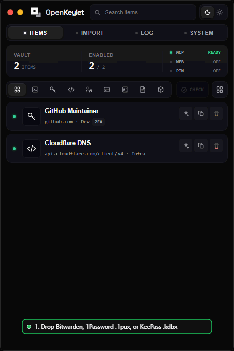
    </td>
    <td width="56%" valign="middle">
      <p>Kasanızı düz metin elektronik tablolara dönüştürmenize gerek yok — yerel olarak şifresini çözmek, tek tek öğeleri işaretlemek ve mevcut kayıtların üzerine yazmadan güvenle birleştirmek için <strong>herhangi bir OpenKeylet ekranına bir parola yöneticisi dışa aktarımı sürükleyin</strong> (veya <strong>SYSTEM → SAFE / 06 → Import vault</strong> altından seçin):</p>
      <ul>
        <li><strong>Bitwarden (Parolayla Korunan Şifreli JSON ve Düz JSON)</strong>: Oturum açma bilgilerini, URI eşleştirme kurallarını, <strong>Passkey'leri</strong>, TOTP'yi, SSH anahtarlarını, kartları, kimlikleri, klasörleri ve parola geçmişini koruyarak <code>PBKDF2-SHA256</code> veya <code>Argon2id</code> + <code>AES-256-CBC</code> / <code>HMAC-SHA256</code> üzerinden yerel olarak şifreyi çözer. (Hesap kısıtlamalı dışa aktarımlar yalnızca Bitwarden içinde çözülebilir; <em>Encrypted JSON · Password protected</em> veya düz JSON seçin.)</li>
        <li><strong>1Password (<code>.1pux</code>)</strong>: 1Password masaüstü <code>.1pux</code> arşivlerini doğrudan okur — arşivlenmiş/çöpe atılmış öğeleri atlarken oturum açma bilgilerini, TOTP'yi, SSH anahtarlarını, API kimlik bilgilerini, kartları, kimlikleri, notları ve kasa klasörlerini eşler.</li>
        <li><strong>KeePass / KeePassXC (<code>.kdbx</code> ve XML)</strong>: KDBX 3.1 / 4.x veritabanlarının kilidini ana parolanızla açar; Geri Dönüşüm Kutusu'nu atlarken iç içe grup yollarını, <code>otp</code> ve <code>TimeOtp-Secret-Base32</code> 2FA'yı, SSH anahtarlarını, özel alanları ve geçmişi korur.</li>
      </ul>
    </td>
  </tr>
</table>

---

### 5 · Tarayıcı Uzantısını Yükleme ve Canlı Tarayıcı Kullanımı

#### Adım 1: OpenKeylet'i 3 Adımda Chrome / Edge / Brave'e Yükleyin

**SYSTEM → WEB / 04 (Browser Bridge)** bölümünü açın: (1) **Open Chrome & copy address** düğmesine tıklayın, `chrome://extensions/` adresini yapıştırın ve **Geliştirici modu (Developer mode)** seçeneğini açın; (2) **Adım 3'teki OpenKeylet rozetini basılı tutun ve `chrome://extensions/` sayfasının boş bir alanına sürükleyin** (veya **Paketlenmemiş öğe yükle** düğmesine tıklayıp uzantı klasörünü seçin). Yerel eşleştirme otomatik olarak tamamlanır:

<p align="center">
  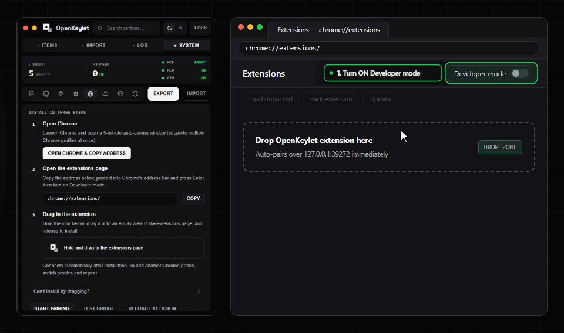
</p>

#### Adım 2: Canlı Tarayıcı Kullanımı (Sıfır Düz Metin Otomatik Doldurma + 2FA + Passkey + Ajan Kanalı)

Eşleştirildikten sonra, herhangi bir sitede oturum açma bilgilerini, kartları, adresleri doldurmak veya canlı 2FA kodlarını elle kopyalamak için araç çubuğu uzantısına tıklayın (asla arkanızdan otomatik gönderim yapmaz) — ya da yapay zeka ajanınızın düz metni LLM bağlamından tamamen uzak tutarak gerçek tarayıcı sekmenizde oturum açma bilgilerini, 2FA'yı ve Passkey'leri canlı olarak doldurmasına izin verin:

<p align="center">
  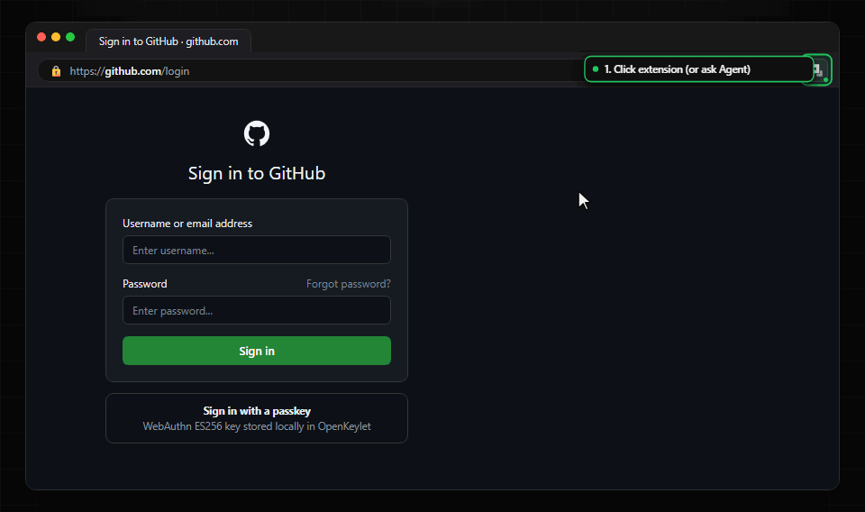
</p>

---

## Diğer Arayüzler

Anında Koyu/Açık geçişi, modül başına Ajan görünürlük denetimleri ve çift depolu şifreli eşitlemeyi destekleyen, katı bir 4px/8px donanım ızgarası üzerinde **Saf Monokrom Karbon ve Porselen (Pure Monochrome Carbon & Porcelain)** olarak tasarlanmıştır:

<table>
  <tr>
    <td width="50%" align="center">
      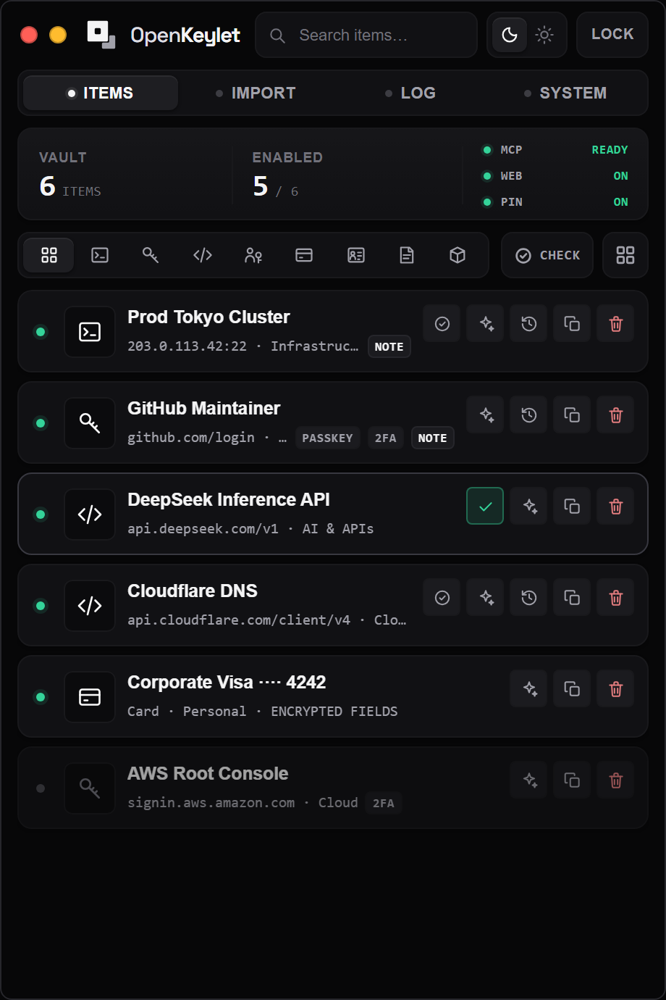<br />
      <sub><strong>Carbon Dark</strong> · 4 sekmeli düzen, tek tıkla toplu <code>CHECK</code> ve <code>PASSKEY / 2FA / NOTE</code> rozetleri</sub>
    </td>
    <td width="50%" align="center">
      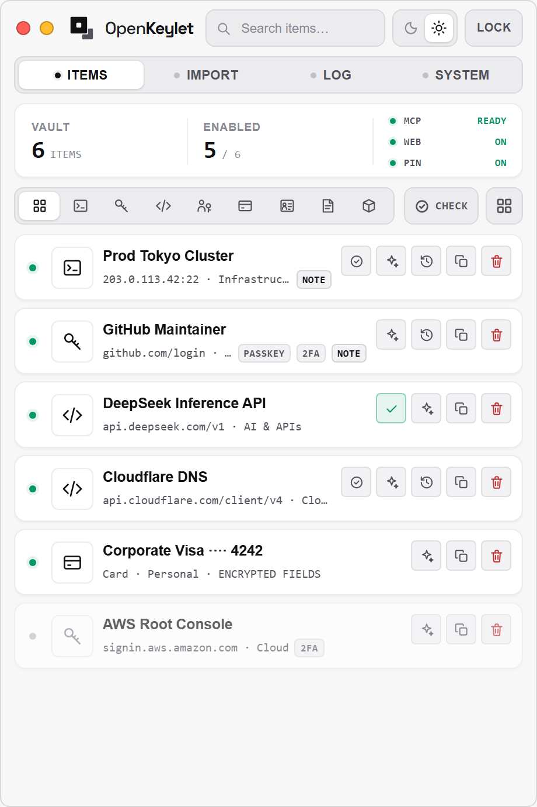<br />
      <sub><strong>Porcelain Light</strong> · Net gün ışığı seramik paleti; soldaki yeşil nokta anında Ajan kesme anahtarı (kill-switch) olarak çalışır</sub>
    </td>
  </tr>
  <tr>
    <td width="50%" align="center">
      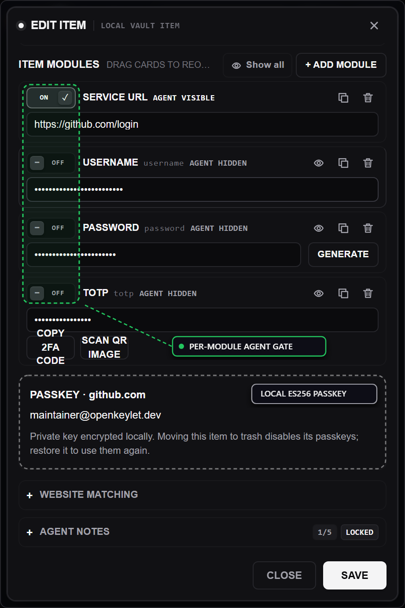<br />
      <sub><strong>Modül Başına Kontrol</strong> · Bağımsız <code>AGENT HIDDEN / VISIBLE</code> kapısı, üretici, 2FA / QR tarama ve yerel ES256 Passkey'ler</sub>
    </td>
    <td width="50%" align="center">
      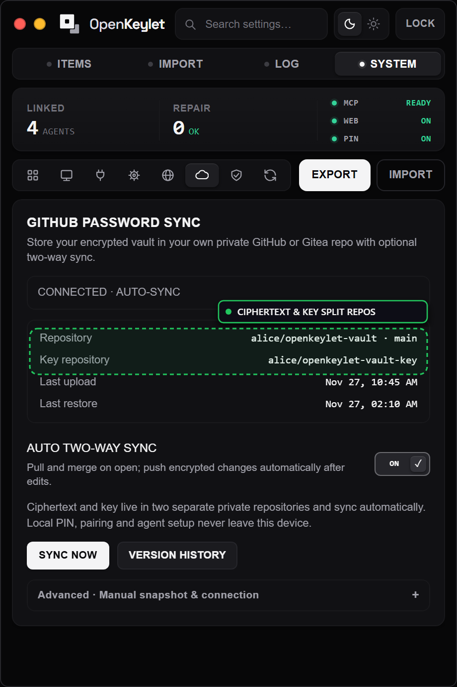<br />
      <sub><strong>Çift Depolu Bulut Eşitleme (CLOUD / 05)</strong> · Sürüm Geçmişi ile şifreli metni (<code>owner/vault</code>) ve 256-bit anahtarı (<code>owner/vault-key</code>) ayırır</sub>
    </td>
  </tr>
</table>

---

## Mimari ve Tüm Yetenekler

<p align="center">
  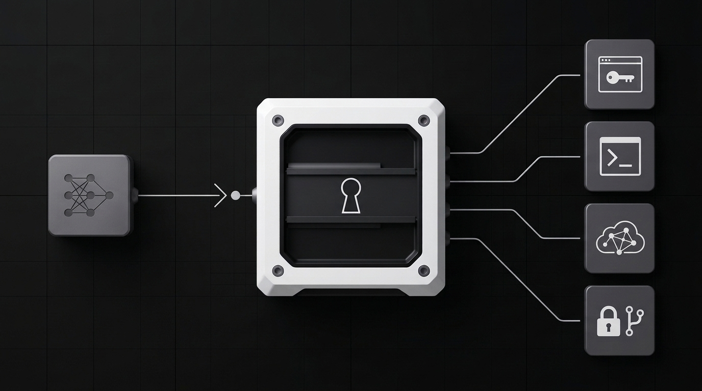
</p>

<table>
  <tr>
    <td width="25%"><strong>01 · Şifreli Çekirdek</strong><br /><br />Parolalar, API anahtarları, SSH anahtarları, Passkey özel anahtarları, TOTP tohumları ve ödeme kartları yerel olarak <code>XChaCha20-Poly1305</code> ile şifrelenir. OpenKeylet hesabı veya barındırılan sunucu yoktur.</td>
    <td width="25%"><strong>02 · Yalnızca Tutamaç Keşfi</strong><br /><br />Ajanlar isteğe bağlı yerel <code>stdio</code> MCP üzerinden yalnızca öğe adlarını, alan etiketlerini, gizli olmayan hedefleri ve <code>{{openkeylet:...}}</code> tutamaçlarını görür — gizli düz metni asla görmez.</td>
    <td width="25%"><strong>03 · Yerel Yürütme ve Sansürleme</strong><br /><br />OpenKeylet HTTP, SSH/SFTP, PTY, web/masaüstü doldurma ve Passkey imzalamayı yerel olarak yürütürken yansıyan gizli bilgileri, <code>Set-Cookie</code> üstbilgilerini ve URL belirteçlerini <code>[REDACTED]</code> olarak temizler.</td>
    <td width="25%"><strong>04 · Sıfır Düz Metin Kendi Kendine Kayıt</strong><br /><br />Web sayfalarında yeni oluşturulan API anahtarları, gönderilen oturum açma bilgileri, API tarafından verilen belirteçler, üretilen parolalar ve Ed25519 SSH anahtarları LLM bağlamına dokunmadan doğrudan kasaya kaydedilir.</td>
  </tr>
</table>

### Altı Temel Yetenek Alanı

| Alan | Çözülen Sorun | Temel Yetenekler |
| --- | --- | --- |
| **1. Sıfır Düz Metin Ajan Yürütmesi** | Ajanların sohbete anahtar yapıştırmadan SSH, API ve dağıtımları çalıştırmasını sağlama | `http_send` (otomatik sağlayıcı kimlik doğrulaması, kaynak kapsamlı servis URL'si / web sitesi kuralları, çapraz kaynak yönlendirme kimlik doğrulama temizliği, `Set-Cookie` sansürleme), `ssh_run` / `ssh_upload` / `ssh_download` (TOFU ana bilgisayar anahtarı sabitleme), `terminal_run` / parça sınırları arası sansürlemeli etkileşimli PTY, `secret_write_file` (atomik `0600` / Win32 NTFS ACL + yok sayılmamış/izlenen Git `.env` uyarıları). |
| **2. Sıfır Düz Metin Ajan Kendi Kendine Kaydı** | Yeni oluşturulan anahtarları, oturum açma bilgilerini veya üretilen kimlik bilgilerini sohbete sızdırmadan kaydetme | `browser_save_key` (eşleştirilmiş sayfalardan yeni görüntülenen tek kullanımlık API anahtarlarını doğrudan yakalar), `browser_save_login`, `http_send(captureSecrets / holdResponse)` + `http_save_secret` (tek kullanımlık belirteç yanıtları için şifreli yerel makbuz), `secret_generate`, `ssh_keygen` (yalnızca ortak anahtarı ve parmak izini döndürür), `secret_ingest_file` ve `draft_prepare`. |
| **3. Eşleştirilmiş Tarayıcı ve Passkey'ler** | Kimlik doğrulamalı panoları, 2FA adımlarını, ödeme formlarını ve Passkey ile oturum açmayı otomatikleştirme | Eşleştirilmiş uzantı üzerinden gerçek Chrome / Edge / Brave oturumunuzu yeniden kullanır: `browser_open`, `browser_inspect` (maskelenmiş URL'ler, formlar, `keyCandidates`, güvenli alt iframe'ler), `browser_fill_login` (yalnızca OTP doğrulama adımlarında otomatik doldurur), `browser_fill_personal` (Stripe Elements dahil), `browser_click` ve `browser_passkey` (Ajan otomatik imzalama varsayılan olarak KAPALI). |
| **4. Evrensel İçe Aktarma ve Kasa Geçişi** | Dağınık `.env`, SSH anahtarları, cURL parçacıkları ve Bitwarden / 1Password / KeePass kasalarını birleştirme | Özel **IMPORT** sekmesi %100 çevrimdışı bir kural çıkarıcı + **PC Tara / Klasör Tara** çalıştırır; seçici birleştirme için **Bitwarden şifreli/düz JSON, 1Password `.1pux`, KeePass `.kdbx` / XML** ve Chrome CSV dosyalarının kilidini doğrudan yerel olarak açarken diskte kalan düz metin dosyalarını işaretler. |
| **5. Yerel Kabuk ve Protokol Köprüleri** | Kasa gizli bilgilerini Claude Code / Codex / Antigravity yerel kabukları içinde sorunsuz kullanma | `openkeylet run --env-file` (sıfır düz metin env enjeksiyonu + canlı stdout/stderr sansürleme), `openkeylet ssh-agent` (Unix soketi / Windows Named Pipe üzerinden salt okunur yerel OpenSSH Agent), `openkeylet git-credential` (Git HTTPS kimlik bilgisi yardımcısı) ve başsız Linux sunucuları için SSH tünelli `admin serve`. |
| **6. Çift Depolu Eşitleme, `.mvault` ve Otomatik Güncelleme** | Satıcı bulutu olmadan macOS, Windows, Linux masaüstleri ve başsız VPS arasında eşitleme | Sürüm Geçmişi geri almalı, şifreli metni (`owner/repo`) ve 256-bit anahtarı (`owner/repo-key`) ayıran isteğe bağlı özel GitHub / kendi barındırılan Gitea ve Forgejo iki yönlü eşitleme; Argon2id (64 MiB) `.mvault` çevrimdışı yedeklemeleri (v3–v8 uyumlu); Ed25519 imzalı GitHub Releases otomatik güncelleyici. |

---

## Anahtar Ayrımı ve Dürüst Güvenlik Sınırları

<p align="center">
  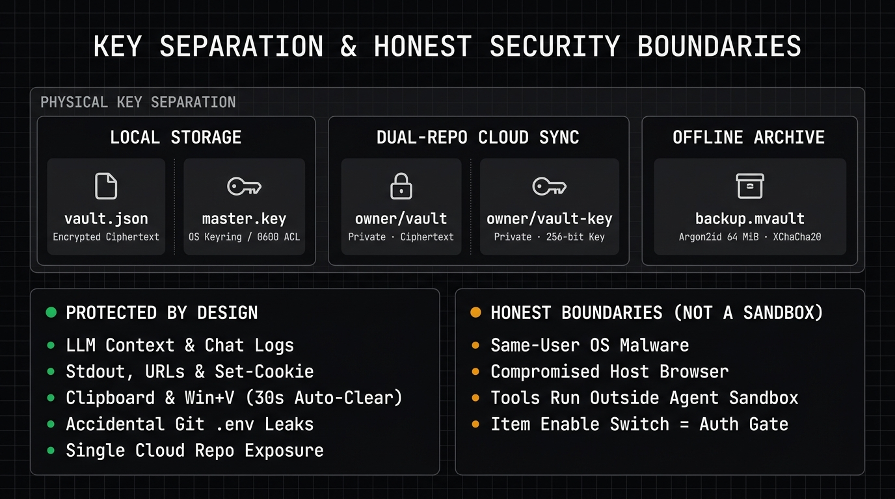
</p>

> [!IMPORTANT]
> **Güvenlik Tiyatrosu Yerine Radikal Şeffaflık.**
> Yapay zeka ajanlarının her dakika bir ana parolaya takılmadan arka planda SSH, API ve tarayıcı kimlik bilgilerini sorunsuzca yürütebilmesi gerektiğinden, OpenKeylet günlük sızıntı önlemeyi işletim sistemi düzeyinde korumalı alandan (sandboxing) ayırır — ve neye karşı savunma yaptığını ve neye karşı yapmadığını açıkça belirtir.

### OpenKeylet Neleri Korur vs. Dürüst Sınırlar

| Sınır | Durum | Gerçekte Nasıl Çalışır |
| --- | :---: | --- |
| **LLM Bağlamı, İstemler ve Sohbet Günlükleri** | **Korunur** | Varsayılan olarak gizli modüller `items_search` veya etkinlik günlüklerinde asla döndürülmez. Terminal, SSH, HTTP ve tarayıcı çıktıları; kullanılan öğelerin gizli bilgilerini, MCP oturumunda işlenen veya doldurulan her değeri, 8+ karakterlik diğer gizli kasa değerlerini, canlı TOTP kodlarını ve `Set-Cookie` / gömülü URL belirteçlerini — bir çağrı öğe adı vermese bile — sansürler. |
| **Ajanların Gizli Düz Metni Okuması** | **Yalnızca Kazara İfşa** | `get_secret` aracı yoktur ve gizli modüller `items_search` içinde asla görünmez; bu da normal iş akışlarında gizli bilgilerin bağlam dışında kalmasını sağlar. Bu, kötü niyetli veya istem enjeksiyonuna (prompt injection) uğramış bir ajana karşı bir savunma **değildir**: etkinleştirilmiş bir öğenin gizli bilgisi `terminal_run` / `ssh_run` içine yerleştirilebilir veya `secret_write_file` ile ajanın kendi araçlarıyla okuyabileceği bir dosyaya yazılabilir ve çıktı sansürleme ham değerleri artı yaygın kodlamaları (JSON kaçışları, base64 / base64url, hex, yüzde kodlaması, kabuk alıntılama, çok satırlı gizli bilgilerin tek tek satırları) kapsar. **Öğenin Etkinleştir (Enable) anahtarı gerçek yetkilendirme kapısıdır.** |
| **Kilidi Açık PC'nizi Kullanan Diğer Kişiler** | **Korunur (PIN ile)** | İsteğe bağlı 6 haneli PIN masaüstü GUI'sini kilitler, kilit ekranının arkasındaki öğeleri/günlükleri temizler, yönetim IPC komutlarını engeller, artan yanlış PIN bekleme süresi uygular ve isteğe bağlı boşta otomatik kilitlemeyi (5 / 15 / 30 / 60 dk) destekler. |
| **Pano Geçmişi Sızıntısı** | **Korunur** | Parolaları, gizli bilgileri, 2FA kodlarını, üretilen parolaları veya kurtarma anahtarlarını kopyalamak, bunları Windows `Win+V` ve Bulut Panosunu atlayacak şekilde işaretler ve **30 saniye sonra** (yalnızca değişmediyse) veya kilit/çıkış anında **otomatik temizler**. |
| **Çevrimdışı Yedekleme Hırsızlığı** | **Korunur** | Masaüstü `.mvault` dışa aktarımları **Argon2id (64 MiB) + XChaCha20-Poly1305** ile ≥12 karakterlik bir parola zorunlu kılar. |
| **Tek Bulut Deposu İfşası** | **Çift Depolu Ayrım** | Bulut anlık görüntüleri, aynı hesap altında ikinci bir özel depoda (`<repo>-key`) saklanan rastgele 256-bit `okv1_` anahtarı kullanır. Her iki depo da `private: true` kontrolünden geçmelidir ve hiçbiri tek başına kasanın şifresini çözemez; hesabı kontrol eden veya her iki depoyu da kapsayan bir belirtece sahip olan herkes okuyabilir. |
| **Durağan Haldeki Yerel Kasa Dosyaları** | **Ayrılmış, İşletim Sistemine Dayanır** | Varsayılan olarak kasa anahtarı veri dizininin dışında yaşar — Windows Credential Manager / Linux Secret Service içinde veya kullanıcıya özel ayrılmış bir `master.key` dizininde (`~/Library/Application Support/OpenKeylet`, `~/.config/openkeylet`, `%LOCALAPPDATA%\OpenKeylet`, Unix `0600` / Win32 yalnızca sahip NTFS DACL `D:P` ile kısıtlı) — böylece veri dizinini tek başına kopyalamak veya eşitlemek anahtarı dışarıda bırakır. Açık `OPENKEYLET_DATA_DIR`, `OPENKEYLET_KEY_FILE` ayarlanmadıkça kendi içinde kalır. Durağan haldeki gizlilik işletim sistemi hesabınıza ve tam disk şifrelemesine dayanır; öğe adları, ana bilgisayarlar, URL'ler, klasörler ve etkinlik günlükleri şifresizdir. |
| **Aynı Kullanıcıdaki OS Zararlı Yazılımı / Ele Geçirilmiş Tarayıcı** | **Korumalı Alan Değildir** | OpenKeylet aynı işletim sistemi kullanıcısı olarak çalışan zararlı yazılımlara, ele geçirilmiş bir tarayıcıya veya etkinleştirilmiş bir SSH/API öğesi üzerinden yıkıcı komutlar çalıştıran kötü niyetli bir ajana karşı savunma **yapmaz**. İşletim sistemi oturum kilidi ve tam disk şifrelemesi (FileVault / BitLocker / LUKS) ile birlikte kullanın. |
| **GUI Kilitliyken Arka Plan MCP** | **Tasarım Gereği: Aktif** | Masaüstü 6 haneli PIN'i, **etkinleştirilmiş** öğeler üzerindeki arka plan `stdio` MCP görevlerini kesintiye uğratmadan *insanların* ekranda kasayı görüntülemesini/düzenlemesini engeller. Ajan erişimini hemen engellemek için bir öğeyi devre dışı bırakın. |

> [!WARNING]
> **OpenKeylet araçları ajanınızın korumalı alanının (sandbox) dışında çalışır.** `terminal_*`, `ssh_*`, `http_send` ve `secret_write_file` ajan istemcinizin kabuk korumalı alanı yerine OpenKeylet MCP sunucusu işleminde işletim sistemi kullanıcınızın izinleriyle yürütülür (`terminal_run` hiçbir öğe belirtilmediğinde bile çalışır). `openkeylet` sunucusuna toptan izin vermek yerine ajan istemcinizde araç başına onayı etkin tutun.

### Modül Başına Görünürlük Matrisi

| Modül Durumu | Kilidi Açık Sahip GUI | Yapay Zeka Ajanına Döndürülür (MCP) | OpenKeylet Tarafından Yerel Kullanılabilir |
| --- | :---: | :---: | :---: |
| **Gizli (Hidden)** *(gizli bilgiler için varsayılan)* | Maskeli (Göz / Kopyala'ya tıklayın) | Asla | Evet (`ssh`, `http`, `fill`, `browser`, `secret_write_file`) |
| **Görünür (Visible)** *(açık geçiş)* | Evet | Evet | Evet |
| **TOTP Tohumu (Seed)** | Maskeli + **2FA Kodunu Kopyala** | Tohum asla döndürülmez; canlı 6 haneli kod yerel olarak enjekte edilir/sansürlenir | Evet |
| **Passkey Özel Anahtarı** | Yalnızca meta veri (RP ID + kullanıcı) | Özel anahtar masaüstü kasasından asla ayrılmaz | Evet. Tarayıcı istemleri uzantı onayından geçer; `browser_passkey` açıkça **Agent Passkey signing** seçeneğinin etkinleştirilmesini gerektirir (varsayılan KAPALI) ve açık bir elle onay penceresini devralamaz |
| **Devre Dışı / Çöpe Atılmış Öğe** | Sahip tarafından görüntülenebilir / geri yüklenebilir | Engellendi | Engellendi (otomatik doldurma yok, Passkey imzalama yok, MCP yürütme yok) |

> Tam [Güvenlik Politikası ve Tehdit Sınırı](SECURITY.md) belgesini okuyun. Önerilen alışkanlıklar: (1) paylaşılan makinelerde 6 haneli PIN + boşta otomatik kilitlemeyi etkinleştirin; (2) her öğenin yeşil Enable noktasını Ajan kesme anahtarınız (kill-switch) olarak görün; (3) `http_send` kapsamını daraltmak için API öğelerinde servis URL'sini kaydedin; (4) bulut eşitleme için kullanılan tüm GitHub hesaplarında 2FA'yı açın.

---

## Çevrimdışı `.mvault` Yedeklemeleri, Çift Depolu Eşitleme ve Kısayollar

* **Çevrimdışı `.mvault` Arşivleri (SYSTEM → SAFE / 06)**:
  * **`.mvault` Dışa Aktarma**: Öğeleri, Passkey'leri, son 20 parola sürümünü ve Çöp Kutusu'nu paketleyen ≥12 karakterlik bir parola (Argon2id 64 MiB + XChaCha20-Poly1305) gerektirir.
  * **`.mvault` Geri Yükleme**: Parolayla korunan paketleri ve eski v3–v7 / CLI `--self-unlocking` dosyalarını otomatik algılar ve işlemeden önce **tahribatsız bir birleştirme önizlemesi** sunar.
  * **Anahtar Konumu Göstergesi**: **`VAULT KEY`** şeridi, ana anahtarınızın işletim sistemi anahtarlığında mı yoksa veri dizini dışındaki harici bir `master.key` yolunda mı yaşadığını gösterir.
* **Çift Depolu Şifreli Bulut Eşitleme (SYSTEM → CLOUD / 05, İsteğe Bağlı)**:
  * **GitHub** (`gh auth login` veya ince ayarlı PAT) ve **Kendi Barındırılan Gitea / Forgejo** (canlı `/api/v1/user` doğrulamasıyla) destekler.
  * Özel `owner/repo` deponuzun yanında otomatik olarak `owner/repo-key` oluşturur (her okuma/yazmada `private: true` zorunludur), çakışma birleştirme ve silme mezar taşlarıyla (tombstones) gecikmeli **Otomatik iki yönlü eşitleme** destekler ve **Sürüm geçmişi** anlık görüntü geri almayı içerir.
  * Yerel PIN, tarayıcı eşleştirme belirteçleri, ajan yapılandırmaları, etkinlik günlükleri (`activity.jsonl`), SSH ana bilgisayar anahtarı sabitlemeleri ve taslaklar cihazınızdan **asla** ayrılmaz.

| Kısayol | Eylem |
| --- | --- |
| `⌘/Ctrl + K` veya `⌘/Ctrl + F` | Arama çubuğuna odaklan |
| `⌘/Ctrl + N` | Yeni kasa öğesi ekle |
| `⌘/Ctrl + 1 / 2 / 3 / 4` | **Items / Import / Log / System** arasında geçiş yap |
| `⌘/Ctrl + ,` | **System** ayarlarını aç |
| `⌘/Ctrl + S` | Açık öğe düzenleyicisini kaydet |
| `⌘/Ctrl + Shift + L` | OpenKeylet'i hemen kilitle (PIN etkinleştirildiğinde) |
| `Esc` | Etkin pencereyi kapat / sürüklemeyi iptal et / aramayı kapat |

---

## Tam MCP Yüzeyi (26 Araç) ve Yerel CLI Köprüsü

OpenKeylet yerel `stdio` MCP (`openkeylet mcp stdio`) üzerinden isteğe bağlı olarak çalışır ve `structuredContent` çıktılarına sahip **26 tipli araç** sunar:

| Kategori | Araç | Amaç |
| --- | --- | --- |
| **Keşif ve Bellek** | `items_search(query?)` | Etkinleştirilmiş öğeleri (Login, SSH, API, Card, Identity, Secure Note), modül adlarını, kayıtlı `agentNotes` notlarını ve kullanılabilir eylemleri arayın |
| | `item_note` | Gelecek oturumların doğru öğeyi hızlıca seçmesi için kısa, gizli olmayan bağlam notları (≤200 karakter, gizli bilgi korumalı) ekleyin, güncelleyin veya kaldırın |
| **Tarayıcı ve Passkey** | `browser_open` | Yeni bir sekmede HTTP/HTTPS URL'si açın veya mevcut bir sekmeyi yönlendirip yüklemenin tamamlanmasını bekleyin |
| | `browser_inspect` | Etkin sekmeyi ve güvenli alt iframe'leri inceleyin: maskelenmiş URL'ler, formlar, alanlar, düğmeler, temizlenmiş uyarılar/özet, `browser_save_key` için `keyCandidates` tutamaçları, bekleyen Passkey'ler ve eşleşen kasa öğeleri |
| | `browser_fill_login` | Kayıtlı oturum açma kimlik bilgilerini eşleştirip canlı bir sayfaya veya eşleşen SSO iframe'ine doldurun (ve yalnızca OTP doğrulama adımlarında TOTP'yi otomatik doldurun) |
| | `browser_save_key` | Model bağlamında düz metni ifşa etmeden, eşleştirilmiş sayfadan yeni görüntülenen tek kullanımlık bir API anahtarını doğrudan kasaya yakalayın |
| | `browser_save_login` | Eşleştirilmiş tarayıcı uzantısı tarafından yakalanan gönderilmiş bir oturum açma bilgisini düz metni ifşa etmeden doğrudan kasaya kaydedin |
| | `browser_fill_personal` | Bölünmüş çapraz kaynak ödeme iframe'leri (ör. Stripe Elements) dahil olmak üzere HTTPS/localhost sayfalarına kayıtlı kartları veya kimlik ayrıntılarını doldurun |
| | `browser_click` | Sayfadaki veya güvenli iframe'deki görünür bir düğmeye, bağlantıya, onay kutusuna, radyo düğmesine veya etikete tıklayın |
| | `browser_passkey` | Yerel kasayı kullanarak WebAuthn Passkey oturum açma veya kaydetme işlemini tamamlayın (uygun olduğunda eşleşen bir oturum açma öğesine bağlanır); açıkça **Agent Passkey signing** seçeneğinin etkinleştirilmesini gerektirir (varsayılan KAPALI) |
| **Doğrudan Doldurma** | `credential_fill` | Bir gizli modülü tarayıcı denetimine, açık masaüstü ön plan denetimine veya yönetilen terminale doldurun |
| **SSH ve SFTP** | `ssh_run` | Önce özel anahtar + parola geri dönüşümlü kimlik doğrulama, stdin, çıktı sınırı ve öğeler arası yer tutucularla SSH komutlarını çalıştırın; sunucu ana bilgisayar anahtarlarını sabitler (TOFU) ve değişen anahtarları reddeder |
| | `ssh_upload` | SFTP üzerinden yerel dosya/dizinleri özyinelemeli olarak yükleyin |
| | `ssh_download` | SFTP üzerinden uzak dosya/dizinleri özyinelemeli olarak indirin |
| **HTTP API'leri** | `http_send` | Kimlik doğrulamalı HTTP/HTTPS istekleri gönderin (otomatik sağlayıcı kimlik doğrulaması, Bearer/Basic, özel üstbilgiler, akış, multipart, çapraz kaynak yönlendirme kimlik doğrulama temizliği, `Set-Cookie` sansürleme, `captureSecrets` ve isteğe bağlı `holdResponse=true` makbuz modu); bir servis URL'si veya web sitesi kuralı kaydedildiğinde kaynak kapsamlıdır |
| | `http_save_secret` | Tek seferlik bir verme isteğini tekrarlamadan şifreli yerel bir `http_send` makbuzundan (`holdResponse=true` veya `captureSecrets` geri dönüşü) alanları kaydedin |
| **Dosyalar ve Başlangıç** | `secret_write_file` | Unix `0600` / Windows yalnızca sahip NTFS ACL ve Git yok sayılmamış/izlenen uyarılarıyla yerel bir dosya şablonunu (`{{openkeylet:module}}` / `{{openkeylet:Item/module}}`) atomik olarak işleyin |
| | `secret_generate` | Düz metni ifşa etmeden yerel olarak bir öğeye güçlü parola/hex/base64url gizli bilgisi kriptografik olarak üretin ve saklayın |
| | `ssh_keygen` | Yerel olarak bir Ed25519 SSH anahtar çifti üretin, özel anahtarı şifreli saklayın ve yalnızca ortak anahtarı ve parmak izini döndürün |
| | `secret_ingest_file` | Düz metni ifşa etmeden yerel bir `.env` veya PEM özel anahtarını doğrudan kasaya aktarın (ve isteğe bağlı olarak mühürlü bir şablon yazın) |
| | `draft_prepare` | Sahibinin yalnızca masaüstü GUI'sinde gizli bilgileri yerel olarak yapıştırması için genel meta verilerle şifreli bir öğe taslağı (en fazla 10 sıradaki taslak) hazırlayın |
| **Terminal** | `terminal_run` | Öğeler arası yer tutucu ve `secretEnv` ikamesi, çıktı kesme sınırı ve çok öğeli sansürleme ile tek seferlik yerel komut |
| | `terminal_start` / `terminal_write` / `terminal_read` / `terminal_stop` | Sınırlı arabellekler ve sürekli sınırlar arası gizli bilgi sansürlemesi ile yönetilen etkileşimli PTY oturumları |

### Yerel CLI ve Protokol Katmanı (Claude Code, Codex ve Antigravity Yerel Kabukları İçin)

```bash
# Connect / sync AI agent MCP configs & managed rules from CLI (desktop or headless)
openkeylet setup --json
openkeylet agent list
openkeylet agent connect --detected
openkeylet update install --json

# Inject secrets into any native command with real-time boundary-safe stdout/stderr redaction
openkeylet run --item "OpenAI" --env-file .env.template --env DB_PASS="Prod DB/password" -- npm run dev

# Import a plaintext .env and emit a sealed template without altering the original file
openkeylet import-env .env --seal .env.template

# Local read-only OpenSSH Agent (Unix socket on macOS/Linux, Named Pipe on Windows)
# Exposes only enabled SSH items and revokes signing immediately when disabled
openkeylet ssh-agent
eval "$(openkeylet ssh-agent --print-env)"   # PowerShell: $env:SSH_AUTH_SOCK = '\\.\pipe\openkeylet-ssh-agent'

# Git HTTPS credential helper (uses enabled tokens/passwords; store/erase are safe no-ops)
git config --global credential.helper '!openkeylet git-credential'
```

<details>
  <summary>Elle <code>stdio</code> MCP Yapılandırması (JSON ve CLI)</summary>

```json
{
  "mcpServers": {
    "openkeylet": {
      "command": "/Applications/OpenKeylet.app/Contents/MacOS/openkeylet",
      "args": ["mcp", "stdio"]
    }
  }
}
```

CLI'dan işletim sisteminiz için istemciye hazır yapılandırmayı yazdırın:

```bash
openkeylet config stdio-json
openkeylet config stdio-toml
```

</details>

---

## İndirmeler, Veri Konumları ve Otomatik Güncellemeler

| Hedef | Format | Notlar |
| --- | --- | --- |
| **macOS arm64** | `.zip` | macOS trafik ışıkları ve başlık çubuğuna sahip yerel Apple Silicon `.app`; masaüstü doldurma için Erişilebilirlik izni gerekir |
| **Windows x64** | `.zip` | Taşınabilir GUI, tepsi, `Win+V` pano hariç tutma, Win32 NTFS ACL'leri, masaüstü doldurma ve tarayıcı uzantısı |
| **Linux x64 GUI** | `.tar.gz` | Masaüstü GUI; X11 masaüstü doldurma ve sistem tepsisi |
| **Linux x64 Headless** | `.tar.gz` | Sıfır WebView/GUI bağımlılığı (`--no-default-features`); tam MCP, SSH, HTTP, terminal, yedekleme, uzak köprü ve `admin serve` |

İkili dosyayı yükseltmek kasanızı otomatik olarak korur:

| Platform | Varsayılan Kasa Dizini | Varsayılan Ayrılmış Anahtar Depolaması |
| --- | --- | --- |
| macOS | `~/Library/Application Support/mcp-vault/v2` | `~/Library/Application Support/OpenKeylet/master.key` |
| Windows | `%APPDATA%\mcp-vault\v2` | Windows Credential Manager / `%LOCALAPPDATA%\OpenKeylet\master.key` |
| Linux | `${XDG_DATA_HOME:-~/.local/share}/mcp-vault/v2` | Linux Secret Service / `~/.config/openkeylet/master.key` |

*(Yalıtılmış/taşınabilir kasalar için `OPENKEYLET_DATA_DIR=/absolute/path` ile veya açık bir harici anahtar dosyası için `OPENKEYLET_KEY_FILE=/absolute/path` ile geçersiz kılın. Başsız Linux VPS, uzak/LAN Tarayıcı Köprüsü ve SSH tünelli yönetici arayüzü için [docs/HEADLESS_AND_REMOTE.md](docs/HEADLESS_AND_REMOTE.md) dosyasına bakın.)*

**Otomatik Güncellemeler (GitHub Releases)**: Resmi imzalı derlemeler doğrudan GitHub Releases üzerinde `releases/latest/download/latest.json` dosyasını kontrol eder, Ed25519 bildirim imzasını ve SHA-256 sağlama toplamını doğrular, isteğe bağlı olarak arka planda sessizce indirir ve MCP yollarını bozmadan yerinde günceller. **SYSTEM → UPDATE / 07** altından yapılandırın veya başsız Linux üzerinde `openkeylet update check` / `openkeylet update install` çalıştırın.

<details>
  <summary>KRU'dan Yükseltme</summary>
  <p>OpenKeylet, <strong>KRU</strong>'nun halefidir ve mevcut yerel kasalar, anahtarlar, <code>.mvault</code> yedeklemeleri, <code>{{kru:module}}</code> yer tutucuları ve <code>KRU_*</code> ortam değişkenleriyle tam uyumluluğu korur. Yükselttikten sonra mevcut <code>kru</code> MCP girişlerini <code>openkeylet</code>'e taşımak için <strong>SYSTEM → Agent Setup → REPAIR</strong> açın, ardından ajanınızı yeniden başlatın.</p>
</details>

---

## Kaynaktan Derleme ve Test

Gereksinimler: **Rust 1.88+**, **Node.js 22+** ve [Tauri 2 önkoşulları](https://v2.tauri.app/start/prerequisites/).

```bash
npm install
npm run check
npm test
npm run build
npm run portable
```

Ek sürüm hedefleri ve doğrulama paketleri:

```bash
npm run release:mac
npm run release:linux
npm run release:headless

# Cross-platform real-binary scenario suite + real Chromium extension, Passkey & stress E2E
cargo test --manifest-path src-tauri/Cargo.toml --no-default-features --test real_world_scenarios
npm run test:browser
node scripts/test-realworld-agent-journey.mjs
node scripts/test-agent-browser.mjs
node scripts/test-realworld-passkey-autofill.mjs
node scripts/test-ux-interactions.mjs
node scripts/test-adversarial-e2e.mjs
```

---

## Topluluk, Geri Bildirim ve Uzun Vadeli Bakım

**OpenKeylet uzun vadeli bakımı yapılan bir projedir.** Yeni yapay zeka ajanı istemcilerine, tarayıcı otomatik doldurma ve Passkey tuhaflıklarına, üçüncü taraf parola kasası formatlarına ve güvenlik sıkılaştırmalarına ayak uydurarak Windows, macOS ve Linux genelinde sürekli geliştiriyoruz.

Ne kadar kısa veya gayri resmi olursa olsun, her türlü geri bildirim OpenKeylet'i şekillendirmeye yardımcı olur:

- **Hata Raporları ve Uç Durumlar**: Bir çökme, site otomatik doldurma tuhaflığı, OS/platform aksaklığı veya beklenmeyen bir davranışla mı karşılaştınız? [Bir Issue açın](https://github.com/omaekumiko2-create/OpenKeylet/issues/new) — kısa bir not veya ekran görüntüsü bile memnuniyetle karşılanır.
- **Özellik İstekleri, UX Önerileri ve Açık Tartışmalar**: Yeni bir iş akışı, arayüz iyileştirmesi, parola yöneticisi içe aktarıcısı veya yapay zeka ajanı entegrasyonu için bir fikriniz mi var — ya da sadece OpenKeylet'i nasıl kullandığınızı mı paylaşmak istiyorsunuz? [Bir Tartışma başlatın veya katılın](https://github.com/omaekumiko2-create/OpenKeylet/discussions).
- **Pull Request'ler ve Katkılar**: Düzeltmeler, belge iyileştirmeleri, yerelleştirmeler ve uyumluluk yamaları her zaman memnuniyetle karşılanır.

---

## Lisans

[MIT](LICENSE) — açık kaynaklı, uzun vadeli bakımı yapılan, denetlenebilir ve tamamen kendi donanımınızda çalışır.
