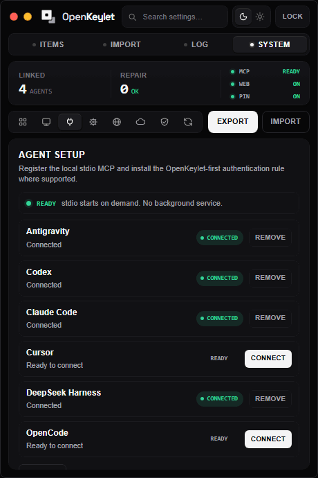
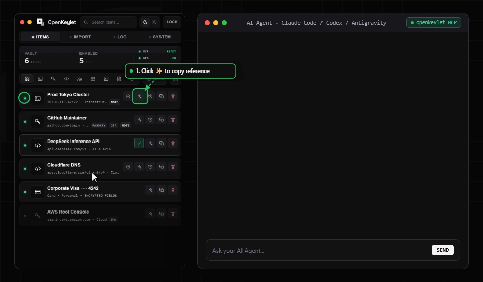

<p align="center">
  
</p>

<h1 align="center">OpenKeylet</h1>

<p align="center">
  <strong>本地优先的加密密码库、Passkey 管理器，以及面向 AI Agent 的零明文 <code>stdio</code> MCP 凭据中继器。</strong>
</p>

<p align="center">
  <a href="https://github.com/omaekumiko2-create/OpenKeylet/releases/latest"></a>
  <a href="LICENSE"></a>
  
  
  
  <a href="#长期维护与社区反馈"></a>
</p>

<p align="center">
  <a href="#安装与更新"><strong>快速安装（推荐 CLI）</strong></a>
  &nbsp;&nbsp;·&nbsp;&nbsp;
  <a href="../../releases/latest"><strong>下载最新版</strong></a>
  &nbsp;&nbsp;·&nbsp;&nbsp;
  <a href="README.md"><strong>English</strong></a>
  &nbsp;&nbsp;·&nbsp;&nbsp;
  <a href="README.tr.md"><strong>Türkçe</strong></a>
  &nbsp;&nbsp;·&nbsp;&nbsp;
  <a href="#3-分钟上手最常用的-5-个核心操作">3 分钟上手</a>
  &nbsp;&nbsp;·&nbsp;&nbsp;
  <a href="#更多界面一览">更多界面</a>
  &nbsp;&nbsp;·&nbsp;&nbsp;
  <a href="#核心架构与全景能力">核心架构</a>
  &nbsp;&nbsp;·&nbsp;&nbsp;
  <a href="#密钥分离与坦诚的安全边界">安全边界</a>
  &nbsp;&nbsp;·&nbsp;&nbsp;
  <a href="#完整-mcp-工具列表26-个与原生-cli-底座">26 个工具</a>
  &nbsp;&nbsp;·&nbsp;&nbsp;
  <a href="#长期维护与社区反馈">反馈与讨论</a>
  &nbsp;&nbsp;·&nbsp;&nbsp;
  <a href="SECURITY.zh-CN.md">安全策略</a>
</p>

---

**OpenKeylet** 把你本机的个人加密密码管理器与现代 AI 编程 / 终端 Agent 无缝打通——原生一键接入 **Antigravity、Claude Code、Codex、Cursor、DeepSeek Harness 与 OpenCode**。

当 Agent 需要登录服务器（SSH / SFTP）、调用认证 API、渲染 `.env` 密钥模板、填写网页账号与支付表单，或者完成 **WebAuthn Passkey** 无密登录时，OpenKeylet 直接在**你的本机代为完成认证动作**——既省去反复复制粘贴的麻烦，又把默认隐藏的明文秘密拦在大模型上下文、中转代理和聊天记录之外。

---

## 安装与更新

### 1 · CLI 一键安装（最推荐）

使用官方 CLI 安装脚本是最快、最稳、最省心的安装方式：自动校验官方 **Ed25519 发布签名**（本机有 Node.js 时）与 **SHA-256 哈希**、安装到固定且兼容内置自更新的用户目录、自动配置 `PATH`，并执行 `openkeylet setup` 一步接好本机已安装的 AI Agent。

**macOS & Linux** *（自动识别桌面 GUI 或无头 Linux 服务器，也可显式加 `--headless` / `--gui`）*：

```bash
curl -fsSL https://raw.githubusercontent.com/omaekumiko2-create/OpenKeylet/main/scripts/install.sh -o /tmp/openkeylet-install.sh \
  && bash /tmp/openkeylet-install.sh \
  && rm -f /tmp/openkeylet-install.sh
```

**Windows（PowerShell）**：

```powershell
$s = Join-Path $env:TEMP "openkeylet-install.ps1"
Invoke-WebRequest "https://raw.githubusercontent.com/omaekumiko2-create/OpenKeylet/main/scripts/install.ps1" -OutFile $s -UseBasicParsing
powershell -NoProfile -ExecutionPolicy Bypass -File $s -Shortcut
Remove-Item $s -Force
```

**CLI 一键原地更新** *（调用内置 Ed25519 签名更新器，自动复用桌面端后台已预下载的更新包、不与 GUI 自动更新冲突，并同步刷新 Agent 受管规则）*：

```bash
openkeylet update install
```

### 2 · 一句话让 AI Agent 帮你安装或更新

直接在 **Claude Code、Antigravity、Codex、Cursor、OpenCode 或 DeepSeek Harness** 对话框里发送下面任意一句话，Agent 会按公开可审计的 [INSTALL.md](INSTALL.md) 流程调用上述 CLI 安装与更新命令：

- **一句话安装：**
  ```text
  请阅读 https://raw.githubusercontent.com/omaekumiko2-create/OpenKeylet/main/INSTALL.md，帮我把 OpenKeylet 安装到本机并连接到当前 Agent。
  ```
- **一句话原地更新：**
  ```text
  请按 https://raw.githubusercontent.com/omaekumiko2-create/OpenKeylet/main/INSTALL.md 用 OpenKeylet 内置签名更新器把本机 OpenKeylet 原地更新到最新版。
  ```

### 3 · 手动下载便携包

如果你更习惯手动解压部署，可以直接前往 [GitHub Releases](../../releases/latest) 下载 Windows、macOS、Linux GUI 或 Linux 无头版便携包。

> [!NOTE]
> **长期维护的开源项目 & 诚实定位**：OpenKeylet 是一个免费开源、**长期持续维护**的社区效率工具（[MIT](LICENSE) 协议，按“现状 / AS-IS”提供，**不承诺任何形式的安全保障**）。我们的核心目标非常纯粹：**让开发者和 AI Agent 的日常凭据协作尽可能丝滑、顺手、少踩坑**，同时把“保护什么、明确不防什么”摊在台面上讲清楚。**非常欢迎各种形式的反馈、Bug 报告、交互/视觉建议、新功能想法与开放讨论**，欢迎随时前往 [Issues](https://github.com/omaekumiko2-create/OpenKeylet/issues) 或 [Discussions](https://github.com/omaekumiko2-create/OpenKeylet/discussions) 交流！

---

## 3 分钟上手：最常用的 5 个核心操作

### 1 · 一键绑定你的 AI Agent（桌面端或 CLI）

<table>
  <tr>
    <td width="44%" align="center">
      
    </td>
    <td width="56%" valign="middle">
      <p>OpenKeylet 通过按需启动的本地 <code>stdio</code> MCP 与 Agent 通信，<strong>无需开放公网端口，无需常驻后台，无需注册账号</strong>：</p>
      <ol>
        <li>打开 <strong>系统（SYSTEM） → MCP / 02（Agent Setup）</strong>（快捷键 <code>⌘/Ctrl + ,</code>）。</li>
        <li>找到你使用的客户端——<strong>Antigravity、Codex、Claude Code、Cursor、DeepSeek Harness 或 OpenCode</strong>，点一下右侧 <strong>CONNECT</strong>（迁移程序路径或从旧版 KRU 升级后点 <strong>REPAIR</strong>）。</li>
        <li>OpenKeylet 会自动写入 <code>openkeylet mcp stdio</code> 配置，并同步安装「涉及认证任务优先使用 OpenKeylet」规则。</li>
        <li>确认顶部亮起绿灯 <strong><code>MCP · READY</code></strong>，<strong>新建或重启 Agent 会话</strong>，发一句话立刻验收：</li>
      </ol>
      <pre><code>帮我查一下你在 OpenKeylet MCP 里能看到哪些已启用的条目。</code></pre>
      <p><sub>Agent 会调用 <code>items_search</code>，仅看到条目名称、公开目标地址和可用动作，看不到任何隐藏明文。其他 MCP 客户端见下方 <a href="#完整-mcp-工具列表26-个与原生-cli-底座">手动配置 / CLI 导出</a>。</sub></p>
    </td>
  </tr>
</table>

---

### 2 · 在 Agent 对话框里怎么让 Agent 使用凭据

<p align="center">
  
</p>

- **方式 A（最快、零出错）**：在 **项目（ITEMS）** 页确认条目左侧绿灯开启 → 点一下右侧 **✨（使用）** 图标，自动复制 `use Prod Tokyo Cluster in OpenKeylet MCP` → 直接粘贴到 Agent 对话框并在后面接上你的任务即可。
- **方式 B（纯自然语言直接说）**：无需背工具名，直接提条目名称或让 Agent 自己去 OpenKeylet 查；多条目组合直接用占位符 `{{openkeylet:项目名/模块名}}`，OpenKeylet 在本地替换并将回显中的秘密自动打码为 `[REDACTED]`。

<details open>
  <summary><strong>高频 Agent 对话指令速查表（直接复制改名字就能用）</strong></summary>

| 实战场景 | 在 Agent 对话框里直接这样说 | OpenKeylet 本地自动调用 |
| --- | --- | --- |
| **SSH 排障与运维** | `用 OpenKeylet 里的「Prod Tokyo Cluster」连上去看看 docker 容器 web-1 为什么一直在重启。` | `items_search` → `ssh_run` |
| **SFTP 上传部署** | `用「Prod Tokyo Cluster」把本地 ./dist 上传到 /var/www/app，然后重载 caddy。` | `ssh_upload` → `ssh_run` |
| **调用认证 API** | `通过 OpenKeylet 里的「Cloudflare DNS」查一下 example.com 当前所有的 A / AAAA 记录。` | `http_send` |
| **零明文抓新 API Key** | `帮我在当前浏览器页面把刚生成的一次性 API Key 直接存进 OpenKeylet，别把明文输出到对话。` | `browser_inspect` → `browser_save_key` |
| **零明文生成 `.env`** | `用「DeepSeek Inference API」通过 secret_write_file 把密钥写入 .env.local，不要打印或回读。` | `secret_write_file` |
| **网页登录 + 2FA** | `用 OpenKeylet 的「GitHub Maintainer」帮我在浏览器当前页面完成登录并自动填 2FA。` | `browser_inspect` → `browser_fill_login` → `browser_click` |
| **WebAuthn Passkey** | `用「GitHub Maintainer」里保存的 Passkey 在浏览器登录 github.com。` | `browser_inspect` → `browser_passkey` |
| **结账填卡与地址** | `用「Corporate Visa ···· 4242」填好当前结账页的卡号和账单地址，别点提交我自己核对。` | `browser_inspect` → `browser_fill_personal` |
| **交互式 CLI / `sudo`** | `开一个本地终端运行发布脚本，遇到提示输入口令时用 OpenKeylet 的「Release Signing Key」填入。` | `terminal_start` → `credential_fill` → `terminal_read` |

</details>

---

### 3 · 纯语言对话让 Agent 零接触存入密钥（明文绝不进对话）

刚在网页后台签发一次性 API Key、刚调接口拿到新 Token、需要生成新密码 / SSH 密钥，或者要把本机 `.env` / 私钥文件入库？**全程无需你复制粘贴，也不用让大模型看到任何明文**——直接在对话框里用自然语言交代一声，OpenKeylet 会在你的本机直接完成采集、生成并加密写入密码库，返回给 Agent 的只有安全句柄：

<p align="center">
  
</p>

<details open>
  <summary><strong>零接触存密对话指令速查（直接这样跟 Agent 说）</strong></summary>

| 常见存密场景 | 在 Agent 对话框里直接这样说 | OpenKeylet 本机零明文调用 |
| --- | --- | --- |
| **抓取网页一次性 API Key** | `把我当前打开的浏览器标签页里刚生成的一次性 API Key 直接存进 OpenKeylet，命名为「Cloud Prod API」，不要打印也不要读取明文。` | `browser_inspect` → `browser_save_key` |
| **保存网页刚提交的新登录** | `把我刚在这个网页登录的账号密码直接存进 OpenKeylet，命名为「Vercel Prod」。` | `browser_save_login` |
| **保存 API 接口签发的新 Token** | `用「Cloudflare DNS」调接口创建一个最小权限部署 Token，把返回的密钥直接捕获存进 OpenKeylet，别把明文输出到对话里。` | `http_send(captureSecrets / holdResponse)` → `http_save_secret` |
| **本机随机生成高强度密码** | `在 OpenKeylet 里为「Staging Postgres」本地生成一条 32 位随机密码，并直接渲染到 .env.local，不要打印密码。` | `secret_generate` → `secret_write_file` |
| **本机生成 Ed25519 SSH 密钥对** | `在 OpenKeylet 里给「Staging GPU Node」生成一对全新的 Ed25519 SSH 密钥，只把公钥发给我用来贴进 GitHub。` | `ssh_keygen` *（仅返回公钥与指纹，私钥永不出库）* |
| **无接触吞入本机 `.env` / 私钥文件** | `用 secret_ingest_file 把本地 ./.env.production 加密存入 OpenKeylet 并生成密封 .env.template，不要回读原文件明文。` | `secret_ingest_file` |
| **建好空壳草稿由你亲自粘贴** | `在 OpenKeylet 里帮我建一个「Stripe Billing」草稿，填好接口地址 https://api.stripe.com/v1，密钥栏留空我自己去桌面端贴。` | `draft_prepare` |

</details>

---

### 4 · 用 Import 功能 10 秒快速保存凭据与老密码库迁入

<table>
  <tr>
    <td width="44%" align="center">
      
    </td>
    <td width="56%" valign="middle">
      <p>切换到顶部 <strong>导入（IMPORT）</strong> 标签页，内置<strong>100% 纯离线、零联网规则提取器</strong>，支持 4 种极速存密方式：</p>
      <ol>
        <li><strong>粘贴或拖拽一键解析</strong>：直接把 <code>.env</code>、cURL、SSH config / 私钥、数据库连接串、2FA 二维码图片或零散文本粘贴 / 拖进去，瞬间拆分为预览卡片（自动识别新增 <code>NEW</code> 与更新 <code>UPDATE</code>），勾选点底部 <strong>Import</strong> 一步入库，同时可产出不含明文的密封 <code>.env</code> 模板。</li>
        <li><strong>全机 / 目录一键扫描</strong>：切到 <strong>Scan</strong>，点 <strong>Scan PC</strong> 或 <strong>Scan Folder</strong>，自动揪出散落在 <code>~/.ssh</code>、<code>~/.aws</code>、项目 <code>.env</code>、<code>CLAUDE.md</code>、<code>AGENTS.md</code>、<code>.bashrc</code> 与 Shell 历史里的凭据；导入不改原文件，完成后逐条列出<strong>仍留有明文的文件及清理建议</strong>。</li>
        <li><strong>模块化新建 / 老密码库迁入</strong>：点 <strong>+ New</strong>（<code>⌘/Ctrl + N</code>）按模板搭积木，或直接拖入 <strong>Bitwarden 加密/未加密 JSON、1Password <code>.1pux</code>、KeePass <code>.kdbx</code> / XML、Chrome CSV 或 <code>.mvault</code></strong> 预览无损合并。</li>
        <li><strong>让 Agent 自己零明文入库</strong>：在网页刚签发一次性 API Key、刚提交登录，或调接口拿到新 Token 时，直接让 Agent 调用 <code>browser_save_key</code> / <code>browser_save_login</code> / <code>http_send(captureSecrets)</code> 加密写入，全程不经对话上下文。</li>
      </ol>
    </td>
  </tr>
</table>

#### 直接拖入 Bitwarden / 1Password / KeePass 密码库迁入

<table>
  <tr>
    <td width="44%" align="center">
      
    </td>
    <td width="56%" valign="middle">
      <p>无需先转换成明文表格，直接将第三方密码管理器的导出包<strong>拖进 OpenKeylet 任意页面</strong>（或在 <strong>系统 → SAFE / 06 → 迁入密码库</strong> 中选择），即可在纯本机完成解密、逐项筛选与冲突安全合并（原导出文件保持不变）：</p>
      <ul>
        <li><strong>Bitwarden（密码保护加密 JSON &amp; 未加密 JSON）</strong>：本机支持 <code>PBKDF2-SHA256</code> 与 <code>Argon2id</code> 密钥派生 + <code>AES-256-CBC</code> / <code>HMAC-SHA256</code> 验签解密，完整保留登录账号、多网址匹配规则、<strong>Passkey</strong>、TOTP、SSH 密钥、银行卡、身份资料、文件夹与密码历史。（注：Bitwarden 账号绑定型加密包仅限 Bitwarden 内部解密，请导出「密码保护加密 JSON」或未加密 JSON。）</li>
        <li><strong>1Password（<code>.1pux</code>）</strong>：直接解析 1Password 桌面端导出的 <code>.1pux</code> 归档，自动映射登录、TOTP、SSH 密钥、API 凭据、银行卡、身份资料、笔记与密码库分组，并自动跳过已归档 / 回收站条目。</li>
        <li><strong>KeePass / KeePassXC（<code>.kdbx</code> &amp; XML）</strong>：直接输入主密码解锁 KDBX 3.1 / 4.x 加密数据库，保留层级分组路径、<code>otp</code> / <code>TimeOtp-Secret-Base32</code> 2FA、SSH 密钥、自定义字段与历史密码，自动跳过回收站。</li>
      </ul>
    </td>
  </tr>
</table>

---

### 5 · 把扩展放入浏览器 & 浏览器使用场景

#### 第一步：3 步把 OpenKeylet 扩展装进 Chrome / Edge / Brave

打开桌面端 **系统 → WEB / 04（Browser Bridge）**：① 点 **Open Chrome & copy address** 打开扩展页并开启右上角 **开发者模式（Developer mode）**；② 按住第 3 步里的 **OpenKeylet 徽标卡片直接拖入 `chrome://extensions/` 空白区域**（也可点「加载已解压的扩展程序」选中扩展目录），松手即自动完成本地配对：

<p align="center">
  
</p>

#### 第二步：在浏览器中的使用场景（零明文自动填充 + 2FA + Passkey + Agent 通道）

配对完成后，既可以自己点击右上角扩展一键填入当前网站账号、银行卡、地址与 2FA 验证码（绝不擅自自动提交），也可以让 AI Agent 通过 **Agent 浏览器通道** 直接在你自己的真实标签页里完成登录与操作，每一步都实时可见、明文绝不发给大模型：

<p align="center">
  
</p>

---

## 更多界面一览

桌面端采用 **纯黑白碳瓷工业风（Carbon & Porcelain）** 4px/8px 硬件网格设计，完整支持暗色/亮色瞬时切换、逐模块 Agent 可见性开关与双仓库加密同步：

<table>
  <tr>
    <td width="50%" align="center">
      <br />
      <sub><strong>暗色碳黑（Carbon Dark）</strong> · 四页导航、一键 <code>CHECK</code> 健康巡检与 <code>PASSKEY / 2FA / NOTE</code> 徽标</sub>
    </td>
    <td width="50%" align="center">
      <br />
      <sub><strong>亮色瓷白（Porcelain Light）</strong> · 昼夜双主题瞬切，左侧绿灯即 Agent 访问总闸门</sub>
    </td>
  </tr>
  <tr>
    <td width="50%" align="center">
      <br />
      <sub><strong>逐模块精细控制</strong> · 独立 <code>AGENT HIDDEN / VISIBLE</code> 闸门、密码生成、2FA / QR 扫码与本机 ES256 Passkey</sub>
    </td>
    <td width="50%" align="center">
      <br />
      <sub><strong>双仓库加密云同步（CLOUD / 05）</strong> · 密文仓与密钥仓物理分离（<code>owner/vault</code> + <code>owner/vault-key</code>），支持版本历史回滚</sub>
    </td>
  </tr>
</table>

---

## 核心架构与全景能力

<p align="center">
  
</p>

<table>
  <tr>
    <td width="25%"><strong>01 · 本机加密核心</strong><br /><br />密码、API Key、SSH 私钥、Passkey 私钥、TOTP 种子与银行卡全部在本地以 <code>XChaCha20-Poly1305</code> 加密，无官方账号与中转服务器。</td>
    <td width="25%"><strong>02 · 仅暴露句柄与元数据</strong><br /><br />Agent 通过按需启动的本地 <code>stdio</code> MCP 只看到条目名、模块名、非敏感地址与 <code>{{openkeylet:...}}</code> 句柄，拿不到默认隐藏明文。</td>
    <td width="25%"><strong>03 · 本机代执行与实时脱敏</strong><br /><br />OpenKeylet 在本地发起 HTTP / SSH / SFTP / PTY / 网页填充与 Passkey 签名，并对回显、<code>Set-Cookie</code> 与 URL 令牌自动打码 <code>[REDACTED]</code>。</td>
    <td width="25%"><strong>04 · 零明文自动入库</strong><br /><br />Agent 在网页刚生成 API Key、刚提交登录、刚调接口拿到新 Token，或在本地生成密码 / Ed25519 密钥时，均可直接加密入库而不经过模型上下文。</td>
  </tr>
</table>

### 六大核心能力一览

| 能力模块 | 解决什么痛点 | 核心亮点 |
| --- | --- | --- |
| **1. Agent 零明文代执行** | 给 Agent 调 API、连服务器、跑部署脚本，又不想把密钥贴进对话框 | `http_send`（自动识别鉴权头、按服务 URL / 规则限域、跨源重定向剥离认证头、`Set-Cookie` 脱敏）、`ssh_run` / `ssh_upload` / `ssh_download`（TOFU 主机密钥固定）、`terminal_run` / 交互式 PTY 跨块脱敏、`secret_write_file`（原子写 `0600` / Win32 NTFS ACL + Git 未忽略/已跟踪 `.env` 告警）。 |
| **2. Agent 零明文自助存密** | 刚注册完服务、刚在网页创建好一次性 API Key，还要手动复制存进密码库 | `browser_save_key`（直抓网页一次性 Key）、`browser_save_login`（直存扩展捕获登录）、`http_send(captureSecrets / holdResponse)` + `http_save_secret`（加密收据入库）、`secret_generate`、`ssh_keygen`（仅返回公钥与指纹）、`secret_ingest_file` 与 `draft_prepare`。 |
| **3. 浏览器自动化与 Passkey** | Agent 需要操作已登录后台、过 2FA、填账单或用 Passkey 登录 | 复用你的真实 Chrome / Edge / Brave 会话：`browser_open`、`browser_inspect`、`browser_fill_login`（含纯 OTP 步自动补填 2FA）、`browser_fill_personal`（含 Stripe Elements 等跨源 iframe）、`browser_click`、`browser_passkey`（默认关闭 Agent 自动代签）。 |
| **4. 全能离线导入与主流密码库迁入** | 散落在 `.env`、`~/.ssh`、cURL、Bitwarden、1Password、KeePass 和 Agent 规则里的凭据难整理 | **IMPORT** 页纯离线规则提取 + **Scan PC / Scan Folder**；支持直接拖入 **Bitwarden 加密/未加密 JSON、1Password `.1pux`、KeePass `.kdbx` / XML** 与 Chrome CSV 本机解锁勾选入库，并列出仍留有明文的文件提醒清理。 |
| **5. 原生终端与协议级桥接** | 在 Claude Code / Codex / Antigravity 自带 Shell 里跑 `npm`、`git`、`ssh` | `openkeylet run --env-file`（环境变量注入 + 实时输出脱敏）、`openkeylet ssh-agent`（只读本地 OpenSSH Agent，Unix Socket / Windows Named Pipe）、`openkeylet git-credential` 与无头服务器 `admin serve`。 |
| **6. 跨平台、双仓同步与离线归档** | 多台 Windows / macOS / Linux 设备与无头 VPS 同步凭据 | 可选私有 GitHub / 自建 Gitea & Forgejo 双仓同步（密文仓与密钥仓分离 + 版本历史回滚）；Argon2id（64 MiB）加密 `.mvault` 离线备份（兼容 v3–v8）；Ed25519 签名 GitHub Releases 自动更新。 |

---

## 密钥分离与坦诚的安全边界

<p align="center">
  
</p>

> [!IMPORTANT]
> **我们的工程哲学：清晰划界，绝不夸大安全承诺。**
> 为了让 AI Agent 能在后台丝滑地执行 SSH、API 与网页登录，无需每隔 30 秒弹窗要求输入主密码，OpenKeylet 选择在「低摩擦日常体验」与「防常见意外泄密」之间取得平衡，并坦诚告知它**不是**对抗同用户恶意软件的操作系统沙箱。

### 保护什么 vs. 明确不防什么

| 安全边界 | 状态 | 机制与真实边界说明 |
| --- | :---: | --- |
| **LLM 上下文、聊天记录与代理日志泄密** | **重点防护** | 默认隐藏的模块绝不会出现在 `items_search` 或活动日志中；终端、SSH、HTTP 和浏览器返回内容会自动脱敏所用条目的秘密、本 MCP 会话渲染/填写过的所有值、库内其他 8 字符以上的隐藏值、实时 TOTP 以及 `Set-Cookie` / URL 内嵌凭证，即使调用未指定条目。 |
| **防 Agent 意外读取隐藏明文** | **仅防意外泄露** | 不提供 `get_secret` 工具，正常协作中明文不会进入模型上下文。但这**不是**针对恶意或遭提示词注入 Agent 的强安全边界：已启用条目的秘密可被代入 `terminal_run` / `ssh_run`，或通过 `secret_write_file` 落盘后再由 Agent 自身读文件工具读取；脱敏覆盖原值及常见编码（JSON 转义、base64 / base64url、hex、URL 编码、shell 引号、多行逐行）。**条目的「启用」开关才是真正的授权闸门。** |
| **旁人 / 他人操作你未锁屏的电脑** | **保护（开启 PIN）** | 可选 6 位 PIN 锁定桌面端查看与管理界面：锁屏后背后列表与日志自动清空脱敏、拦截敏感管理 IPC、输错 3 次起渐进冷却，并支持空闲自动重锁（5 / 15 / 30 / 60 分钟）。 |
| **剪贴板历史残留泄密** | **重点防护** | 复制密码、秘密字段、2FA 验证码、生成器密码或恢复密钥时，自动标记跳过 Windows `Win+V` 与云剪贴板，并在 **30 秒后自动清空**（仅当剪贴板未被新内容覆盖时清理），锁屏或退出立即清除。 |
| **离线备份文件外泄** | **强加密保护** | 桌面端 `.mvault` 导出强制 ≥12 位独立口令 + **Argon2id（64 MiB）+ XChaCha20-Poly1305** 加密。 |
| **单个云端仓库外泄** | **双仓分离保护** | 云端快照使用 256 位随机 `okv1_` 密钥加密，密文存入 `owner/repo`，密钥独立存入同账号另一个私有仓库 `owner/repo-key`。每次读写均校验 `private: true`，单个仓库外泄无法解密；但控制了账号或持有覆盖双仓令牌的人可读出整个密码库。 |
| **本机密码库静态文件** | **密钥分离，依赖 OS** | 默认模式下，解密密钥存放在数据目录之外——Windows 凭据管理器 / Linux Secret Service，或独立的用户密钥目录（`~/.config/openkeylet`、`%LOCALAPPDATA%\OpenKeylet`、`~/Library/Application Support/OpenKeylet`，Unix `0600` / Windows 仅当前用户 NTFS DACL `D:P`），因此单独拷走或同步数据目录不会带走密钥。显式指定 `OPENKEYLET_DATA_DIR` 时保持自包含，也可通过 `OPENKEYLET_KEY_FILE` 指定独立密钥路径。静态机密性依赖你的 OS 账号与全盘加密；条目名、主机、URL、文件夹与活动记录未加密保存。 |
| **同用户恶意软件 / 被攻陷的浏览器** | **明确不防（非沙箱）** | OpenKeylet **无法**抵御已入侵你同权限系统用户的恶意程序、被攻陷的浏览器，或恶意 Agent 利用已启用 SSH / API 条目执行破坏性操作。请配合系统锁屏与全盘加密（BitLocker / FileVault / LUKS）。 |
| **锁屏期间的后台 MCP** | **按设计保持可用** | 桌面端 6 位 PIN 锁的是“人”的界面操作，不会打断后台已授权的 `stdio` MCP 任务；若不想让 Agent 使用某条目，关闭该条目的 **启用** 开关即可立即阻断。 |

> [!WARNING]
> **OpenKeylet MCP 工具运行在 Agent 客户端沙箱之外。** `terminal_*`、`ssh_*`、`http_send` 与 `secret_write_file` 以你的当前系统用户权限在 OpenKeylet 进程内运行，不受 Agent 自身 Shell 沙箱约束（`terminal_run` 即使不指定条目也能执行）。建议在 Agent 客户端中为这类工具保留逐次审批，而不要无条件全局放行。

### 逐模块可见性矩阵

| 模块状态 | 本机已解锁 GUI | 返回给 AI Agent (MCP) | 由 OpenKeylet 本机代执行 |
| --- | :---: | :---: | :---: |
| **隐藏（秘密模块默认）** | 掩码显示（可点眼睛 / 复制） | 绝不返回 | 支持（`ssh`、`http`、`fill`、`browser`、`secret_write_file`） |
| **可见（手动开启）** | 可见 | 允许返回 | 支持 |
| **TOTP 种子** | 掩码 + **复制 2FA 验证码** | 永不返回种子；仅在本地动态生成并脱敏注入 | 支持 |
| **Passkey 私钥** | 仅显示网站（RP ID）与账号元数据 | 私钥永不离开桌面加密库 | 支持。网页触发走扩展人工确认窗口；Agent `browser_passkey` 需手动开启 **允许 Agent 使用 Passkey**（默认关闭），且不可接管已打开的人工确认窗口 |
| **已停用 / 回收站条目** | 仅本人可见 / 可恢复 | 完全拦截 | 完全拦截（禁止自动填充、禁止 Passkey、禁止 MCP 调用） |

> 完整威胁边界说明请参阅 [SECURITY.zh-CN.md](SECURITY.zh-CN.md)。建议最佳实践：① 共享设备开启 6 位 PIN 与空闲自动锁；② 用条目启用灯当 Agent 授权闸门；③ 给 API 条目填写服务 URL 限制发送域；④ 给托管云同步的 GitHub 账号开启 2FA。

---

## 离线备份、双仓库云同步与快捷键

* **离线 `.mvault` 备份（系统 → SAFE / 06）**：
  * **Export `.mvault`**：≥12 位独立口令 + Argon2id（64 MiB）+ XChaCha20-Poly1305，完整打包条目、Passkey、最近 20 条密码历史与回收站。
  * **Restore `.mvault`**：自动识别新版口令包与旧版 v3–v7 / `--self-unlocking` 自解锁包，落盘前展示**只读合并预览**（冲突自动安全重命名，绝不覆盖现有记录）。
  * **Key Location 读数**：卡片底部直接显示当前 **`VAULT KEY`** 是存于系统凭据库还是独立 `master.key` 路径。
* **双仓库加密云同步（系统 → CLOUD / 05，完全可选）**：
  * 支持 **GitHub**（复用本机 `gh auth login` 或 PAT）与 **自建 Gitea / Forgejo**（保存前实测 `/api/v1/user`）。
  * 绑定私有仓库 `owner/repo` 后自动创建独立的私有密钥仓 `owner/repo-key`（均校验 `private: true`），开启 **Auto two-way sync** 自动防抖推送与启动拉取合并，并可随时通过 **Version history** 回滚历史加密快照。
  * 本机 PIN、浏览器配对令牌、Agent 配置、活动日志（`activity.jsonl`）、SSH 主机固定记录与草稿**永远只留在本机**。

| 快捷键 | 功能 |
| --- | --- |
| `⌘/Ctrl + K` 或 `⌘/Ctrl + F` | 聚焦顶部搜索框 |
| `⌘/Ctrl + N` | 新建密码库项目 |
| `⌘/Ctrl + 1 / 2 / 3 / 4` | 快速切换 **项目 / 导入 / 记录 / 系统** |
| `⌘/Ctrl + ,` | 打开 **系统** 设置 |
| `⌘/Ctrl + S` | 保存当前打开的编辑器 |
| `⌘/Ctrl + Shift + L` | 立即锁定桌面端（已开启 PIN 时） |
| `Esc` | 关闭弹窗 / 取消拖拽 / 收起搜索 |

---

## 完整 MCP 工具列表（26 个）与原生 CLI 底座

OpenKeylet 通过按需启动的本地 `stdio` MCP（`openkeylet mcp stdio`）提供 **26 个**带结构化 `structuredContent` 的工具：

| 分类 | 工具名 | 用途 |
| --- | --- | --- |
| **发现与记忆** | `items_search(query?)` | 搜索已启用项目（登录、SSH、API、银行卡、身份、安全笔记）的名称、模块、`agentNotes` 与可用动作 |
| | `item_note` | 添加/更新/删除简短非敏感上下文备注（≤200 字，自动拦截密文），帮后续会话秒定位项目 |
| **浏览器与 Passkey** | `browser_open` | 通过配对扩展打开或跳转 HTTP/HTTPS 页面并等待加载完成 |
| | `browser_inspect` | 检查当前页面及安全子 iframe：脱敏 URL、表单控件、按钮、告警摘要、供 `browser_save_key` 使用的 `keyCandidates` 句柄、待处理 Passkey 与匹配条目 |
| | `browser_fill_login` | 匹配并填写网页或受信任 SSO iframe 的账号、密码及实时 TOTP（纯 OTP 验证步自动补填 2FA） |
| | `browser_save_key` | 将网页刚展示的一次性 API Key 直接抓入本地加密库，明文不进入模型上下文 |
| | `browser_save_login` | 将扩展刚捕获的已提交网页登录账号密码直接存入本地加密库，明文不进入上下文 |
| | `browser_fill_personal` | 在 HTTPS / localhost 页面填写已保存的支付卡或身份地址（支持 Stripe Elements 等跨源分拆 iframe） |
| | `browser_click` | 点击页面或安全 iframe 中的可见按钮、链接、复选框、单选框或标签 |
| | `browser_passkey` | 调用本机加密库完成 WebAuthn Passkey 登录或注册（支持直接挂载到匹配登录项）；仅在显式开启 **允许 Agent 使用 Passkey** 后免确认放行 |
| **直接填写** | `credential_fill` | 向浏览器控件、显式指定的桌面控件或托管终端写入单个隐藏模块 |
| **SSH 与 SFTP** | `ssh_run` | 私钥优先 + 密码自动回退认证执行 SSH 命令，支持 stdin、输出截断保护与跨条目占位符；首次连接 TOFU 固定主机密钥，密钥变更自动拒绝 |
| | `ssh_upload` | 通过 SFTP 递归上传本地文件或目录 |
| | `ssh_download` | 通过 SFTP 递归下载远端文件或目录 |
| **HTTP API** | `http_send` | 发送认证 HTTP/HTTPS 请求（自动识别服务商、Bearer/Basic、自定义头、流式下载、multipart、跨源重定向剥离认证头、`Set-Cookie` 脱敏、`captureSecrets` 自动截留新令牌入库、`holdResponse=true` 加密收据模式）；已保存服务 URL 或规则的条目自动按 Origin 限域 |
| | `http_save_secret` | 从 `http_send` 的加密本地收据（`holdResponse=true` 或 `captureSecrets` 未命中回退）按槽位/路径保存新签发密钥，无需重复发请求 |
| **密钥文件与录入** | `secret_write_file` | 本地原子渲染模板文件（单条目 `{{openkeylet:模块}}` 与跨条目 `{{openkeylet:项目/模块}}`），强制 Unix `0600` / Windows 仅当前用户 NTFS ACL，并在位于 Git 仓库未忽略或已跟踪时给出告警 |
| | `secret_generate` | 在本地密码学生成强密码 / hex / base64url 令牌并直接加密写入项目，不向模型暴露明文 |
| | `ssh_keygen` | 在本地生成 Ed25519 SSH 密钥对，私钥直接加密入库，仅向模型返回公钥与指纹 |
| | `secret_ingest_file` | 直接将本机 `.env` 或 PEM 私钥加密吸收进 Vault（可选写出密封模板），不经过模型上下文 |
| | `draft_prepare` | 预建加密草稿骨架（最多 10 条草稿队列），用户仅需在桌面端粘贴密文即可保存 |
| **本地终端** | `terminal_run` | 一次性执行本地命令，支持跨条目占位符与 `secretEnv` 注入、输出截断保护与多条目联合脱敏 |
| | `terminal_start` / `terminal_write` / `terminal_read` / `terminal_stop` | 托管交互式 PTY 会话，带缓冲区上限与跨读取边界持续脱敏 |

### 原生 CLI 与协议层底座（适合 Claude Code / Codex / Antigravity 原生终端）

```bash
# 通过 CLI 自动接入 / 同步 AI Agent MCP 配置与受管规则（桌面端与无头版通用）
openkeylet setup --json
openkeylet agent list
openkeylet agent connect --detected
openkeylet update install --json

# 为任意原生命令注入多条目环境变量并做实时跨块 stdout/stderr 脱敏
openkeylet run --item "OpenAI" --env-file .env.template --env DB_PASS="Prod DB/password" -- npm run dev

# 导入现有 .env 并写出不含明文的密封模板（不改动源文件）
openkeylet import-env .env --seal .env.template

# 本地只读 OpenSSH Agent（macOS/Linux Unix Socket，Windows Named Pipe）
# 仅暴露已启用的 SSH 私钥，桌面端关闭条目即刻吊销签名权限
openkeylet ssh-agent
eval "$(openkeylet ssh-agent --print-env)"   # PowerShell: $env:SSH_AUTH_SOCK = '\\.\pipe\openkeylet-ssh-agent'

# Git HTTPS 凭据助手（自动匹配已启用令牌/密码，store/erase 安全空操作）
git config --global credential.helper '!openkeylet git-credential'
```

<details>
  <summary>手动 <code>stdio</code> MCP 配置（JSON 与命令行导出）</summary>

```json
{
  "mcpServers": {
    "openkeylet": {
      "command": "/Applications/OpenKeylet.app/Contents/MacOS/openkeylet",
      "args": ["mcp", "stdio"]
    }
  }
}
```

也可以直接通过 CLI 输出当前平台路径的可用配置：

```bash
openkeylet config stdio-json
openkeylet config stdio-toml
```

</details>

---

## 下载、数据目录与自动更新

| 目标平台 | 包格式 | 说明 |
| --- | --- | --- |
| **macOS arm64** | `.zip` | 原生 Apple Silicon `.app`（红绿灯标题栏适配）；桌面输入需授予辅助功能权限 |
| **Windows x64** | `.zip` | 便携 GUI、系统托盘、Windows `Win+V` 剪贴板隔离、Win32 NTFS ACL、桌面填写与浏览器扩展 |
| **Linux x64 GUI** | `.tar.gz` | 桌面 GUI；支持 X11 桌面输入与系统托盘 |
| **Linux x64 无头版** | `.tar.gz` | 零 WebView/GUI 依赖（`--no-default-features`）；完整保留 MCP、SSH、HTTP、终端、备份、远程桥接与 `admin serve` |

升级可执行文件会自动保留现有密码库：

| 平台 | 默认数据目录 | 默认独立密钥位置（Key Separation） |
| --- | --- | --- |
| macOS | `~/Library/Application Support/mcp-vault/v2` | `~/Library/Application Support/OpenKeylet/master.key` |
| Windows | `%APPDATA%\mcp-vault\v2` | Windows 凭据管理器 / `%LOCALAPPDATA%\OpenKeylet\master.key` |
| Linux | `${XDG_DATA_HOME:-~/.local/share}/mcp-vault/v2` | Linux Secret Service / `~/.config/openkeylet/master.key` |

*（设置 `OPENKEYLET_DATA_DIR=/绝对路径` 可使用独立便携目录，设置 `OPENKEYLET_KEY_FILE=/绝对路径` 可指定外置密钥文件。无头 Linux VPS、远程 Browser Bridge 与 SSH 隧道管理页请见 [docs/HEADLESS_AND_REMOTE.md](docs/HEADLESS_AND_REMOTE.md)。）*

**自动更新（GitHub Releases）**：官方签名版本直接检查 GitHub Releases 的 `latest.json`，强制验证 Ed25519 发布签名与安装包 SHA-256，支持静默下载与原地无痛更新；可在 **系统 → UPDATE / 07** 中配置，无头版 Linux 可执行 `openkeylet update check` / `openkeylet update install`。

<details>
  <summary>从旧版 KRU 升级说明</summary>
  <p>OpenKeylet 原名 <strong>KRU</strong>，完整兼容原有本地密码库、密钥、<code>.mvault</code> 备份、<code>{{kru:模块名}}</code> 占位符与 <code>KRU_*</code> 环境变量。升级后打开 <strong>系统 → Agent 接入 → REPAIR</strong> 即可将旧 <code>kru</code> 配置迁移为 <code>openkeylet</code>，然后重启 Agent。</p>
</details>

---

## 从源码构建与测试

环境要求：**Rust 1.88+**、**Node.js 22+** 与 [Tauri 2 平台依赖](https://v2.tauri.app/start/prerequisites/)。

```bash
npm install
npm run check
npm test
npm run build
npm run portable
```

跨平台打包与全量端到端测试：

```bash
npm run release:mac
npm run release:linux
npm run release:headless

# 真实二进制跨平台场景测试 + 真实 Chromium 扩展 / Passkey / 对抗压力 E2E
cargo test --manifest-path src-tauri/Cargo.toml --no-default-features --test real_world_scenarios
npm run test:browser
node scripts/test-realworld-agent-journey.mjs
node scripts/test-agent-browser.mjs
node scripts/test-realworld-passkey-autofill.mjs
node scripts/test-ux-interactions.mjs
node scripts/test-adversarial-e2e.mjs
```

---

## 长期维护与社区反馈

**OpenKeylet 是一个长期维护的开源项目。** 我们会持续跟进 Windows / macOS / Linux 三端适配、主流 AI Agent 客户端接入、网页自动填充与 Passkey 兼容性、第三方密码库迁移格式以及日常安全加固。

无论是一句话吐槽、截图反馈还是完整方案，我们都非常欢迎各种形式的交流与建议：

- **提交 Bug 与异常场景**：遇到崩溃、特定网站填充异常、系统兼容问题或任何不顺手的地方，欢迎直接 [新建 Issue](https://github.com/omaekumiko2-create/OpenKeylet/issues/new)（哪怕只有一句话或一张截图也没关系）。
- **功能建议、体验优化与自由讨论**：有新功能想法、界面/交互建议、希望支持的密码管理器或 Agent 客户端，或者想分享你的实战用法，欢迎前往 [Discussions 讨论区](https://github.com/omaekumiko2-create/OpenKeylet/discussions) 畅所欲言。
- **参与贡献（PR）**：欢迎提交 Bug 修复、文档完善、多语言润色或新适配代码。

---

## 许可证

[MIT](LICENSE) — 长期维护、开源公益、自由使用与审查代码，并完全运行在你自己的设备上。
