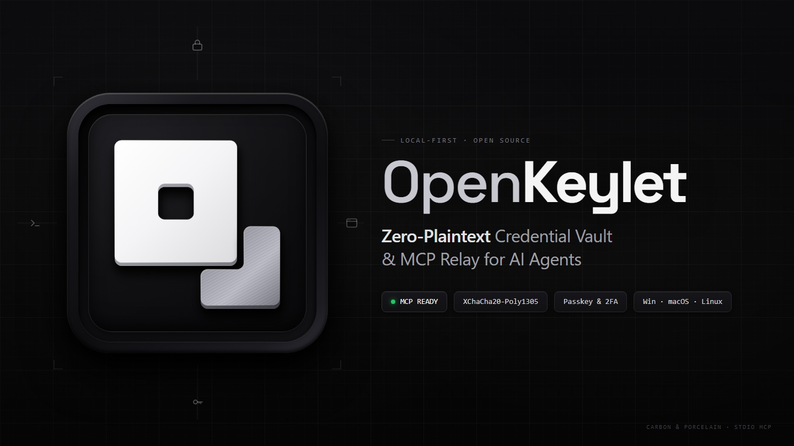
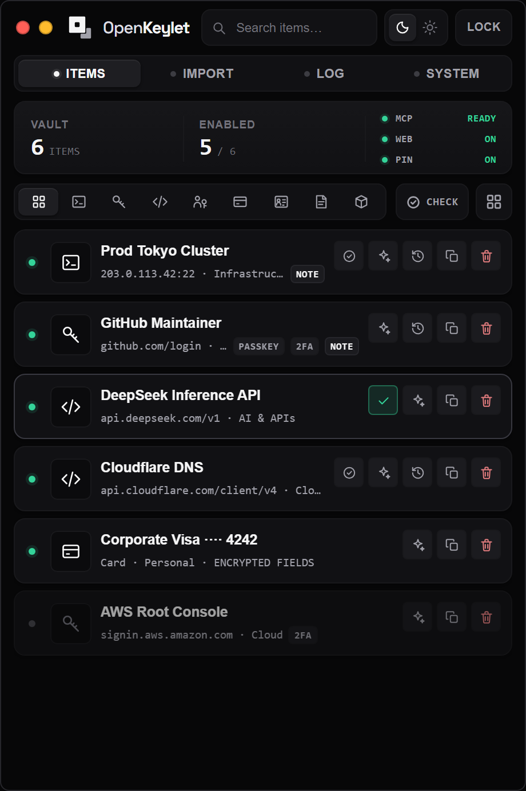
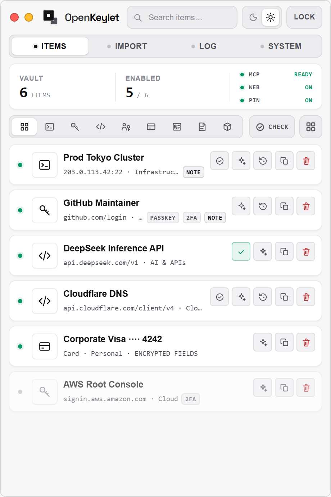
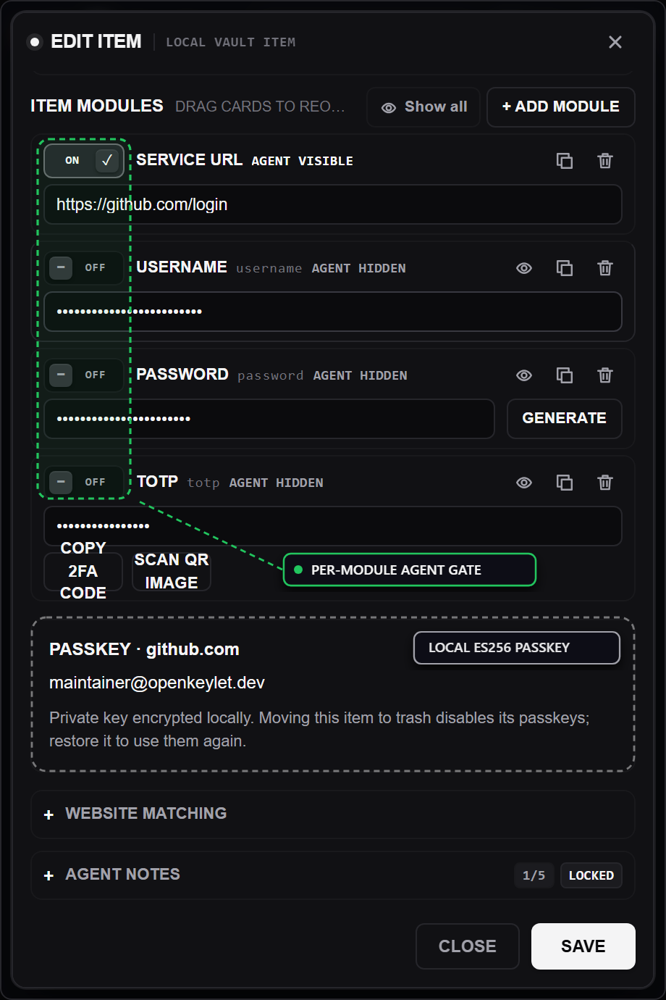
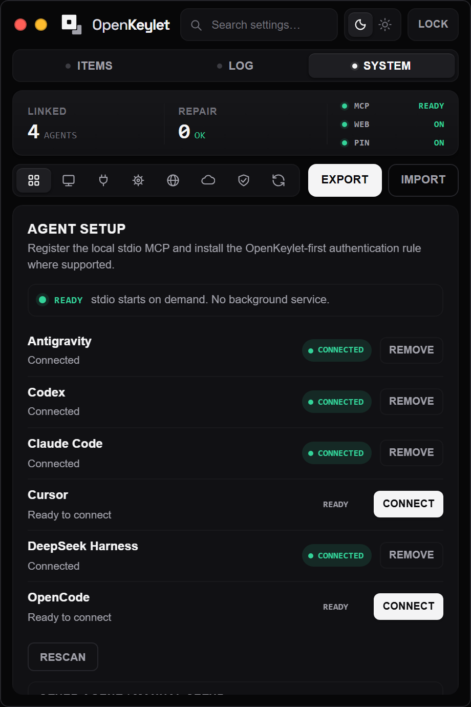
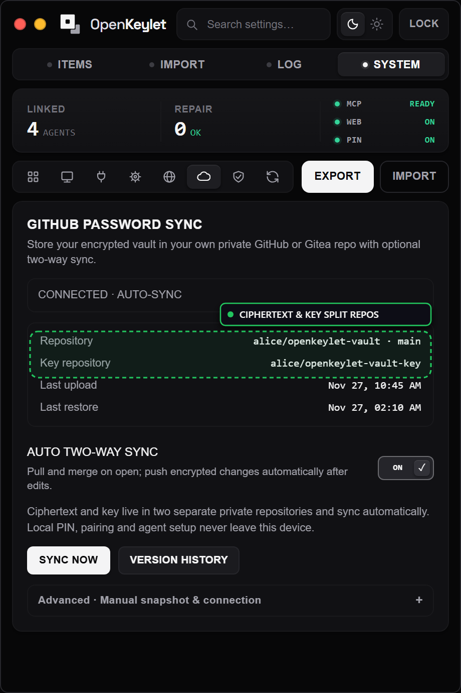
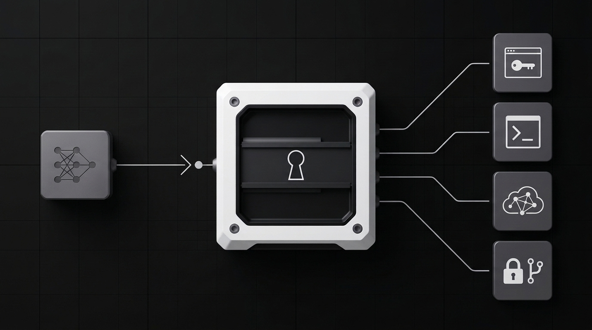

<p align="center">
  
</p>

<h1 align="center">OpenKeylet</h1>

<p align="center">
  <strong>本地优先的加密密码库、Passkey 管理器，以及面向 AI Agent 的零明文 <code>stdio</code> MCP 凭据中继器。</strong>
</p>

<p align="center">
  <code>本地优先</code>&nbsp;·&nbsp;<code>XChaCha20-Poly1305</code>&nbsp;·&nbsp;<code>无需云端账号</code>&nbsp;·&nbsp;<code>Windows / macOS / Linux</code>&nbsp;·&nbsp;<code>MIT 开源</code>
</p>

<p align="center">
  <a href="../../releases/latest"><strong>下载最新版本</strong></a>
  &nbsp;&nbsp;·&nbsp;&nbsp;
  <a href="README.md"><strong>English</strong></a>
  &nbsp;&nbsp;·&nbsp;&nbsp;
  <a href="#权限边界与威胁模型">权限边界</a>
  &nbsp;&nbsp;·&nbsp;&nbsp;
  <a href="#手把手实战教程">实战教程</a>
  &nbsp;&nbsp;·&nbsp;&nbsp;
  <a href="#使用建议与最佳实践">使用建议</a>
  &nbsp;&nbsp;·&nbsp;&nbsp;
  <a href="SECURITY.zh-CN.md">安全策略</a>
</p>

---

**OpenKeylet** 把你本机的个人加密密码管理器与现代 AI 编程/终端 Agent 无缝打通——原生支持 **Antigravity、Codex、Claude Code、Cursor、DeepSeek Harness 与 OpenCode**。

当 Agent 需要登录服务器（SSH/SFTP）、调用认证 API、渲染 `.env` 密钥文件、填写网页表单，或者完成 **WebAuthn Passkey** 网页登录时，OpenKeylet 在**本机直接代为完成认证动作**，而不把默认隐藏的明文秘密塞进大模型上下文、返回值或日志里。

---

## 产品界面一览

采用极简克制的 **纯黑白碳瓷工业风（Carbon & Porcelain）** 设计语言，完整适配 Windows、macOS 与 Linux 原生窗口习惯。

<table>
  <tr>
    <td width="50%" align="center">
      <br />
      <sub><strong>暗色碳黑（Carbon Dark）</strong> · 默认一行一条清爽列表，支持一键切换 4 列卡片网格</sub>
    </td>
    <td width="50%" align="center">
      <br />
      <sub><strong>亮色瓷白（Porcelain Light）</strong> · 完整名称、地址、2FA 与 Passkey 徽标一目了然</sub>
    </td>
  </tr>
  <tr>
    <td width="50%" align="center">
      <br />
      <sub><strong>逐模块精细控制</strong> · 独立 Agent 可见性开关、实时 2FA 验证码与 Passkey 绑定</sub>
    </td>
    <td width="50%" align="center">
      <br />
      <sub><strong>Agent 一键接入</strong> · 自动检测并配置本地 <code>stdio</code> MCP</sub>
    </td>
  </tr>
</table>

<details>
  <summary>查看可选「GitHub 密码同步」界面（支持 GitHub / 自建 Gitea &amp; Forgejo）</summary>
  <br />
  <p align="center">
    
  </p>
</details>

---

## 核心架构：零明文本地中继

<p align="center">
  
</p>

<table>
  <tr>
    <td width="25%"><strong>01 · 本机加密核心</strong><br /><br />密码、Passkey 私钥、TOTP 种子与支付卡全部通过 <code>XChaCha20-Poly1305</code> 在本机加密。无官网账号、无托管服务器。</td>
    <td width="25%"><strong>02 · 元数据发现</strong><br /><br />Agent 通过按需启动的本地 <code>stdio</code> MCP 仅看到项目名、字段名、非秘密地址和可用动作，接触不到隐藏明文。</td>
    <td width="25%"><strong>03 · 本地代执行</strong><br /><br />OpenKeylet 在本机签署 Passkey、填写网页/桌面表单、执行 SSH/SFTP、发送 HTTP 请求或渲染配置文件，并对回显自动脱敏（<code>[REDACTED]</code>）。</td>
    <td width="25%"><strong>04 · 用户自有同步</strong><br /><br />可随时导出密码保护的 <code>.mvault</code> 离线包，或自愿接入你自己的私有 GitHub / Gitea 仓库做加密快照双向同步。</td>
  </tr>
</table>

---

## 权限边界与威胁模型

OpenKeylet 坚持**坦诚、清晰的威胁模型**。由于定位是让本地 AI Agent 后台无感代执行认证步骤（无需每执行一次 SSH 就弹窗输主密码），我们在“日常低摩擦”与“离线强加密”之间划清了明确的边界：

### 保护什么 vs. 不保护什么

| 安全边界 | 状态 | 机制说明 |
| --- | :---: | --- |
| **防 LLM 上下文与日志泄密** | **保护** | 默认隐藏的凭据模块不会出现在 MCP 返回值或活动记录中；终端、SSH、HTTP 和浏览器结果会脱敏所用条目的秘密、本 MCP 会话渲染或填写过的每个值、库中其他 8 个字符及以上的隐藏值以及实时 TOTP，即使调用未指定任何条目。 |
| **防 Agent 读取隐藏明文** | **仅防意外泄露** | 不提供 `get_secret` 工具，隐藏模块也绝不会通过 `items_search` 返回，因此正常使用时其值不会进入模型上下文。但这不是针对恶意 Agent 或遭提示词注入的 Agent 的安全边界：已启用条目的秘密可以被替换进 `terminal_run` / `ssh_run` 命令，或由 `secret_write_file` 渲染到 Agent 随后能用自身工具读取的文件中；输出脱敏也只匹配原值及其常见编码（JSON 转义、base64 / base64url、十六进制、百分号编码、shell 引号形式、多行值的单行）。条目的 **启用** 开关才是真正的授权闸门。 |
| **防旁人 / 他人在本机操作** | **保护（开启 PIN）** | 可选 6 位 PIN 用于锁定桌面查看与管理界面：锁屏后背后列表与日志自动脱敏清空、拦截所有敏感管理命令、输错 3 次起渐进冷却，并支持可选空闲自动重锁（5 / 15 / 30 / 60 分钟）。 |
| **防剪贴板历史残留泄密** | **保护** | 复制密码、秘密模块、2FA 验证码、生成器密码或云恢复密钥时，自动标记跳过 Windows `Win+V` 与云剪贴板，并在 **30 秒后自动清空**（仅当剪贴板内容未被覆盖时才清，绝不误删你后复制的内容），锁屏或退出时立即清理。 |
| **防离线备份泄露** | **保护** | 桌面 `.mvault` 导出使用 ≥12 位独立口令 + Argon2id（64 MiB）+ XChaCha20-Poly1305。 |
| **防云端仓库泄露** | **仅限单个仓库外泄** | 云端快照用 256 位随机 `okv1_` 密钥加密，密钥放在同一账号下的另一个私有仓库（`<仓库名>-key`）。密文仓库里只有密文，两个仓库都严格校验 `private: true`，任何一个单独外泄都读不出内容。但控制了账号、或持有同时覆盖两个仓库的令牌的人，可以读取整个密码库。 |
| **本机密码库文件静态安全** | **密钥分离，依赖操作系统** | 默认模式下，密码库密钥保存在数据目录之外——Windows 凭据管理器 / Linux Secret Service，或独立的用户密钥目录（`~/.config/openkeylet`、`%LOCALAPPDATA%\OpenKeylet`、`~/Library/Application Support/OpenKeylet`），因此单独拷贝、打包或同步数据目录不会带走密钥（正式备份请使用 `.mvault` 导出或仓库同步）。显式指定 `OPENKEYLET_DATA_DIR` 时仍保持目录自包含，也可通过 `OPENKEYLET_KEY_FILE` 指定独立密钥路径。静态机密性仍取决于操作系统账号与全盘加密；条目名称、描述、主机、URL、文件夹和活动记录未加密保存。 |
| **防恶意 Agent / 同用户恶意程序** | **非沙箱** | OpenKeylet **不能**抵御已入侵你同权限系统用户的恶意软件、被攻陷的浏览器，或恶意 Agent 利用已启用 SSH/API 凭据发起的破坏性命令。请务必配合操作系统登录锁屏与全盘加密（BitLocker / FileVault / LUKS）。 |
| **锁屏期间的后台 MCP** | **按设计保持可用** | 桌面端 6 位 PIN 锁的是“人”的界面操作，不会打断后台已授权的 `stdio` MCP 任务；如需禁止 Agent 使用某个条目，直接关闭该条目的 **启用** 开关即可。 |

**OpenKeylet 工具在 Agent 沙箱之外执行。** `terminal_*`、`ssh_*`、`http_send` 和 `secret_write_file` 以你的系统用户权限在 OpenKeylet MCP 服务进程中运行，不受 Agent 客户端对其自身 shell 施加的沙箱或命令审批机制约束；即使不使用任何条目，`terminal_run` 也能执行。请在 Agent 客户端中为这些工具保留逐次审批，不要一键放行整个 `openkeylet` 服务。

### 逐模块可见性矩阵

| 模块状态 | 本机已解锁 GUI | 返回给 AI Agent (MCP) | 由 OpenKeylet 本机代执行 |
| --- | :---: | :---: | :---: |
| **隐藏（凭据默认）** | 掩码显示（可点击小眼睛 / 复制） | 绝不返回 | 支持（`ssh`、`http`、`fill`、`browser`、`secret_write_file`） |
| **可见（手动开启）** | 可见 | 允许返回 | 支持 |
| **TOTP 种子** | 掩码 + **一键复制 2FA 验证码** | 永不返回种子；仅在本地动态生成并脱敏注入 | 支持 |
| **Passkey 私钥** | 仅显示网站（RP ID）与账号元数据 | 私钥永不离开桌面加密库 | 支持。浏览器发起的请求经扩展确认窗口（仅在 PIN 验证后设置 UV）；Agent 通过 `browser_passkey` 签名需先手动开启 **允许 Agent 使用 Passkey**（默认关闭），且不能接管已打开的人工确认窗口 |
| **已禁用 / 回收站条目** | 仅本人可见 / 可恢复 | 完全拦截 | 完全拦截（禁止自动填充、禁止 Passkey 签名、禁止 MCP 调用） |

> 在将 OpenKeylet 用于核心生产基础设施前，请阅读完整的[安全策略与威胁边界](SECURITY.zh-CN.md)。

---

## 使用建议与最佳实践

1. **在办公或公用电脑上开启「6 位 PIN + 空闲自动锁定」**
   在 **系统 → APP / 03** 打开 **PIN 锁**，按习惯设置 **空闲自动锁定**（推荐 `15 分钟`）。起身离开不怕旁人偷看或改动，同时不影响后台正在跑的 Agent 任务。
2. **把条目的「启用」开关当成 Agent 授权闸门**
   把常给 Agent 用的开发机 SSH、测试 API 保持启用；把极高危的生产 root 账号或个人网银平时设为**停用**，需要时再开。
3. **坚持默认「Agent 隐藏」，善用占位符**
   密码、API Key、SSH 私钥和 TOTP 的左侧开关保持 `OFF`（隐藏）。优先在 `http_send`、`terminal_run`、`ssh_run` 和 `secret_write_file` 中使用 `{{openkeylet:模块名}}` 占位符。
4. **为 API 条目保存服务 URL**
   条目保存了服务 URL（或网址规则）时，`http_send` 只会把它的令牌发送到该 Origin；未保存时由 Agent 任意选择目标。`terminal_run`、`ssh_run` 与 `secret_write_file` 中的占位符不受目标绑定限制。
5. **保护好 GitHub 账号，并妥善保管 `.mvault` 备份口令**
   同步用的钥匙放在你账号下的 `<仓库名>-key` 私有仓库里，谁控制了账号谁就能读取密码库，请开启两步验证。不要把任何一个仓库设为公开，也不要删除钥匙仓库。想多一份保险，可在「高级」里点 **查看恢复密钥**，离线保存一份。
6. **按需控制「允许 Agent 使用 Passkey」**
   **系统 → WEB / 04** 中的 **允许 Agent 使用 Passkey** 默认关闭。仅在你需要让 Agent 通过 `browser_passkey` 为已启用条目免确认完成 Passkey 登录或注册时再开启（开启期间响应会基于你的长期授权声明用户在场与用户验证，但 Agent 仍不能接管正在等待人工操作的确认窗口）；保持关闭即可维持仅限人工在扩展窗口中确认。
7. **多设备使用同步时保持习惯一致**
   双向同步按条目 `id` 与 `updatedAt` 合并并通过删除墓碑同步永久删除；尽量避免两台断网设备同时修改**同一条目的不同字段**，以免后写入时间戳覆盖先写入的改动。

---

## 手把手实战教程

### 教程 1 · 一键绑定你的 AI Agent

OpenKeylet 通过按需启动的本地 **`stdio` MCP** 与 AI 编程/终端 Agent 通信，无需开放公网端口，也无需任何中转账号。

1. 打开 **OpenKeylet**，进入 **系统 → MCP / 02（Agent 接入）**（快捷键 `⌘/Ctrl + ,`）。
2. 找到你使用的客户端——**Antigravity、Codex、Claude Code、Cursor、DeepSeek Harness 或 OpenCode**，点击右侧的 **CONNECT**（如果你移动了程序路径或从旧版 KRU 升级，点击 **REPAIR / 修复**）。
   - OpenKeylet 会自动写入本地 `stdio` MCP 配置（`openkeylet mcp stdio`）。
   - 对支持的客户端，还会同步安装「涉及登录/认证任务时优先使用 OpenKeylet」规则，避免 Agent 直接向你索要明文密码。
3. 确认顶部状态栏亮起绿灯 **`MCP · READY`**，然后**新建一个 Agent 对话窗口**（或在 IDE 中刷新 MCP 服务）。
4. **立刻发一句话验证是否绑通**：
   ```text
   帮我查一下你在 OpenKeylet MCP 里能看到哪些已启用的条目。
   ```
   Agent 会调用 `items_search`，只看到条目名、公开目标地址和可用动作，看不到任何隐藏明文。

> 使用其他支持 MCP 的客户端？展开下方[手动 `stdio` MCP 配置](#完整-mcp-工具列表23-个与原生-cli-底座)，或直接运行 `openkeylet config stdio-json`。

---

### 教程 2 · 如何把凭据交给 Agent 使用（`USE` 一键点击 + 自然语言指令库）

日常让 Agent 使用你的密码/服务器/API/网页登录，有**两种最顺手的方式**，全程不暴露明文：

#### 方式 A · 最常用、零出错：点一下条目上的 `USE`（使用）

1. 在主界面找到目标条目（默认是**单行列表视图**，点击 **`+ ADD`** 左侧图标可随时切换为 **4 列卡片网格**）。
2. 确认该条目右侧的绿色状态灯已点亮（点一下状态灯即可随时开启/关闭 Agent 访问权限）。
3. 点击该行上的 **`USE`**（中文界面显示 **使用**），OpenKeylet 会立刻把一段不含任何秘密的引用提示词复制到剪贴板：
   ```text
   use Prod Tokyo Cluster in OpenKeylet MCP
   ```
4. **直接粘贴到你的 AI Agent 对话框里**，在后面顺口补上你想做的事即可：
   ```text
   use Prod Tokyo Cluster in OpenKeylet MCP 帮我看看磁盘剩余空间，拉一下 nginx 最近 50 行错误日志，有问题的话顺手重启一下服务。
   ```
   ```text
   use GitHub Maintainer in OpenKeylet MCP 打开我现在浏览器里的后台页面帮我完成登录。
   ```

#### 方式 B · 纯自然语言直接吩咐（无需记格式、无需记工具名）

因为 OpenKeylet 已经内置了 Agent 规则并提供 `items_search`，你完全不需要背工具名，甚至不必点 `USE`——直接用平时说话的方式提一嘴条目名（或直接让 Agent 自己去 OpenKeylet 找）就能跑通：

| 常见实战场景 | 直接这样跟 Agent 说 | OpenKeylet 本地自动调用 |
| --- | --- | --- |
| **SSH 排障与运维** | `用 OpenKeylet 里的「Prod Tokyo Cluster」连上去看看 docker 容器 web-1 为什么一直在重启。` | `items_search` → `ssh_run` |
| **SFTP 上传部署** | `用「Prod Tokyo Cluster」把本地 ./dist 目录上传到 /var/www/app，然后重载 caddy。` | `ssh_upload` → `ssh_run` |
| **拉取服务器日志** | `从 OpenKeylet 的「Prod Tokyo Cluster」把 /var/log/app/crash.log 下载到 ./tmp/crash.log 并帮我定位报错原因。` | `ssh_download` |
| **调用认证 API** | `通过 OpenKeylet 里的「Cloudflare DNS」查一下 example.com 当前所有的 A 和 AAAA 记录。` | `http_send` |
| **零明文生成 `.env`** | `用 OpenKeylet 里的「DeepSeek Inference API」，通过 secret_write_file 把密钥写入 .env.local，不要在对话里打印明文。` | `secret_write_file` |
| **网页登录 + 自动填 2FA** | `打开 Chrome 当前的后台登录页，用 OpenKeylet 的「AWS Staging Console」帮我填好账号密码和 2FA 验证码。` | `browser_inspect` → `browser_fill_login` → `browser_click` |
| **网页 Passkey 无密登录** | `用 OpenKeylet 里「GitHub Maintainer」保存的 Passkey 帮我在浏览器里登录 github.com。` | `browser_inspect` → `browser_passkey` |
| **自动填账单 / 收货地址** | `用 OpenKeylet 里的「Corporate Visa ···· 4242」帮我把当前结算页面的银行卡和账单信息填好，别点提交我自己核对。` | `browser_inspect` → `browser_fill_personal` |
| **交互式命令行 / `sudo`** | `开一个本地终端运行发布脚本，遇到提示输入签名口令时用 OpenKeylet 的「Release Signing Key」自动填入。` | `terminal_start` → `credential_fill` → `terminal_read` |
| **全自动发现（懒人用法）** | `继续把 staging 分支发布上去，中间如果遇到需要 SSH、API Key 或网页登录的步骤，先去 OpenKeylet 找现成凭据。` | `items_search` → 自动匹配动作 |

#### 方式 C · 进阶占位符用法（`{{openkeylet:模块名}}`）

当你希望 Agent 渲染 `.env` / YAML / JSON 配置文件，或在请求头/命令中引用秘密字段时，只需让 Agent 写入占位符：

```env
DEEPSEEK_API_KEY={{openkeylet:API Credential}}
CF_API_TOKEN={{openkeylet:Token}}
```

OpenKeylet 会在本地执行 `secret_write_file`、`http_send`、`ssh_run` 或 `terminal_run` 时自动替换为真实值，并将 stdout/stderr/HTTP 回显中的秘密（原值或常见编码形式，终端换行或着色时同样适用）动态打码为 `[REDACTED]`。向程序传递秘密时优先使用 `secretEnv` 或 `openkeylet run --env-file`；`secret_write_file` 渲染出的文件含有明文，Agent 不应回读、diff 或提交该文件。

---

### 教程 3 · 创建、测试与整理模块化凭据

1. 点击 **`+ 添加`**（`⌘/Ctrl + N`），选择预设模板：**登录、SSH、API、银行卡、身份资料、安全笔记或空白**。
2. **像搭积木一样组合模块**：点击 **`+ 添加模块`** 按需添加账号、密码（内置强密码生成器）、TOTP 2FA、API 凭据、SSH 私钥、私钥口令、主机/端口、服务 URL 或自定义字段，拖动把手即可排序。
3. **控制模块可见性**：秘密模块左侧开关默认 **`OFF`（对 Agent 隐藏）**，仅当确实需要 Agent 读取某个非敏感值时再单独打开。
4. **配置多网址匹配规则**：登录条目支持配置多条网址规则（`baseDomain`、`host`、`startsWith`、`exact`、`regex`），浏览器自动填充与 Agent 网页登录都能精准匹配子域名。
5. **一键自检、历史回溯与排序**：
   - SSH / API 条目可直接点 **`CHECK`** 测试连通性；
   - 点击 **`HIS`** 可随时查看或复制最近 20 个历史密码版本；
   - 拖动列表行/卡片（或聚焦后按列表 `↑/↓`、网格 `←/→`）可自由排序，点击 `+ ADD` 旁的布局按钮随时切换单行列表与 4 列网格。

---

### 教程 4 · 浏览器扩展配对、自动填充、2FA 与 Passkey

1. 打开 **系统 → WEB / 04（浏览器接入）** 并开启 Browser Bridge（顶部状态栏显示绿灯 **`WEB · ON`**）。
2. **第 1 步**：点击 **打开浏览器并复制地址** → 在地址栏粘贴 `chrome://extensions/` → 打开右上角「开发者模式」。
3. **第 2 步**：按住 OpenKeylet 徽标拖入扩展页空白处（或点 **扩展目录** →「加载已解压的扩展程序」），安装后自动完成配对。
4. **个人日常使用**：
   - 在任意网页点开扩展弹窗即可填充账号、密码、银行卡与身份资料（完整兼容中英文结账表单、Shadow DOM、React/Vue 受控组件与分步登录），且绝不擅自替你提交表单。
   - 弹窗内可直接点 **2FA**（桌面编辑器内点 **复制 2FA 验证码**），复制后 30 秒自动清空剪贴板且跳过 Windows `Win+V` 历史。
   - 支持 **WebAuthn Passkey** 注册与登录（ES256、可发现凭据与指定凭据列表、兼容 `prf` / `largeBlob` 等扩展），私钥始终留在桌面端加密库中。
5. **让 Agent 代劳网页登录**：
   - 在你自己的 Chrome/Edge/Brave 里打开目标页面，对 Agent 说：`use GitHub Maintainer in OpenKeylet MCP 帮我登录当前页面`。
   - 你可以在浏览器里实时看到每一步填写与点击。**允许 Agent 使用 Passkey** 默认关闭，Passkey 请求始终走扩展人工确认窗口；仅当你在 **系统 → WEB / 04** 显式开启后，Agent 才能通过 `browser_passkey` 代签（且仍不能接管已打开的人工确认窗口）。

---

### 教程 5 · 离线加密包（`.mvault`）备份与旧版兼容迁移

所有本地数据导出、恢复与迁移统一收口在 **系统 → SAFE / 06（本地数据与离线包）**：

* **导出 `.mvault`**：点击 **导出 .mvault**，设置至少 12 位独立备份密码。底层使用 Argon2id（64 MiB，3 轮）+ XChaCha20-Poly1305 加密，完整包含所有条目、Passkey、最近 20 条密码历史与回收站。
* **恢复 `.mvault`（带安全预览，100% 兼容旧版 v3–v8）**：
  1. 点击 **恢复 .mvault**，先选择 `.mvault` 文件。
  2. OpenKeylet 会自动探测包头是否受口令保护——**旧版 v3–v7 及通过 `openkeylet backup export --self-unlocking` 导出的自解锁 `.mvault` 会自动跳过密码弹窗**，并在预览中给出安全提示（建议导入后重新导出为新版带口令包）。CLI 只有在显式传入该参数时才会写出这种文件，默认导出会要求输入口令。
  3. 确认落盘前先查看**只读合并预览**：清晰列出将新增条数、将跳过的完全相同条数、同名不同内容的自动安全重命名（如 `GitHub(2)`，绝不覆盖现有记录）、Passkey、回收站与密码历史数量。
  4. 点击 **确认导入** 完成原子合并（如已开启云端自动同步，会自动触发一次推送）。
* **从 Bitwarden / Chrome / Edge 迁入**：点击 **导入 Bitwarden / CSV**，同样支持先预览数量与兼容性提示，再整批原子导入 Bitwarden JSON（含 ES256 PKCS#8 Passkey 与 TOTP）或 Chrome/Edge CSV（弹窗内也支持直接选 `.mvault`）。
* **从文件导入后清理明文**：**导入** 页的 **本机扫描** 还会检查 Agent 规则文件（`CLAUDE.md`、`AGENTS.md`、`GEMINI.md`、`.cursorrules`、`.claude/rules`、`.cursor/rules`）、Shell 启动文件（`.bashrc`、`.zshrc`、`.profile`、fish 配置中的 `export NAME=value`）以及 Shell 历史记录。导入从不改动原文件，因此完成提示会列出**仍留有明文**的每个文件以及对应的下一步（改用脱敏 `.env` 模板、确认金库副本可用后删除私钥文件、删掉粘贴进去的那一行……）。CLI 的 `import-env` 与 `import-ssh` 会打印同样的清单。脱敏 `.env` 模板遇到无法脱敏的行时，会替换为 `# OpenKeylet removed …` 注释，而不是原样复制。

---

### 教程 6 · 多设备加密云同步（GitHub / 自建 Gitea & Forgejo）

在 **系统 → CLOUD / 05** 中，你可以自愿接入一个属于自己的**私有仓库**来做多设备加密同步（完全非强制）：

1. **选择托管平台**：
   - **GitHub**：直接复用本机 `gh auth login` 登录态，或填入对密文仓库和钥匙仓库都具备 `Contents: Read & write` 权限的细粒度 PAT（如需让 OpenKeylet 自动帮你建仓库，额外勾选 `Administration: Write`）。
   - **自建 Gitea / Forgejo**：填入你的 HTTPS 服务器地址与访问令牌，点击 **检查服务器与账号** 即可通过 `/api/v1/user` 预先验证连通性。
2. **绑定私有仓库**：填写 `owner/repo`（每次读写严格校验 `private: true`）。OpenKeylet 会在同一账号下创建钥匙仓库 `owner/repo-key`，把同步密钥放进去，与密文分开存放。你不需要记任何密钥。
3. **日常只需盯住一个主按钮**：
   - 开启 **自动双向同步** 后，每次编辑/删除自动防抖上传、启动软件自动拉取合并（遇 `409 Conflict` 自动拉取合并重试，永久删除通过删除墓碑同步）。
   - 只要本地有尚未上传的改动或后台推送因断网失败，顶部会持续显示 **`待同步 / PENDING SYNC`** 状态条，主按钮自动变为 **`同步待上传改动`**，一键即可完成对账。
   - **仅上传快照 / 仅恢复快照 / 查看恢复密钥 / 重新连接 / 断开连接** 等低频操作统一收纳在底部可折叠的 **高级 · 手动快照与连接管理** 抽屉里，不干扰日常操作。
4. **在第二台设备（Windows / macOS / Linux）恢复**：打开 **系统 → CLOUD / 05** → 选择 **连接已有密码仓库** → 授权同一个账号并选中仓库 → 点击 **`同步并恢复`**。钥匙会自动从钥匙仓库读取。

> 本机 PIN、浏览器配对令牌、Agent 配置、操作记录（`activity.jsonl`）、SSH 主机密钥固定记录（`ssh-known-hosts.json`）与编辑草稿**永远只留在本机**，不会上传到仓库。

---

### 桌面端现代快捷键

| 快捷键 | 功能 |
| --- | --- |
| `⌘/Ctrl + K` 或 `⌘/Ctrl + F` | 聚焦顶部搜索框 |
| `⌘/Ctrl + N` | 新建密码库项目 |
| `⌘/Ctrl + 1 / 2 / 3` | 快速切换 **项目 / 记录 / 系统** |
| `⌘/Ctrl + ,` | 打开 **系统** 设置 |
| `⌘/Ctrl + S` | 保存当前打开的编辑器 |
| `⌘/Ctrl + Shift + L` | 立即锁定桌面端（已设置 PIN 时） |
| `Esc` | 关闭当前弹窗 / 取消拖拽 / 收起搜索 |

---

## 完整 MCP 工具列表（26 个）与原生 CLI 底座

OpenKeylet 通过按需启动的本地 `stdio` MCP（`openkeylet mcp stdio`）提供 **26 个**带结构化 `structuredContent` 的工具：

| 分类 | 工具名 | 用途 |
| --- | --- | --- |
| **发现与记忆** | `items_search(query?)` | 搜索已启用项目（含登录、SSH、API、银行卡、身份、安全笔记）的名称、模块、`agentNotes` 与可用动作 |
| | `item_note` | 为项目添加/更新/删除简短非敏感上下文备注（≤200 字，自动拦截密文），帮助后续会话快速定位项目 |
| **浏览器与 Passkey** | `browser_open` | 通过已配对扩展在浏览器打开或跳转指定 HTTP/HTTPS 页面并等待加载完成 |
| | `browser_inspect` | 检查当前页面及安全子 iframe：脱敏地址、标题、表单、字段（含复选框/单选框）、按钮、脱敏告警/页面摘要、供 `browser_save_key` 使用的 `keyCandidates` 句柄、待处理 Passkey 及匹配条目 |
| | `browser_fill_login` | 匹配并填写网页或受信任 SSO iframe 的账号、密码及实时 TOTP（纯 OTP 验证页自动补填 2FA） |
| | `browser_save_key` | 将网页刚展示的一次性 API Key 直接由扩展抓入本地库，明文不进入模型上下文 |
| | `browser_save_login` | 将扩展刚捕获的已提交网页登录账号密码直接存入本地库，明文不进入上下文 |
| | `browser_fill_personal` | 在 HTTPS/localhost 页面填写已保存的支付卡或身份地址（支持 Stripe Elements 等跨源分拆支付 iframe） |
| | `browser_click` | 点击页面或安全 iframe 中的可见按钮、链接、复选框、单选框或标签 |
| | `browser_passkey` | 调用本机加密库完成 WebAuthn Passkey 登录或注册（支持直接挂载到指定/匹配的已有登录项）；**允许 Agent 使用 Passkey** 开启时无需逐次确认 |
| **直接填写** | `credential_fill` | 向浏览器控件、显式指定的桌面控件或托管终端写入单个隐藏模块 |
| **SSH 与 SFTP** | `ssh_run` | 私钥优先 + 密码自动回退认证执行 SSH 命令，支持标准输入、输出截断保护与跨条目 `{{openkeylet:项目/模块}}` / `{{openkeylet-raw:...}}` 占位符；首次连接时固定服务器主机密钥，之后拒绝密钥已变更的连接 |
| | `ssh_upload` | 通过 SFTP 递归上传本地文件或目录 |
| | `ssh_download` | 通过 SFTP 递归下载远端文件或目录 |
| **HTTP API** | `http_send` | 发送认证 HTTP/HTTPS 请求（自动识别服务商、Bearer/Basic、自定义认证头、流式下载、multipart、`insecure`、`followRedirects`、跨源重定向剥离认证头，支持 `captureSecrets` 直接截留新令牌入库以及可选 `holdResponse=true` 加密收据模式）；已保存服务 URL 或网址规则的条目，其秘密只会发送到该 Origin 或匹配规则的地址 |
| | `http_save_secret` | 从 `http_send` 的加密本地收据（`holdResponse=true` 或 `captureSecrets` 未命中回退）按槽位/路径保存新签发密钥，无需重复发请求 |
| **密钥文件与录入** | `secret_write_file` | 本地原子渲染模板文件，支持单条目 `{{openkeylet:模块}}` 与跨条目 `{{openkeylet:项目/模块}}`（Unix `0600`、Windows 仅当前用户 NTFS ACL，若位于 Git 仓库且未被 `.gitignore` 忽略会额外提示），用于无法读取环境变量的程序；渲染出的文件含有明文 |
| | `secret_generate` | 在本地密码学生成强密码/hex/base64url 令牌并直接加密写入项目，不向模型暴露明文 |
| | `ssh_keygen` | 在本地生成 Ed25519 SSH 密钥对，私钥直接加密入库，仅向模型返回公钥与指纹 |
| | `secret_ingest_file` | 直接将本机 `.env` 或 PEM 私钥文件加密吸收进 Vault（可选同时生成密封模板），不经过模型上下文 |
| | `draft_prepare` | 预建加密草稿骨架（支持最多 10 条草稿队列），用户仅需在桌面端粘贴密文即可保存 |
| **本地终端** | `terminal_run` | 一次性执行本地命令，支持跨条目占位符与 `secretEnv` 注入、输出截断保护与多条目联合脱敏 |
| | `terminal_start` / `terminal_write` / `terminal_read` / `terminal_stop` | 托管交互式 PTY 会话，带缓冲区上限与跨读取边界持续脱敏 |

### 原生 CLI 与协议层底座（专为 Claude Code / Codex / Antigravity 原生终端打造）

当 Agent（或开发者本人）在原生终端里运行 `git`、`ssh`、开发服务器或测试套件时，可直接零明文接入 OpenKeylet：

```bash
# 为任意原生命令注入多条目环境变量并做实时跨块输出脱敏
openkeylet run --item "OpenAI" --env-file .env.template --env DB_PASS="Prod DB/password" -- npm run dev

# 本地只读 OpenSSH Agent（macOS/Linux Unix Socket，Windows Named Pipe）
# 仅暴露已启用的 SSH 私钥，桌面端关闭开关即刻吊销签名权限
openkeylet ssh-agent
eval "$(openkeylet ssh-agent --print-env)"   # macOS/Linux（Windows PowerShell: $env:SSH_AUTH_SOCK = '\\.\pipe\openkeylet-ssh-agent'）

# Git HTTPS 凭据助手（自动匹配已启用令牌/密码，store/erase 安全空操作不改库）
git config --global credential.helper '!openkeylet git-credential'
```

<details>
  <summary>手动 <code>stdio</code> MCP 配置（JSON 与命令行导出）</summary>

```json
{
  "mcpServers": {
    "openkeylet": {
      "command": "C:\\path\\to\\openkeylet.exe",
      "args": ["mcp", "stdio"]
    }
  }
}
```

也可以直接通过 CLI 输出客户端可用配置：

```bash
openkeylet config stdio-json
openkeylet config stdio-toml
```

</details>

---

## 下载与数据目录

| 目标平台 | 包格式 | 说明 |
| --- | --- | --- |
| **Windows x64** | `.zip` | 便携 GUI、系统托盘、Windows 剪贴板历史隔离、桌面填写与浏览器扩展 |
| **macOS arm64** | `.zip` | 原生 `.app`（macOS 红绿灯与标题栏适配）；桌面输入需授予辅助功能权限 |
| **Linux x64 GUI** | `.tar.gz` | AppImage GUI；支持 X11 桌面输入与托盘 |
| **Linux x64 无头版** | `.tar.gz` | 无 WebView/GUI 依赖（`--no-default-features`）；完整保留 MCP、SSH、HTTP、终端、备份与桥接 |

替换或升级可执行文件不会删除现有密码库：

| 平台 | 默认数据目录 |
| --- | --- |
| Windows | `%APPDATA%\mcp-vault\v2` |
| macOS | `~/Library/Application Support/mcp-vault/v2` |
| Linux | `${XDG_DATA_HOME:-~/.local/share}/mcp-vault/v2` |

*（设置 `OPENKEYLET_DATA_DIR=/绝对路径` 可使用独立便携目录。无头 Linux 服务器、远程/局域网 Browser Bridge、经 SSH 隧道访问的管理界面以及 CLI `--passphrase` 备份，请参阅 [docs/HEADLESS_AND_REMOTE.md](docs/HEADLESS_AND_REMOTE.md)。）*

**自动更新（GitHub Releases）**：官方签名版本直接通过 GitHub Releases（`releases/latest/download/latest.json`）检查更新，强制验证 Ed25519 发布签名与安装包 SHA-256，默认支持后台静默下载、就绪后提示重启或下次启动自动生效，且原地替换不会破坏已绑定的 MCP 路径。可在 **设置 → UPDATE / 07** 中关闭自动检查或切换为仅提示模式；无头版 Linux 可执行 `openkeylet update check` / `openkeylet update install`。

<details>
  <summary>从旧版 KRU 升级说明</summary>
  <p>OpenKeylet 原名 <strong>KRU</strong>，完全兼容原有的本地密码库、密钥、<code>.mvault</code> 备份、<code>{{kru:模块名}}</code> 占位符和 <code>KRU_*</code> 环境变量。升级后打开 <strong>系统 → Agent 接入 → 修复</strong> 即可将旧 <code>kru</code> 配置迁移为 <code>openkeylet</code>，然后重启 Agent。</p>
</details>

---

## 从源码构建与测试

环境要求：**Rust 1.88+**、**Node.js 22+** 与 [Tauri 2 平台依赖](https://v2.tauri.app/start/prerequisites/)。

```bash
npm install
npm run check
npm test
npm run build
npm run portable
```

跨平台打包与全量端到端测试：

```bash
npm run release:mac
npm run release:linux
npm run release:headless

# 真实 Chromium 扩展、Passkey、跨平台 UX 与对抗压力 E2E（Playwright）
npm run test:browser
node scripts/test-agent-browser.mjs
node scripts/test-realworld-passkey-autofill.mjs
node scripts/test-ux-interactions.mjs
node scripts/test-adversarial-e2e.mjs
```

---

## 许可证

[MIT](LICENSE) — 自由使用、审查代码，并完全运行在你自己的设备上。
