

  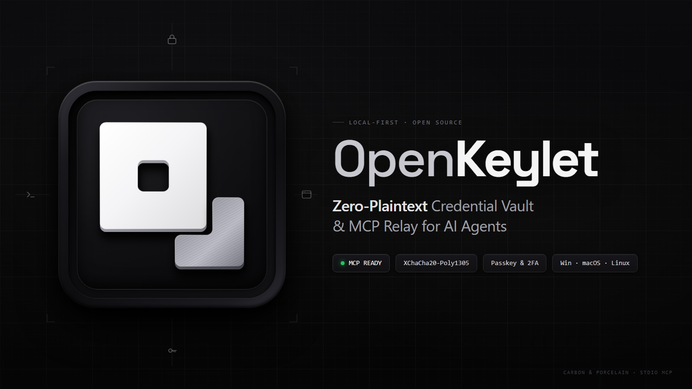

# OpenKeylet v0.20.0

> **本地优先的加密密码库、Passkey 管理器，以及面向 AI Agent 的零明文 `stdio` MCP 凭据中继器。**
> *Local-first encrypted password vault, Passkey manager, and zero-plaintext `stdio` MCP credential relay for AI agents.*
>
> **长期维护 & 开源公益声明 / Long-Term Maintained Project**：OpenKeylet 是一个**长期持续维护**的开源项目（[MIT](https://github.com/omaekumiko2-create/OpenKeylet/blob/main/LICENSE) 协议，按现状 AS-IS 免费提供，**不承诺任何形式的安全保障**）。非常欢迎各种形式的反馈、Bug 报告、体验建议与功能讨论：[Issues](https://github.com/omaekumiko2-create/OpenKeylet/issues) · [Discussions](https://github.com/omaekumiko2-create/OpenKeylet/discussions)。

---

## 3 分钟快速上手 · Quickstart

1. **一键绑定 Agent**：打开 **系统 → MCP / 02**，点击 **CONNECT** 一键接入 Antigravity / Claude Code / Codex / Cursor / DeepSeek Harness / OpenCode，重启会话即可用。
2. **对话框里给 Agent 用**：点击条目右侧 **✨（使用）** 复制 `use <条目名> in OpenKeylet MCP` 粘贴到 Agent 对话框，或直接自然语言提及条目名，明文不进入模型上下文。
3. **10 秒导入凭据 & 老密码库直迁**：切到 **导入（IMPORT）** 页粘贴/拖入 `.env`、cURL、SSH、数据库 URI 或点击 **Scan PC** 纯离线提取；也可直接拖入 **Bitwarden 密码保护加密 JSON、1Password `.1pux` 或 KeePass `.kdbx`** 本机解锁并逐项勾选无损迁入。
4. **装进浏览器并用起来**：打开 **系统 → WEB / 04**，打开 `chrome://extensions/` 开启开发者模式，将第 3 步的 OpenKeylet 徽标直接拖入页面即可自动配对。

  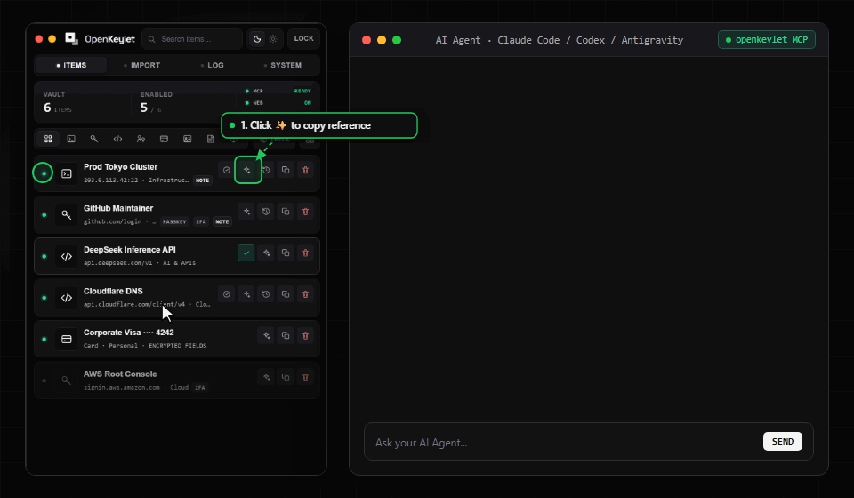

  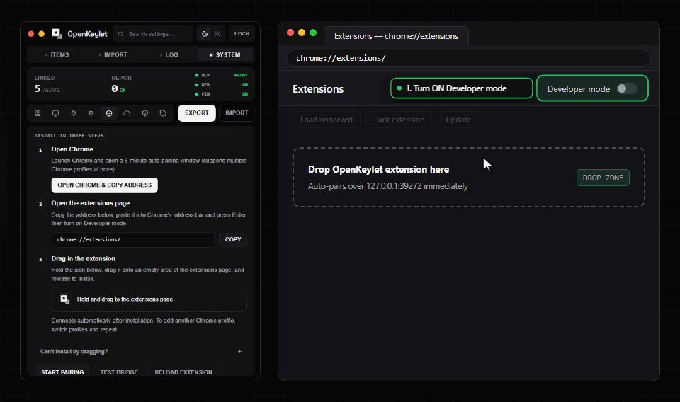

  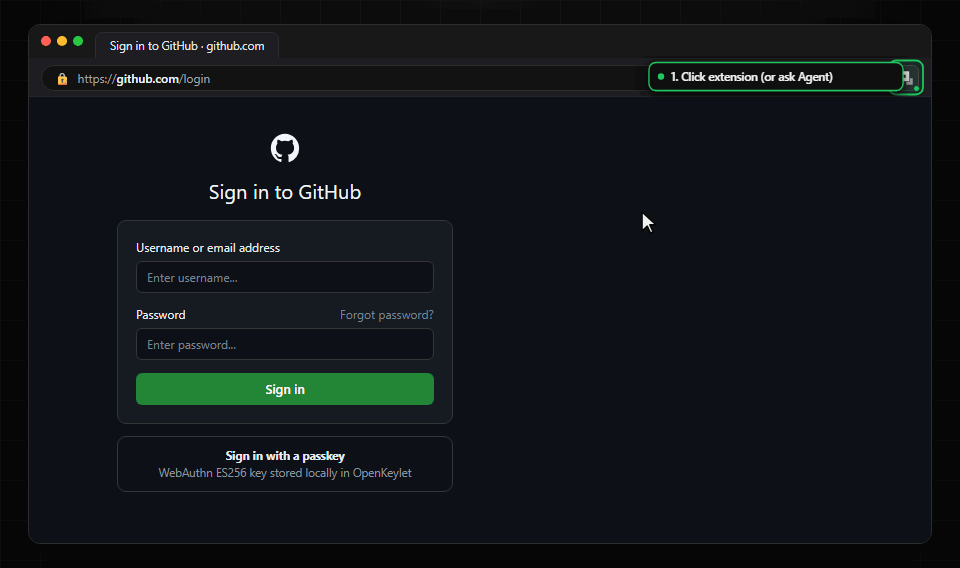

---

## 核心升级亮点 · Highlights

### 1. 四页碳瓷架构、纯离线「智能导入中心」与主流密码库加密包直迁
- 升级为 **项目（ITEMS）/ 导入（IMPORT）/ 记录（LOG）/ 系统（SYSTEM）** 四页布局，内置一键批量健康巡检（`CHECK`）、列表/网格双视图与暗色/瓷白双主题。
- **100% 离线零联网规则提取器**：粘贴 `.env`、cURL、SSH 配置/私钥、数据库连接串或 2FA 二维码图片即自动分拣预览入库；**Scan PC / Scan Folder** 同步检查 `CLAUDE.md`、`AGENTS.md`、`.bashrc` 等文件并给出明文清理建议。
- **主流密码库加密包直迁**：新增原生解析 **Bitwarden 密码保护加密 JSON**（支持 PBKDF2-SHA256 与 Argon2id + AES-256-CBC / HMAC-SHA256，保留 Passkey / 2FA / SSH / 文件夹）、**1Password `.1pux`** 与 **KeePass / KeePassXC `.kdbx`（KDBX 3.1 / 4.x）及 XML**，拖入即可本机解锁、搜索筛选、查看兼容性提示、冲突安全另存并原子加密入库。

<table>
  <tr>
    <td width="50%" align="center">
      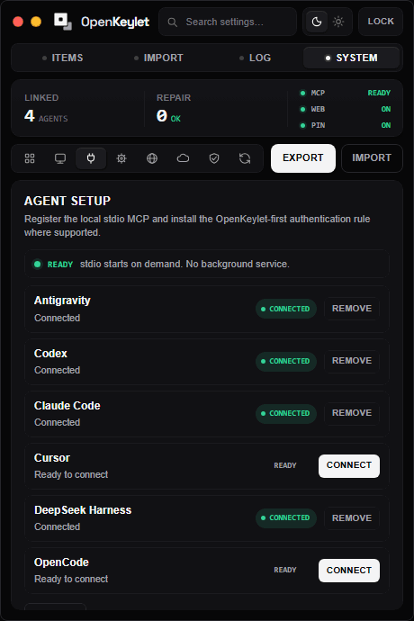 
      <strong>Agent 一键接入</strong> · 6 款主流 Agent 本地 <code>stdio</code> MCP 一键绑定
    </td>
    <td width="50%" align="center">
      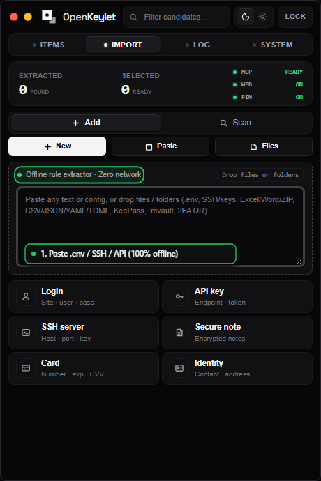 
      <strong>Smart Import Hub</strong> · 纯离线提取与候选预览
    </td>
  </tr>
  <tr>
    <td width="50%" align="center">
      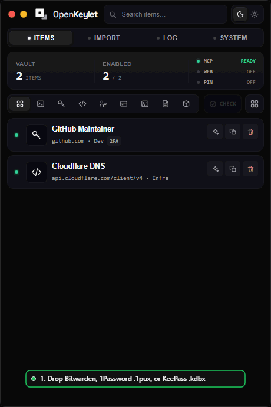 
      <strong>主流密码库直迁</strong> · Bitwarden 加密 JSON / 1Password <code>.1pux</code> / KeePass <code>.kdbx</code> 本机解锁勾选入库
    </td>
    <td width="50%" align="center">
      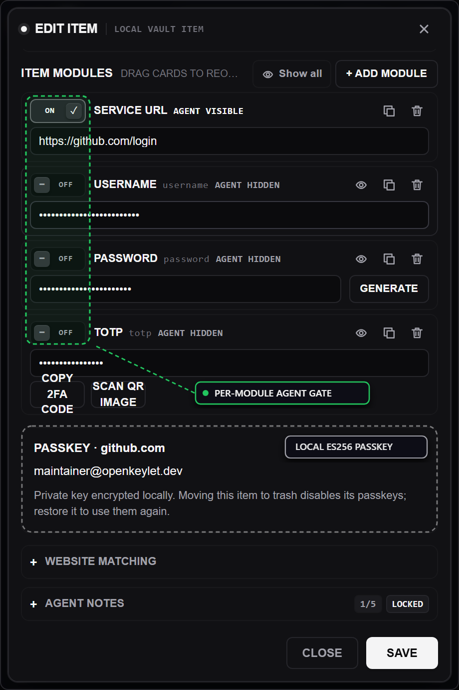 
      <strong>逐模块控制</strong> · 独立 Agent 可见性闸门、2FA 与本机 ES256 Passkey
    </td>
  </tr>
</table>

  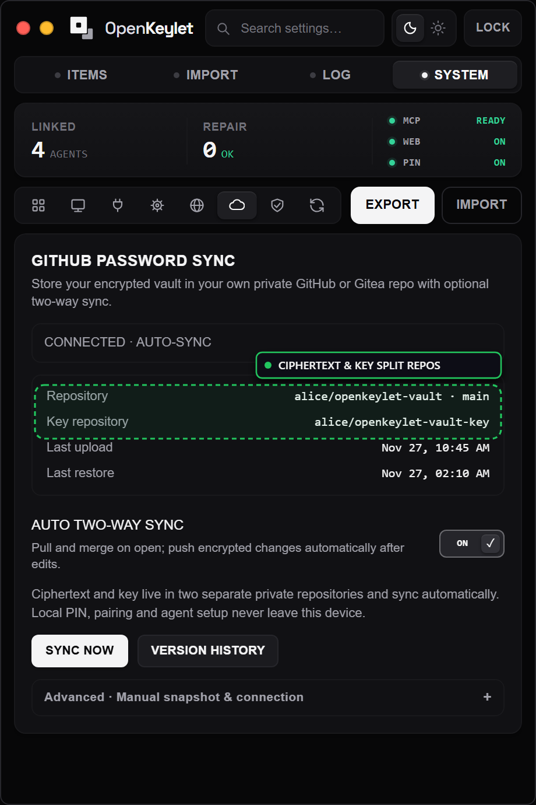 
  <strong>双仓库加密云同步（CLOUD / 05）</strong> · 密文仓与密钥仓物理分离（<code>owner/vault</code> + <code>owner/vault-key</code>），支持版本历史回滚

### 2. 26 个 MCP 工具：零明文「代执行 + 自助存密」闭环
- 新增 **`browser_save_key`**、**`browser_save_login`**、**`http_send(captureSecrets / holdResponse)`** 与 **`http_save_secret`**，Agent 在网页或 API 中刚签发的新密钥/新账号可直接由本机加密入库，明文全程不进入模型上下文。
- 原生 CLI 桥接增强：`openkeylet run --env-file`（支持含点号/连字符的键名与跨块输出脱敏）、`openkeylet import-env --seal`、`openkeylet ssh-agent`（Unix Socket / Windows Named Pipe）、`openkeylet git-credential` 与无头服务器 `admin serve`。

  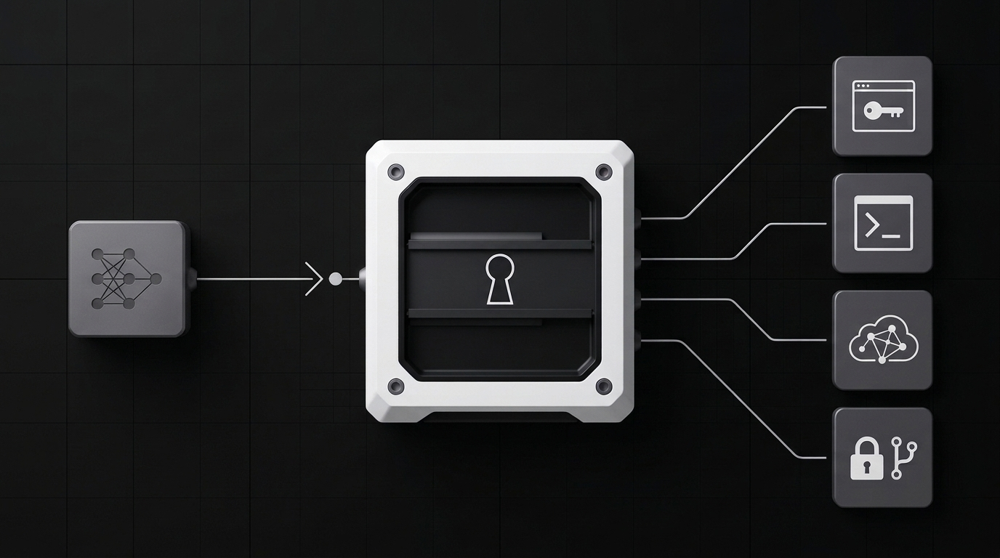

### 3. 物理密钥分离、双仓云同步与对抗审计加固
- **本机密钥分离**：默认模式下 `master.key` 存储在数据目录之外（Windows 凭据管理器 / Linux Secret Service 或独立用户密钥目录，Unix `0600` / Win32 仅当前用户 NTFS DACL `D:P`），并在 **系统 → SAFE / 06** 直观显示密钥实际位置。
- **双仓库加密云同步（GitHub / Gitea & Forgejo）**：自动拆分密文仓（`owner/repo`）与密钥仓（`owner/repo-key`），严格校验 `private: true`，新增 **Version history** 历史快照查看与回滚。
- **实测与审计加固**：
  - 导入包加解密全部迁移至工作线程（`spawn_blocking`）并配备单飞并发锁、锁库/取消代际号防竞态校验、Base64 解码前体积上限、常规文件有界读取，以及 Bitwarden/KDBX KDF 算力预算上限和流式 `quick-xml` 解析器。
  - `http_send` 增加 `Set-Cookie` / `Set-Cookie2` 响应头脱敏、URL 令牌打码及 `http_save_secret` 2xx 校验，修复 `regex` 网址规则过宽问题。
  - `secret_write_file` 原子落盘前即设定私有权限、失败自动清理残留，并结合 `git ls-files` 检测**已被 Git 跟踪**的明文文件（即使已写入 `.gitignore` 也会给出告警）。
  - `browser_inspect` 增加跨框架/焦点字段占位符脱敏与页面导航中 `Frame removed` 自动重试，以及 Windows `git.cmd` 包装脚本自动识别。

  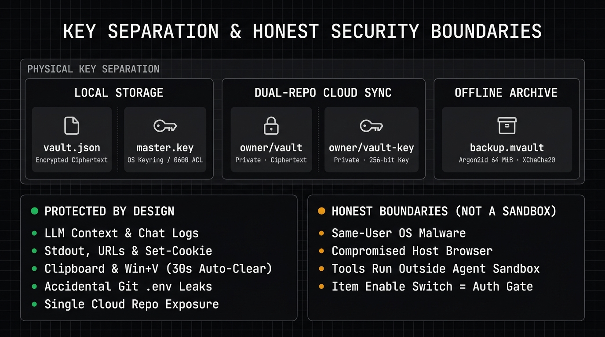

---

## 安全边界速览 · Honest Security Boundaries

| ✅ 重点防护（日常意外泄密） | ⚠️ 明确不防（非操作系统沙箱） |
| --- | --- |
| LLM 上下文、提示词与聊天日志泄密 | 同系统用户的本地恶意软件 |
| `stdout` / `stderr` / URL / `Set-Cookie` 回显泄密 | 已被攻陷的宿主浏览器进程 |
| 剪贴板历史 & `Win+V` 残留（30 秒自动清理） | MCP 工具运行在 Agent 自身 Shell 沙箱之外（建议保留客户端审批） |
| 误提交 `.env` 到 Git / 单云端仓库外泄 / 离线 `.mvault` 被盗 | **条目「启用」开关才是真正的 Agent 授权闸门** |

---

## 下载包说明 · Downloads

| 平台 Platform | 安装包 Artifact | 说明 Notes |
| --- | --- | --- |
| **macOS arm64** | `OpenKeylet_0.20.0_macos-arm64-portable.zip` | Apple Developer ID 签名与公证 `.app` + 浏览器扩展 |
| **Windows x64** | `OpenKeylet_0.20.0_windows-x64-portable.zip` | 便携桌面 GUI、系统托盘、`Win+V` 隔离、Win32 NTFS ACL、浏览器扩展 |
| **Linux x64 GUI** | `OpenKeylet_0.20.0_linux-x64-portable.tar.gz` | 桌面 GUI AppImage、X11 填充与系统托盘 |
| **Linux x64 Headless** | `OpenKeylet_0.20.0_linux-headless-x64.tar.gz` | 零 GUI 依赖，完整 MCP / CLI / SSH / `admin serve`，适合云端 VPS |

> 覆盖升级二进制不会影响已有本地密码库；所有官方构建均附带 Ed25519 签名校验清单 `latest.json` 与 `SHA256SUMS.txt`。完整教程请参阅 [简体中文文档](https://github.com/omaekumiko2-create/OpenKeylet/blob/main/README.zh-CN.md) / [English README](https://github.com/omaekumiko2-create/OpenKeylet/blob/main/README.md)。
>
> **长期维护 · 欢迎反馈 / Feedback Welcome**：OpenKeylet 将持续长期维护与迭代。欢迎在 [GitHub Issues](https://github.com/omaekumiko2-create/OpenKeylet/issues) 提交 Bug 与兼容性问题，或在 [GitHub Discussions](https://github.com/omaekumiko2-create/OpenKeylet/discussions) 分享建议、想法与使用经验！
